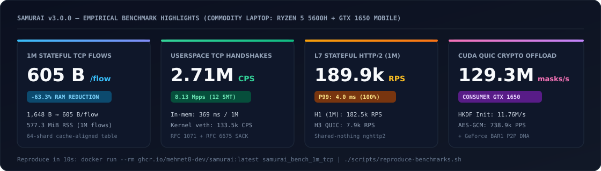
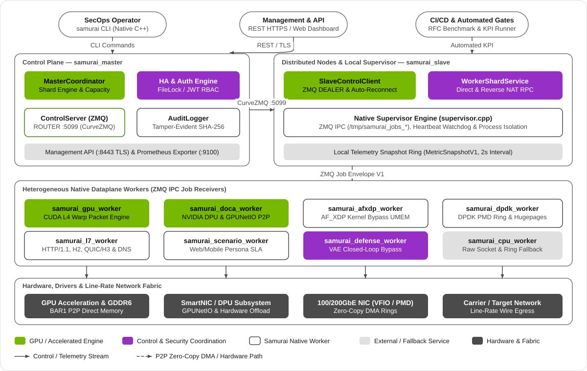

<div align="center">

# SAMURAI

### Line-Rate Network Resilience, Stateful L4–L7 & Carrier-Telecom Stress Platform

**1,000,000 stateful TCP flows in 577 MiB RAM (`605 B/flow`) · `2.71M CPS` on a laptop CPU · `AF_XDP` · `DPDK` · Consumer GeForce `BAR1 P2P` CUDA · 5G CUPS · MCP AI Agent Ready**

[](https://github.com/Mehmet8-Dev/Samurai/actions/workflows/ci.yml)
[](https://github.com/Mehmet8-Dev/Samurai/releases)
[](LICENSE)
[](samurai/CMakeLists.txt)
[](https://github.com/Mehmet8-Dev/Samurai/pkgs/container/samurai)
[](mcp/README.md)

[Try in 10 Seconds](#-try-it-in-10-seconds-zero-build) · [Verified Benchmarks](#-verified-benchmarks-reproducible) · [AI Agent / MCP](#-use-with-ai-coding-agents--rl-autopilot-native-c17-mcp) · [Architecture](#-architectural-topology) · [Documentation](#-documentation) · [Discussions](https://github.com/Mehmet8-Dev/Samurai/discussions)

</div>

---



## What Is Samurai?

Most load testers force an uncomfortable trade-off:
- **Scripting load tools (Python/JS)** hit GIL, GC, and syscall ceilings long before saturating 10G–100G links.
- **Stateless packet blasters** flood raw UDP/SYN frames but lack stateful TCP SACK recovery, HTTP/2 & QUIC/HTTP-3 state machines, multi-step persona flows, carrier 4G/5G signaling, or closed-loop SLO feedback.
- **Enterprise hardware generators** lock GPU/DPU dataplanes behind proprietary appliances and five-figure licenses.

**Samurai (v3.0.0)** closes that gap in a single, **100% open-source (AGPL-3.0), pure C++17** runtime — spanning 64-shard userspace TCP, `io_uring`/kTLS HTTP/2 & QUIC/H3, `AF_XDP`/`DPDK` kernel bypass, **consumer GeForce BAR1 P2P GPU-to-NIC DMA**, BlueField `DOCA GPUNetIO`, 4G/5G carrier telecom (`GTP-U`, `PFCP`, `SCTP`, `Diameter`, `SIP/RTP/SRTP`), ZeroMQ distributed orchestration, and a **native C++17 MCP server (`samurai_mcp`)** for AI coding agents & closed-loop RL autopilots.

---

## ⚡ Try It in 10 Seconds (Zero Build)

Verify Samurai's headline numbers on your own hardware using the pre-built multi-stage GHCR image — no CMake, DPDK, or CUDA toolchain required for your first run:

```bash
# 1) Reproduce the 1,000,000 active stateful TCP flow benchmark (605 B/flow, 64 shards)
docker run --rm ghcr.io/mehmet8-dev/samurai:latest samurai_bench_1m_tcp

# 2) Run the Shared-Nothing Stateful HTTP/1.1 & HTTP/2 userspace benchmark
docker run --rm ghcr.io/mehmet8-dev/samurai:latest samurai_bench_l7 --proto h2 --flows 10000

# 3) Run the RFC 2544 / 3511 / 8219 compliance benchmark suite
docker run --rm ghcr.io/mehmet8-dev/samurai:latest samurai --run-rfc-suite all

# 4) Inspect built-in L4, L7 & 5G Telecom workload profiles
docker run --rm ghcr.io/mehmet8-dev/samurai:latest samurai --list-profiles
```

Or clone and reproduce all benchmarks locally with hardware metadata included (ready to share in [GitHub Discussions](https://github.com/Mehmet8-Dev/Samurai/discussions)):

```bash
./scripts/reproduce-benchmarks.sh          # Quick (~5s): 100k TCP + 10k L7 H1/H2 + RFC suite
./scripts/reproduce-benchmarks.sh --full   # Full (~45s): includes 1,000,000 active TCP flows
```

---

## 🤖 Use with AI Coding Agents & RL Autopilot (Native C++17 MCP)

Samurai ships a **pure native C++17, zero-Python, modular MCP server** ([`samurai/mcp/`](samurai/mcp/)) speaking MCP `2024-11-05` over stdio — usable by **Claude Code, Cursor, Codex, Antigravity**, and **autonomous Autopilot / Mahoraga RL agents**.

```bash
# Claude Code — local native C++ binary (zero Python, zero dependencies)
claude mcp add samurai -- /path/to/Samurai/build/mcp/samurai_mcp

# Or directly via the pre-built GHCR container (zero build)
claude mcp add samurai -- docker run -i --rm --network host ghcr.io/mehmet8-dev/samurai:latest samurai_mcp
```

Exposes **15 native tools** spanning dataplane benchmarking, RFC 2544/3511/8219 compliance, cluster telemetry, **Scenario Engine** (in-process persona→flow→step compilation, SLA verification, and live stateful execution), and stateful **Closed-Loop Autopilot / Mahoraga RL** control (`AIMD`, `BinSearch`, in-process SRLP MLP & RL² GRU `RlPolicy` inference, `LeverShield` WAF reflex, and `RlExploreConfig`).

> **Fail-Closed Agent Safety:** All MCP tools enforce native `samurai::core::ValidateTargetSafety(..., allow_public=false)` and never expose `--allow-public-target`. See [`mcp/README.md`](mcp/README.md) for Cursor/Codex JSON config and the full 15-tool API.

---

## 📊 Verified Benchmarks (Reproducible)

All numbers below were measured on a **commodity laptop** (AMD Ryzen 5 5600H — 6 physical cores / 12 SMT threads, 13 GiB RAM, GTX 1650 Mobile, Linux `6.14`, GCC 13 `-O3 -mavx2`). Every claim separates **in-memory dataplane**, **Linux kernel wire (`netns + veth`)**, and **GPU hardware offload** boundaries honestly:

| Benchmark | Boundary / Scope | Measured Result | Hardware | Reproduce |
| :--- | :--- | :--- | :--- | :--- |
| **1M Active TCP Flows RAM** | Userspace `TcpDataplaneCore` (`VmRSS`) | **`605.31 B/flow`** (`577.3 MiB` total — **63.3% reduction** from `1,648 B/flow`) | Ryzen 5 5600H | [`test_1m_tcp_flows`](docs/benchmarks/43-tcpdp-1m-flows-benchmark-report.md) |
| **1M TCP 3-Way Handshakes** | In-memory 64-shard dataplane + RFC 1071 checksums | **`2.71M CPS` / `8.13 Mpps`** (`369 ms` for 1M handshakes, 12 SMT) | Ryzen 5 5600H | [`43-tcpdp-1m-flows`](docs/benchmarks/43-tcpdp-1m-flows-benchmark-report.md) |
| **Kernel Wire Interop** | Isolated `netns + veth + AF_PACKET` vs Linux `accept4()` | **`133.49 kCPS` / `400.48 kPPS`** (100,000 handshakes, 0 retransmits) | Ryzen 5 5600H | [`test_tcpdp_veth_wire`](docs/benchmarks/43-tcpdp-1m-flows-benchmark-report.md) |
| **1M Stateful HTTP/1.1 Flows** | Shared-nothing userspace TCP + dynamic RFC 7230 | **`182.5k RPS`** (`100.0%` success, `P50 3ms`, `P99 15ms`) | Ryzen 5 5600H | [`44-l7-stateful`](docs/benchmarks/44-l7-stateful-userspace-benchmark-report.md) |
| **1M Stateful HTTP/2 Flows** | Shared-nothing userspace TCP + `nghttp2` | **`189.9k RPS`** (`100.0%` success, `P50 2ms`, `P99 4ms`, 4 shards) | Ryzen 5 5600H | [`44-l7-stateful`](docs/benchmarks/44-l7-stateful-userspace-benchmark-report.md) |
| **100k Stateful HTTP/3 QUIC** | Real UDP sockets + `ngtcp2`/`nghttp3` + TLS 1.3 + coalescing | **`7,905 RPS`** (`P50 2.81ms`, `P99 7.32ms`, 11–12× datagram coalescing) | Ryzen 5 5600H | [`44-l7-stateful`](docs/benchmarks/44-l7-stateful-userspace-benchmark-report.md) |
| **QUIC RFC 9001 CUDA Crypto** | GPU batch HKDF + AES-ECB Header Protection + AEAD | **`129.3M masks/s`** · **`11.76M HKDF keys/s`** · **`738.9k PPS` AES-GCM** | GTX 1650 Mobile | [`44-l7-stateful`](docs/benchmarks/44-l7-stateful-userspace-benchmark-report.md) |

---

## 🧭 How Samurai Compares

| Capability | **Samurai v3.0** | `wrk` / `hey` | `k6` / `Locust` | `Cisco TRex` | `pktgen` |
| :--- | :---: | :---: | :---: | :---: | :---: |
| Pure Native C++17 (Zero Scripting Runtime) | ✅ | ✅ / Go | JS / Python | ✅ (C++ / Py ctrl) | Kernel C |
| Stateful Userspace TCP (1M Flows @ 605 B/flow) | ✅ | ❌ | ❌ | ✅ | ❌ |
| Stateful HTTP/1.1, HTTP/2 (`kTLS`), QUIC/HTTP-3 | ✅ | H1 only | H1/H2 (k6) | Partial | ❌ |
| `AF_XDP` & `DPDK` Kernel-Bypass | ✅ | ❌ | ❌ | ✅ (DPDK) | Kernel TX |
| Consumer GeForce GPU BAR1 P2P + CUDA Crypto | ✅ | ❌ | ❌ | ❌ | ❌ |
| 4G/5G Carrier Telecom (`GTP-U`, `PFCP`, `SCTP`, `Diameter`, `SIP`) | ✅ | ❌ | ❌ | Partial | ❌ |
| Distributed ZMQ Master/Slave + Closed-Loop RL Autopilot | ✅ | ❌ | Cloud / Basic | ❌ | ❌ |
| Fail-Closed Target Safety Gate + AI Agent MCP Server | ✅ | ❌ | ❌ | ❌ | ❌ |

---

## 🏗 Architectural Topology



<details>
<summary>System Dataflow Overview (ASCII)</summary>

```text
[CLI (`samurai`) / HTTP REST API (`:8089`) / MCP Server (`samurai-mcp`)]
       │ (ZMQ ABI v3 / POSIX HTTP / stdio JSON-RPC)
       ▼
[Master / Slave Control Plane (`samurai_master` / `samurai_slave`)]
  ├── Multi-Master Region Federation & HA Leader Election (Static / File-Lease / Redis / K8s)
  ├── Closed-Loop Autopilot (`Mahoraga` RL Policy + AIMD / Binary Search + VAE Anomaly Defense)
  └── Fail-Closed `ValidateTargetSafety` Gate + HMAC-SHA256 JWT RBAC + SHA-256 Audit Chain
       │ (ZMQ ROUTER/DEALER + `WarmWorkerPool` IPC)
       ▼
[Native C++17 Dataplane Workers (`samurai_*_worker`)]
  ├── AF_XDP Worker  ──────> [Zero-Copy UMEM] ──> [NIC Ring]
  ├── DPDK PMD Worker ─────> [Hugepages Ring] ───> [Physical Wire]
  ├── GPU / DOCA Worker ───> [VRAM / BAR1 P2P] ──> [GeForce / BlueField DPU]
  ├── L7 Stateful Worker ──> [io_uring / kTLS / nghttp2 / ngtcp2] ──> [Target App]
  ├── Scenario Worker ─────> [Multi-Step Persona DSL] ──> [Target Service]
  └── Telco Worker ────────> [GTP-U / PFCP / SCTP / Diameter / SIP-SRTP] ──> [BNG / 5G UPF]
```
</details>

---

## 🛠 Prerequisites & Compilation

### System Requirements
- **OS:** Linux (Ubuntu 22.04+, Debian 12+, RHEL 8+)
- **Compiler:** GCC 9+ or Clang 10+ (C++17)
- **Build System:** CMake 3.16+ and Make / Ninja
- **Core Libraries:** `libzmq3-dev`, `libssl-dev`, `pkg-config`, `build-essential`
- **Optional Acceleration & Protocol Libraries:**
  - HTTP/2, QUIC/HTTP-3 & `io_uring`: `libnghttp2-dev`, `libngtcp2-dev`, `libngtcp2-crypto-gnutls-dev`, `libnghttp3-dev`, `libgnutls28-dev`, `liburing-dev`
  - AF_XDP & PCAP: `libbpf-dev`, `libelf-dev`, `libpcap-dev`, `libhiredis-dev`
  - DPDK: `libdpdk-dev` · CUDA: NVIDIA CUDA Toolkit 12.x+

### Build from Source

```bash
# Install core + protocol dependencies (Ubuntu/Debian)
sudo apt update && sudo apt install -y \
  build-essential cmake pkg-config libzmq3-dev libssl-dev \
  libhiredis-dev libpcap-dev libnghttp2-dev libngtcp2-dev \
  libngtcp2-crypto-gnutls-dev libnghttp3-dev libgnutls28-dev liburing-dev

# Configure and build all native targets
cmake -B build -S samurai -DCMAKE_BUILD_TYPE=Release
cmake --build build -j"$(nproc)"
```

Key native binaries produced under `build/`:
- `build/cli/samurai` — Native CLI front-end (auto-discovers workers in `build/zmq/`, `/usr/local/bin/`, or `$PATH`)
- `build/control/daemon/samurai_master` & `samurai_slave` — Distributed control plane daemons
- `build/zmq/samurai_*_worker` — All native dataplane worker engines
- `build/l4/test_1m_tcp_flows` & `build/zmq/bench_l7_stateful_userspace` — Reproducible L4/L7 benchmark harnesses

---

## 🚀 Usage Guide

> Every CLI command below is verified against the compiled `samurai` v3.0.0 binary. Worker binaries are auto-discovered (override anytime with `--worker-dir`).

### 1) Standalone CLI (`samurai`)

```bash
# List built-in corporate L4, L7, and 4G/5G telecom profiles
./build/cli/samurai --list-profiles

# Stateful HTTP/2 load test against a local service with KPI pass/fail gate & JSON report
./build/cli/samurai \
  --worker l7 \
  --target 127.0.0.1 \
  --port 8080 \
  --l7-protocol http2 \
  --concurrency 4 \
  --keepalive \
  --count 10000 \
  --kpi-max-errors 0 \
  --report-json reports/h2_run.json \
  --confirm

# High-speed UDP packet test via CPU engine (requires CAP_NET_RAW / sudo for raw sockets)
sudo ./build/cli/samurai \
  --worker cpu \
  --target 127.0.0.1 \
  --port 9999 \
  --protocol udp \
  --count 100000 \
  --rps 50000 \
  --confirm

# Carrier 5G Telecom simulation (SCTP / Diameter / SIP-SRTP / GTP-U)
./build/cli/samurai \
  --worker telco \
  --profile telco-sctp-flood \
  --target 10.0.0.10 \
  --telco-subscribers 500 \
  --telco-cps 200 \
  --telco-duration-ms 5000 \
  --confirm

# RFC 2544 / 3511 / 8219 compliance suite with HTML + Markdown output
./build/cli/samurai \
  --run-rfc-suite all \
  --rfc-report-out reports/rfc_report.html
```

### 2) Distributed Multi-Node Cluster (`samurai_master` & `samurai_slave`)

```bash
# Master node (control plane on :5099, POSIX HTTP Management API on :8089)
./build/control/daemon/samurai_master \
  --control-listen tcp://0.0.0.0:5099 \
  --management-listen 0.0.0.0:8089 \
  --insecure-control \
  --worker cpu \
  --target 10.0.0.50 \
  --port 443 \
  --count 500000 \
  --expect-workers 2

# Worker node (run on each generator host; use --worker bundle to serve all worker kinds)
./build/control/daemon/samurai_slave \
  --control-endpoints <MASTER_IP>:5099 \
  --dispatch-mode reverse \
  --worker bundle
```

### 3) Docker & Docker Compose (Pre-Built GHCR Image)

```bash
# Pull pre-built native runtime image
docker pull ghcr.io/mehmet8-dev/samurai:latest

# Run 1-command 1M TCP flow benchmark via Docker Compose
docker compose --profile bench run --rm bench

# Launch a full distributed Master + 2 Slaves + Redis HA cluster
docker compose -f docker-compose.distributed.yml up -d
curl -s http://127.0.0.1:8089/healthz
```

> **Hardware Acceleration Note:** The GHCR container ships `samurai`, `samurai_master`, `samurai_slave`, benchmark harnesses (`samurai_bench_1m_tcp`, `samurai_bench_100k_tcp`, `samurai_bench_l7`), and commodity/telco workers (`cpu`, `afpacket`, `afxdp`, `l7`, `scenario`, `defense`, `telco`). For CUDA, GeForce BAR1 P2P, DOCA GPUNetIO, or DPDK PMD hardware backends, compile natively on the target host.

---

## ⚙️ Dataplane Worker Engines

| Worker (`--worker`) | Native Binary | Capabilities & Acceleration Path |
| :--- | :--- | :--- |
| `cpu` | `samurai_cpu_worker` | Raw sockets, memory ring buffer, dynamic header spoofing |
| `afpacket` | `samurai_afpacket_worker` | Linux `AF_PACKET` `TPACKET_V3` memory-mapped TX rings |
| `afxdp` | `samurai_afxdp_worker` | Linux XSK / UMEM zero-copy kernel bypass |
| `dpdk` | `samurai_dpdk_worker` | DPDK PMD hardware ring buffers and hugepages |
| `gpu` | `samurai_gpu_worker` | NVIDIA CUDA persistent kernel, GeForce BAR1 P2P & GPU Doorbell |
| `doca` | `samurai_doca_worker` | NVIDIA BlueField DPU & DOCA GPUNetIO direct VRAM streaming |
| `l7` | `samurai_l7_worker` | Stateful HTTP/1.1, HTTP/2 (`nghttp2` + kTLS), QUIC / HTTP/3 (`ngtcp2`), DNS |
| `scenario` | `samurai_scenario_worker` | Persona-based multi-step user workflows and microsecond SLA tracking |
| `telco` | `samurai_telco_worker` | 4G/5G CUPS, PFCP N4, GTP-U (5G QFI), SCTP, Diameter, SIP/RTP/SRTP |
| `defense` | `samurai_defense_worker` | Variational Autoencoder (VAE) resilience & anomaly evaluation |

---

## ✅ Native Self-Test Suites

```bash
./build/control/samurai_control_selftest
./build/l4/test_tcp_sliding_window
./build/l4/test_100k_tcp_flows
./build/l7_emu_native/test_l2l3_astf
./build/l7_emu_native/test_kernel_threaded_l7
```

---

## 📚 Documentation

| Area | Key Guides |
| :--- | :--- |
| **Architecture** | [System Overview](docs/00-overview.md) · [Core Runtime Modules](docs/25-core-runtime-modules.md) · [ZMQ Worker & ABI](docs/36-zmq-worker-architecture.md) · [DPU-GPU CUPS Telecom](docs/49-telecom-gpu-dpu-cups-dataplane-architecture.md) · [GeForce P2P & Doorbell](docs/46-gpu-initiated-doorbell-and-baremetal-pmd.md) |
| **Benchmarks** | [L4 1M Flows Report (605 B/flow)](docs/benchmarks/43-tcpdp-1m-flows-benchmark-report.md) · [L7 Stateful Userspace Report](docs/benchmarks/44-l7-stateful-userspace-benchmark-report.md) · [Reproduce Script](scripts/reproduce-benchmarks.sh) · [RFC Baseline Runbook](docs/39-rfc-benchmark-baseline-runbook.md) |
| **AI Agents & MCP** | [Samurai MCP Server Guide](mcp/README.md) · [Agent Skill (`SKILL.md`)](skills/samurai-netbench/SKILL.md) |
| **Deployment** | [Docker & Containers](docs/11-docker.md) · [Distributed Control Plane](docs/40-distributed-control-plane-handbook.md) · [Production Runbook](docs/32-production-operations-runbook.md) · [Monitoring & Grafana](docs/12-dashboard.md) · [Helm Chart](deploy/helm/samurai) |
| **Developer & Launch** | [CMake & Native Testing](docs/09-dev-testing.md) · [DPDK Setup](docs/34-dpdk-environment-setup-guide.md) · [Target Safety Policy](docs/07-safety.md) · [Open-Source Launch Playbook](docs/50-open-source-growth-and-launch-playbook.md) · [Full Docs Index](docs/README.md) |

---

## 🛡 Security & Authorized Use Policy

This software is strictly intended for network administrators, security researchers, and systems engineers conducting authorized resilience, scalability, and stress assessments on infrastructure they own or hold explicit written permission to test. Unauthorized generation of hostile traffic is illegal under international computer misuse statutes. The end user assumes all legal liability.

For coordinated vulnerability disclosure, supported versions, and secure-by-default controls (target allowlists/denylists, ZMQ CURVE, HMAC-SHA256 JWT RBAC, SHA-256 audit log chains), see [`SECURITY.md`](SECURITY.md).

---

## 💬 Community & Contributing

- **Share Your Benchmark Results:** Run `./scripts/reproduce-benchmarks.sh` and post your hardware numbers in [GitHub Discussions](https://github.com/Mehmet8-Dev/Samurai/discussions) or via the [Benchmark Report template](.github/ISSUE_TEMPLATE/benchmark_report.md).
- **Contribute:** See [`CONTRIBUTING.md`](CONTRIBUTING.md) for open engineering PR proposals and [`CODE_OF_CONDUCT.md`](CODE_OF_CONDUCT.md).

### Contributors
- **Mehmet Okur** ([@Mehmet8-Dev](https://github.com/Mehmet8-Dev) · `mehmetokur756@gmail.com`) — Creator & Lead Architect
- **0x4nyroot** ([@0x4nyroot](https://github.com/0x4nyroot) · `sefakocyigit10@gmail.com`) — Contributor

---

## 📄 License & Commercial Support

Samurai is 100% open-source software licensed under the **GNU Affero General Public License v3.0 (AGPL-3.0)** — see [`LICENSE`](LICENSE) for the full text.

Under AGPL-3.0, all features remain open and any modified version deployed or operated over a network (including managed services and SaaS platforms) must disclose its complete source code under the same license.

For **commercial support, dedicated SLA / SLO agreements, custom integration engineering, or project sponsorship**, contact [@Mehmet8-Dev](https://github.com/Mehmet8-Dev) or `mehmetokur756@gmail.com`.
