# Samurai (Shogun) — Native C++ Network Stress & Security Test Platform

Samurai (Sürüm 2.2+, Kod adı: **Shogun**), **yalnızca yetkili lab ve güvenlik testi ortamlarında** kullanılmak üzere geliştirilmiş, yüksek başarımlı (high-throughput), düşük gecikmeli (low-latency) ve modüler bir ağ stres ve dayanıklılık test platformudur.

Platform, Python bağımlılıklarından arındırılarak tamamen modern **C++ (C++17)**, **ZeroMQ (ZMQ) binary IPC wire protocol**, **Kernel-Bypass (AF_XDP, DPDK)**, **GPU/CUDA paket sentezi** ve **User-Space TCP/L7 motorları** ile çalışan native mimariye dönüştürülmüştür.

---

## Temel Özellikler

- **Saf Native C++ Çalışma Zamanı:** Sıfır Python çalışma zamanı gecikmesi; C++17 ile derlenen mikroservis mimarisi.
- **Native CLI Front-End (`samurai`):** Güçlü argüman doğrulama, KPI gate kontrolleri, RFC paket testleri ve profil yönetimi.
- **Dağıtık Control-Plane (`samurai_master` & `samurai_slave`):**
  - ZMQ ROUTER/DEALER tabanlı asenkron RPC haberleşmesi.
  - Dinamik iş parçalama (Sharding - eşit, kapasite, bölge bazlı).
  - High Availability (HA) lider seçimi (Static ve File-Lease).
  - Multi-Master & Multi-Region koordinatörü.
  - Saf POSIX soket tabanlı yerleşik HTTP REST Management API (`:8089`).
  - OpenSSL HMAC-SHA256 ile HS256 JWT ve RBAC yetkilendirme.
  - Tahrif edilemez (tamper-evident) SHA-256 denetim günlüğü (Audit Log).
- **Yüksek Başarımlı Dataplane Motorları:**
  - **L4 User-Space TCP Stack (`tcp_dataplane_core`):** 64-shard kilit şeritli (lock-striped) flow tablosu, out-of-order paket işleme, timer-wheel retransmit.
  - **AF_XDP (Kernel-Bypass):** Linux XSK / UMEM zero-copy ring bufferları üzerinden Mpps seviyesinde paket iletimi.
  - **DPDK:** PMD ring tabanlı donanım hızlandırma.
  - **GPU CUDA & DOCA GPUNetIO:** Donanım hızlandırmalı paket üretimi ve DPU akış yönetimi.
  - **L7 Emülasyon Native (`l7_emu_native`):** HTTP/1.1, HTTP/2 (nghttp2), QUIC / HTTP/3 (ngtcp2) ve DNS motorları (Kernel socket veya Custom TCP/AF_XDP modları).
  - **Scenario Engine Native (`scenario_engine_native`):** Web/Mobil persona tabanlı çok adımlı kullanıcı davranışları ve SLA denetleyicisi.
  - **CPU Native Packet Engine (`cpu_native`):** Raw socket / packet ring optimizasyonu, dinamik spoofing ve amplifikasyon jeneratörleri.

---

## Mimari Şema

```mermaid
flowchart TB
    %% ─────────────────────────────────────────────────────────────
    %% 1. KULLANICI ARAYÜZÜ, DOĞRULAMA & GÜVENLİK SINIRI
    %% ─────────────────────────────────────────────────────────────
    subgraph UI_Layer ["1. Kullanıcı Arayüzü, Doğrulama & Güvenlik Sınırı"]
        direction LR
        CLI["samurai Native CLI<br/>(args.cpp · Profil Yönetimi · Validasyon)"]
        Gate["Anti-Tamper & Lisans Kapısı<br/>(ELF Bütünlük Denetimi · RSA/Ed25519)"]
        KPIGate["KPI Gate & RFC Test Paketi<br/>(RFC 2544 · RFC 6675 · SLA Eşikleri)"]
        MgmtAPI["REST Management API (:8089)<br/>(POSIX Sockets · HS256 JWT RBAC)"]
    end

    %% ─────────────────────────────────────────────────────────────
    %% 2. DAĞITIK KONTROL DÜZLEMİ & ORKESTRASYON
    %% ─────────────────────────────────────────────────────────────
    subgraph Control_Layer ["2. Dağıtık Kontrol Düzlemi & Orkestrasyon"]
        direction LR
        Master["samurai_master Daemon<br/>(Dinamik Shard Bölücü · Telemetri)"]
        HA["HA Lider Seçimi<br/>(File / Redis Lease)"]
        Audit["Denetim Günlüğü (Audit Log)<br/>(Kriptografik SHA-256 Zinciri)"]
        Slave["samurai_slave Daemon<br/>(Düğüm Yöneticisi · Ajan Süreci)"]
        Supervisor["Supervisor Engine<br/>(Süreç Yaşam Döngüsü & IPC Takibi)"]
    end

    %% ─────────────────────────────────────────────────────────────
    %% 3. ASENKRON ZMQ IPC & WORKER ÇALIŞMA ZAMANI
    %% ─────────────────────────────────────────────────────────────
    subgraph Worker_Layer ["3. Asenkron ZMQ IPC & Worker Yürütme Katmanı"]
        WireProto["ZMQ Binary IPC Veri Yolu (ipc:///tmp/samurai_*)<br/>56-Bayt SamuraiWireHeaderV1 (Magic: 0x53414D55) · Asenkron Kontrol Kanalı"]
        
        subgraph Workers ["Native C++ Worker Daemons (Bağımsız Süreçler)"]
            direction LR
            W_Kernel["Kernel-Bypass Dataplane<br/>• samurai_afxdp_worker<br/>• samurai_dpdk_worker<br/>• samurai_cpu_worker"]
            W_HW["Donanım & Hızlandırıcılar<br/>• samurai_gpu_worker (CUDA)<br/>• samurai_doca_worker (GPUNetIO)"]
            W_App["Protokol & Senaryo Motorları<br/>• samurai_l7_worker (H2/H3/DNS)<br/>• samurai_scenario_worker (Persona)<br/>• samurai_defense_worker (VAE)"]
        end
    end

    %% ─────────────────────────────────────────────────────────────
    %% 4. DURUMSAL TAŞIMA & PROTOKOL YIĞINLARI
    %% ─────────────────────────────────────────────────────────────
    subgraph Engine_Layer ["4. Durumsal Taşıma & Uygulama Protokol Yığınları"]
        subgraph L7_Engine ["L7 Reaktif Emülasyon Motoru (l7_emu_native)"]
            Reactor["Multi-Reactor: epoll & Zero-Syscall io_uring"]
            L7_Protos["HTTP/1.1 · HTTP/2 (nghttp2) · QUIC / HTTP/3 (ngtcp2) · EDNS0/ECS"]
            Scenario_Core["Scenario Engine: Web/Mobil Persona Durum Makinesi"]
        end

        subgraph L4_TCP ["L4 User-Space TCP Stack (tcp_dataplane_core)"]
            Flow_Table["64-Shard TTAS Akış Tablosu<br/>alignas(64) False-Sharing Önleme"]
            SACK_Engine["RFC 6675 SACK Kayıp Kurtarma<br/>Out-of-Order Reassembly & PAWS"]
            Timer_Heap["Per-Shard Timer Heap & Dinamik RTO"]
        end
    end

    %% ─────────────────────────────────────────────────────────────
    %% 5. KERNEL-BYPASS & DONANIM HIZLANDIRMA DATAPLANE
    %% ─────────────────────────────────────────────────────────────
    subgraph Dataplane_Layer ["5. Kernel-Bypass & Donanım Hızlandırma Dataplane"]
        direction LR
        AFXDP["Linux AF_XDP (XSK)<br/>Zero-Copy UMEM Ring Buffers"]
        DPDK["DPDK PMD Veri Yolu<br/>rte_mempool, VFIO-PCI Polling"]
        CUDA_DOCA["NVIDIA CUDA & DOCA GPUNetIO<br/>Async Streams, GPUDirect RDMA"]
        AFPACKET["Linux PACKET_TX_RING<br/>Mmap Circular Rings & Raw Sockets"]
    end

    %% ─────────────────────────────────────────────────────────────
    %% 6. FİZİKSEL ARAYÜZLER & HEDEF ALTYAPI
    %% ─────────────────────────────────────────────────────────────
    subgraph Physical_Layer ["6. Fiziksel Donanım Arayüzleri & Hedef Altyapı"]
        direction LR
        NIC["10G / 40G / 100G NIC Donanımı (Mellanox ConnectX, Intel i40e/E810)"]
        GPU_HW["NVIDIA Kurumsal GPU & BlueField DPU Hızlandırıcılar"]
        SUT["Test Edilen Sistem / Hedef Ağ Altyapısı (SUT)"]
    end

    %% Akışlar ve İlişkiler
    CLI --> Gate --> Master
    CLI -.->|Tekil Yerel Çalıştırma| Supervisor
    MgmtAPI <--> Master
    Master --- HA
    Master --- Audit
    Master ==>|ZMQ ROUTER / DEALER :5099| Slave
    Slave --> Supervisor
    Supervisor -->|fork / execvp & IPC Kurulumu| WireProto
    WireProto --> W_Kernel & W_HW & W_App

    W_App --> L7_Engine
    L7_Engine --> L4_TCP
    W_Kernel --> L4_TCP
    W_HW --> CUDA_DOCA

    L4_TCP --> AFXDP & DPDK & AFPACKET

    AFXDP -->|Zero-Copy UMEM DMA| NIC
    DPDK -->|Donanımsal Kuyruk Polling| NIC
    AFPACKET -->|Halkasal Bellek İletimi| NIC
    CUDA_DOCA -->|GPUDirect / PCIe Veri Yolu| GPU_HW
    GPU_HW -->|Doğrudan Paket İletimi| NIC
    NIC ==>|Hat Hızında Ağ Trafiği| SUT
```



---

## Derleme (Build)

### Gereksinimler

- **İşletim Sistemi:** Linux (Ubuntu 20.04+, Debian 11+, RHEL 8+)
- **Derleyici:** GCC 9+ veya Clang 10+ (C++17 standardı)
- **Yapı Sistemi:** CMake 3.16+ ve Make / Ninja
- **Kütüphaneler:** `libzmq3-dev`, `libssl-dev`, `pkg-config`, `build-essential`
- **Opsiyonel Kütüphaneler:**
  - AF_XDP için: `libbpf-dev`, `libelf-dev`
  - HTTP/2 & QUIC için: `libnghttp2-dev`, `libngtcp2-dev`
  - DPDK için: `libdpdk-dev`
  - CUDA için: NVIDIA CUDA Toolkit (12.x+)

### Derleme Adımları

```bash
# Bağımlılıkları yükleyin (Ubuntu/Debian)
sudo apt-get update
sudo apt-get install -y build-essential cmake pkg-config libzmq3-dev libssl-dev libbpf-dev libelf-dev

# Derleme dizinini oluşturun ve derleyin
mkdir -p build && cd build
cmake .. -DCMAKE_BUILD_TYPE=Release
make -j$(nproc)
```

Derleme sonucunda `build/` altında aşağıdaki ikili dosyalar oluşur:
- `build/ddos_samurai/cli/samurai` (Ana CLI)
- `build/ddos_samurai/control/daemon/samurai_master` (Master Daemon)
- `build/ddos_samurai/control/daemon/samurai_slave` (Slave Daemon)
- `build/ddos_samurai/zmq/daemon/samurai_*_worker` (Tüm Dataplane Worker ikilileri)
- `build/ddos_samurai/*_selftest` (Bileşen birim testleri)

---

## Kullanım

### 1) Standart CLI ile Test Başlatma (`samurai`)

```bash
# CPU worker ile temel UDP flood testi
./build/ddos_samurai/cli/samurai \
  --worker cpu \
  --target 127.0.0.1 --port 8080 \
  --protocol udp --count 100000 \
  --confirm

# AF_XDP Kernel-Bypass ile ultra yüksek hızlı paket testi
sudo ./build/ddos_samurai/cli/samurai \
  --worker afxdp \
  --target 10.0.0.50 --port 80 \
  --protocol tcp --count 5000000 \
  --confirm

# L7 HTTP/2 Stres Testi
./build/ddos_samurai/cli/samurai \
  --worker l7 \
  --target 10.0.0.50 --port 443 \
  --protocol http2 --scheme https \
  --concurrency 100 --max-connections 50 \
  --count 200000 --confirm

# Scenario Engine ile Gerçekçi Kullanıcı Senaryosu
./build/ddos_samurai/cli/samurai \
  --worker scenario \
  --target 10.0.0.50 --port 443 \
  --scenario-payload-ref docs/scenario_web_mobile.yaml \
  --count 100000 --confirm
```

---

### 2) Dağıtık (Distributed) Master / Slave Modu

Farklı sunuculardaki kaynakları birleştirerek test yükünü yatayda ölçekleme:

#### **Master Düğümü (`samurai_master`):**
```bash
./build/ddos_samurai/control/daemon/samurai_master \
  --control-listen tcp://0.0.0.0:5099 \
  --count 10000000 \
  --target 10.0.0.50 \
  --port 443 \
  --protocol tcp \
  --expect-workers 4 \
  --cluster-secret "samurai-cluster-secret" \
  --management-listen 0.0.0.0:8089
```

#### **Slave Düğümleri (`samurai_slave`):**
Her worker sunucusunda çalıştırın:
```bash
./build/ddos_samurai/control/daemon/samurai_slave \
  --control-endpoints <MASTER_IP>:5099 \
  --worker afxdp \
  --worker-id "slave-node-01" \
  --worker-region "eu-central" \
  --cluster-secret "samurai-cluster-secret" \
  --heartbeat-interval-ms 2000
```

---

### 3) Docker Compose ile Dağıtık Çalıştırma

```bash
docker compose -f docker-compose.distributed.yml up --build --scale slave=4
```

---

## Worker Türleri Referansı

| Worker Adı (`--worker`) | Native Binary | Açıklama ve Yetenekler |
| :--- | :--- | :--- |
| `cpu` | `samurai_cpu_worker` | Standart CPU raw socket, paket halkası, dinamik spoofing |
| `afxdp` | `samurai_afxdp_worker` | Linux XDP/UMEM zero-copy kernel bypass |
| `dpdk` | `samurai_dpdk_worker` | DPDK PMD donanım kuyruğu tabanlı paket iletimi |
| `gpu` | `samurai_gpu_worker` | CUDA tabanlı GPU paralel paket sentezi |
| `doca` | `samurai_doca_worker` | NVIDIA DPU & GPUNetIO doğrudan bellek veri yolu |
| `l7` | `samurai_l7_worker` | HTTP/1.1, HTTP/2, QUIC/HTTP/3, DNS (Epoll / User-Space TCP) |
| `scenario` | `samurai_scenario_worker` | Çok adımlı web/mobil persona senaryo motoru |
| `defense` | `samurai_defense_worker` | VAE anomali doğrulama ve savunma bypass analizleri |

---

## Native Self-Testler (Doğrulama)

Tüm bileşenlerin sağlığını C++ birim testleriyle doğrulamak için:

```bash
./build/ddos_samurai/control/samurai_control_selftest
./build/ddos_samurai/l7_emu_native/samurai_l7_selftest
./build/ddos_samurai/scenario_engine_native/samurai_scenario_engine_selftest
./build/ddos_samurai/licensing/samurai_licensing_selftest
```

---

## Yasal ve Etik Bildirim

Bu yazılım yalnızca sistem yöneticilerinin, güvenlik araştırmacılarının ve ağ mühendislerinin kendi sahip oldukları veya açık yazılı izin aldıkları altyapılarda stres/dayanıklılık testleri yapabilmesi amacıyla tasarlanmıştır. İzin alınmamış hedeflere yönelik trafik üretilmesi yasa dışıdır. Tüm yasal sorumluluk kullanıcıya aittir.

---

## Detaylı Dokümantasyon İndeksi

Tüm alt modüllerin ayrıntılı teknik açıklamaları için [`docs/README.md`](docs/README.md) dizinini inceleyebilirsiniz.
