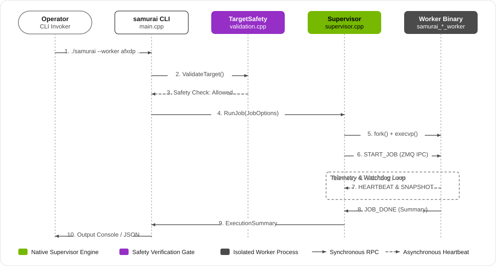

# 01 - Native CLI (`samurai`) Reference

`samurai` is the high-performance native command-line interface for the Samurai network resilience and stress-testing platform, compiled from C++17 source code (`samurai/cli/main.cpp`).



---

## 1. Syntax & Core Parameters

```bash
./build/samurai/cli/samurai --worker <cpu|gpu|dpdk|afxdp|doca|l7|defense|scenario> [options]
```

### Essential Parameters
- `--worker <kind>`: Native dataplane engine (`cpu`, `afxdp`, `dpdk`, `gpu`, `doca`, `l7`, `scenario`, `defense`).
- `--target <IP>`: Target IPv4 destination (Default: `127.0.0.1`).
- `--port <N>`: Destination port (Default: `80`).
- `--protocol <P>`: Network protocol (`tcp`, `udp`, `icmp`, `http1`, `http2`, `quic`, `dns`).
- `--count <N>`: Total packet or request count.
- `--rate <RPS>`: Target transmission rate pacing (packets/requests per second).
- `--confirm`: Mandatory flag to confirm authorization and proceed with test execution.

---

## 2. Common Usage Scenarios

### A) CPU Raw Socket UDP Stress Test
```bash
./build/samurai/cli/samurai \
  --worker cpu \
  --target 127.0.0.1 \
  --port 8080 \
  --protocol udp \
  --count 100000 \
  --size 64 \
  --confirm
```

### B) Kernel-Bypass AF_XDP Line-Rate Packet Generation
```bash
sudo ./build/samurai/cli/samurai \
  --worker afxdp \
  --target 10.0.0.50 \
  --port 80 \
  --protocol tcp \
  --count 10000000 \
  --confirm
```

### C) Hardware-Offloaded DPDK PMD Ring Burst
```bash
sudo ./build/samurai/cli/samurai \
  --worker dpdk \
  --target 10.0.0.50 \
  --port 443 \
  --protocol tcp \
  --count 50000000 \
  --confirm
```

### D) Stateful L7 HTTP/2 Multiplexed Load
```bash
./build/samurai/cli/samurai \
  --worker l7 \
  --target 10.0.0.50 \
  --port 443 \
  --protocol http2 \
  --scheme https \
  --concurrency 100 \
  --max-connections 50 \
  --count 500000 \
  --confirm
```

### E) GPU CUDA Persistent Dataplane Egress
```bash
./build/samurai/cli/samurai \
  --worker gpu \
  --target 10.0.0.50 \
  --port 80 \
  --protocol tcp \
  --count 25000000 \
  --confirm
```

---

## 3. Exit Codes & Telemetry Formatting

The CLI outputs JSON-compatible summary metrics on completion:
- `0x00`: Success (`KPI_PASS`). All packets sent within rate and SLA parameters.
- `0x01`: General error or argument parsing failure.
- `0x02`: Safety boundary violation (`TargetSafety` rejected destination IP).
- `0x03`: Hardware preflight failure (e.g. Missing NUMA node or AF_XDP interface).
- `0xFF`: Aborted by operator or emergency shutdown signal.
