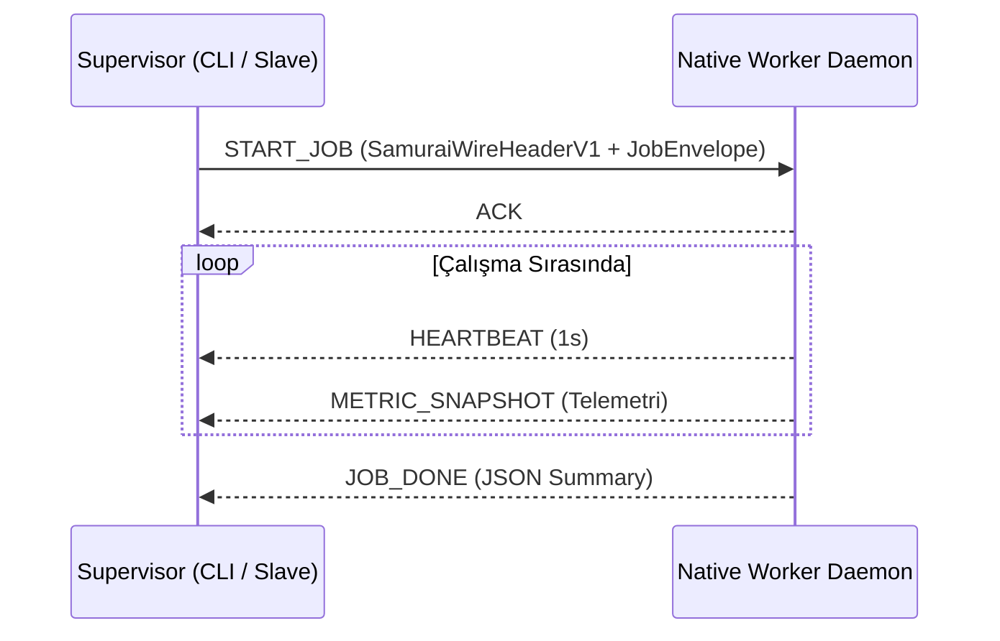

# 02 - Orchestrator & Native Supervisor

Native Orchestrator katmanı (`ddos_samurai/orchestrator/`), Master, Slave veya yerel CLI tarafından verilen iş parametrelerini (`JobOptions`) ZMQ IPC mesajlarına dönüştürerek ilgili worker ikililerini (`samurai_*_worker`) yöneten köprüdür.

---

## 1. Temel Görevler

1. **Worker Seçimi ve Eşleme:**
   [`worker_registry.hpp`](file:///home/mehmet/Masa%C3%BCst%C3%BC/Python/v11/DDoSamurai/ddos_samurai/orchestrator/worker_registry.hpp) tablosu üzerinden CLI veya Slave'den gelen worker adı (`cpu`, `afxdp`, `l7` vb.) ilgili native ikili dosyaya eşlenir:
   - `cpu` $\rightarrow$ `samurai_cpu_worker`
   - `afxdp` $\rightarrow$ `samurai_afxdp_worker`
   - `dpdk` $\rightarrow$ `samurai_dpdk_worker`
   - `gpu` $\rightarrow$ `samurai_gpu_worker`
   - `doca` $\rightarrow$ `samurai_doca_worker`
   - `l7` $\rightarrow$ `samurai_l7_worker`
   - `scenario` $\rightarrow$ `samurai_scenario_worker`
   - `defense` $\rightarrow$ `samurai_defense_worker`

2. **ZMQ Supervisor Lifecycle (`supervisor.cpp`):**
   - Her iş için benzersiz Unix domain socket (`ipc:///tmp/samurai_jobs_*` ve `ipc:///tmp/samurai_events_*`) kanalları açılır.
   - Hedef worker prosesi `fork()` / `execvp()` ile bağımsız bir native süreç olarak başlatılır.
   - Sıkı 56-baytlık binary başlık (`SamuraiWireHeaderV1`) ve `JobEnvelopeV1` ile `START_JOB` mesajı gönderilir.
   - Worker'dan düzenli aralıklarla gelen `HEARTBEAT` ve `METRIC_SNAPSHOT` telemetri mesajları toplanır.
   - İş bittiğinde (`JOB_DONE`) veya iptal edildiğinde (`STOP_JOB`) süreç temiz bir şekilde sonlandırılır.

---

## 2. ZMQ Binary İletişim Protokolü

---

## 3. Dağıtık Shard Entegrasyonu

Slave modunda çalışan `samurai_slave`, Master'dan gelen `StartShard` RPC çağrısını aldığında [`SupervisorShardRunner`](file:///home/mehmet/Masa%C3%BCst%C3%BC/Python/v11/DDoSamurai/ddos_samurai/control/daemon/supervisor_shard_runner.cpp) aracılığıyla doğrudan yerel Supervisor motorunu tetikler. Böylece küme seviyesindeki işler yerel C++ worker süreçlerine kayıpsız iletilir.
