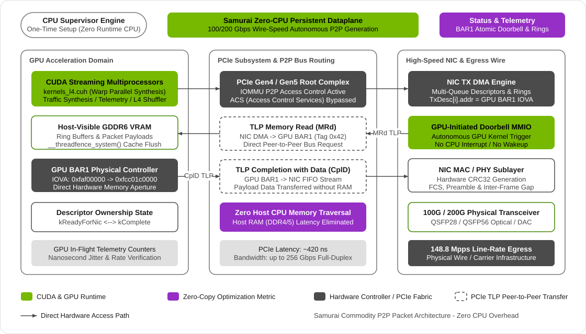

# 05 - GPU CUDA & DOCA GPUNetIO Hardware Dataplane

The GPU and DPU hardware acceleration subsystem leverages massive parallel computing architectures to deliver wire-speed packet synthesis (100Gbps+) and autonomous flow management with zero runtime Host-CPU overhead.



---

## 1. Architectural Components

1. **`samurai_gpu_worker` (`samurai/zmq/daemon/gpu_worker.cpp`):**
   - Utilizes CUDA streaming multiprocessors (`samurai/gpu_packet_cuda/kernels_l4.cuh`) to synthesize packets across thousands of parallel threads.
   - Packet buffers generated directly within Vulkan host-visible GDDR6 VRAM are transferred to the NIC via PCIe peer-to-peer (P2P) memory routing.

2. **`samurai_doca_worker` (`samurai/zmq/daemon/doca_gpunetio_worker.cpp`):**
   - Combines NVIDIA BlueField DPU and DOCA GPUNetIO technologies to bypass the host operating system completely.
   - Enables zero-copy direct memory access (DMA) between DPU NIC RX/TX rings and GPU VRAM.

3. **DPU State Runtime (`dpu_state_runtime.hpp`):**
   - Hardware-offloaded TCP state table running directly within DPU memory.
   - Handles TCP connection lifecycles, passive opens, and dynamic retransmission policies.

---

## 2. Compilation & Bare-Metal Execution

CUDA and DOCA acceleration flags are automatically discovered during CMake configuration:

```bash
# Execute native GPU CUDA worker
./build/samurai/cli/samurai \
  --worker gpu \
  --target 10.0.0.50 \
  --port 80 \
  --protocol tcp \
  --count 25000000 \
  --confirm

# Execute DOCA GPUNetIO hardware pipeline
sudo ./build/samurai/cli/samurai \
  --worker doca \
  --target 10.0.0.50 \
  --port 80 \
  --confirm
```
