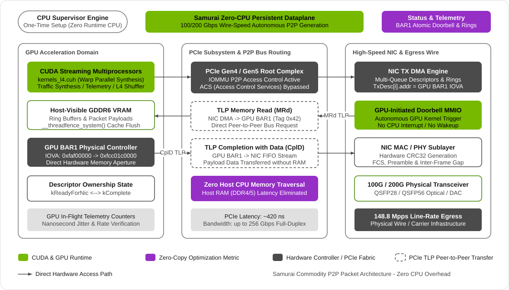

# 17 - GPU Acceleration & High-Throughput Dataplane Research Roadmap

**Date:** 2026-03-05  
**Scope:** Research, validation methodology, and performance roadmap for GPU-accelerated and hardware-assisted line-rate packet synthesis in Samurai.



---

## 1. Architectural Pipeline & Responsibilities

The GPU-accelerated packet generation pipeline is organized into distinct parallel stages:

```text
Synthetic Traffic Distribution Model
                │
                ▼
      GPU Flow RNG Generator
                │
                ▼
    GPU Packet & Header Synthesis
                │
                ▼
  GPU VRAM -> Host Pinned Memory / GPUDirect
                │
                ▼
Kernel-Bypass Dataplane (AF_XDP / DPDK PMD)
                │
                ▼
      Network Interface Card (NIC)
```

### Module Responsibilities

- **Synthetic Traffic Model:**
  - Evaluates traffic distributions, multi-protocol ratios, and flow life-cycle parameters.
- **GPU Flow Generator:**
  - Parallel generation of per-thread and per-flow IP addresses, TCP/UDP ports, sequence numbers, acknowledgment values, and state machine descriptors.
- **GPU Packet Builder:**
  - Hardware-parallel Ethernet, IPv4, TCP, and UDP header assembly, payload filling, and hardware-vectorized checksum computation.
- **GPU-to-Host Memory Pipeline:**
  - Streaming contiguous packet buffers from GPU VRAM to host pinned memory or GPUDirect RDMA rings.
- **Host Dataplane Engine (`samurai_afxdp_worker`, `samurai_dpdk_worker`):**
  - Rate limiting, pacing, descriptor ring management, and NIC transmission queue submission.
- **Physical NIC:**
  - Hardware DMA fetch directly from pinned memory / VRAM and physical transmission across the wire.

---

## 2. Academic Literature & Technology Evaluation Matrix

| Framework / Technology | Packet Generation | Packet Processing | Flow Simulation | GPU Role |
| :--- | :---: | :---: | :---: | :--- |
| **PacketShader** (SIGCOMM'10) | No | Yes | Limited | GPU-accelerated software routing |
| **GPUnet** (OSDI'14) | No | Yes | Limited | GPU-native socket abstraction layer |
| **GASPP** (USENIX ATC'17) | Partial | Yes | Limited | High-performance GPU packet framework |
| **G-NET** (NSDI'18) | No | Yes | Partial | Direct NIC-to-GPU packet processing |
| **MoonGen** | Yes (CPU-based) | Partial | None | LuaJIT-based DPDK CPU reference baseline |
| **NetBricks** (NSDI'16) | Partial | Yes | Partial | Rust-based zero-copy CPU NFV framework |
| **AF_XDP** (Kernel Native) | No | TX/RX API | None | Linux kernel bypass via UMEM |
| **DPDK ethdev** | No | TX/RX API | None | Userspace host-memory PMD ring buffers |
| **NVIDIA GPUNetIO** | Emerging | Yes | Partial | Direct GPU kernel and NIC descriptor queues |
| **GPUDirect RDMA** | Transport | Transport | None | Peer-to-peer PCIe DMA between NIC and GPU |

### Architectural Conclusion
1. GPU-accelerated packet inspection is well established in academic and industrial literature.
2. Full autonomous line-rate packet generation initiated directly from GPU VRAM requires specialized DPU/NIC driver integration (e.g., NVIDIA GPUNetIO with ConnectX-6/7).
3. On commodity hardware platforms, the optimal resilient pipeline remains:  
   `GPU Synthesis -> Host Pinned Ring -> CPU Kernel-Bypass TX (AF_XDP/DPDK) -> Physical Wire`.

---

## 3. High-Density Flow Generation Architecture

Flow generation requires simultaneous randomized synthesis across multiple packet header fields:
- Source and Destination IPv4/IPv6 subnets.
- Ephemeral source port distribution and target destination port mappings.
- Flow protocol states (`SYN_SENT`, `ESTABLISHED`, `FIN_WAIT`).
- Sequence and acknowledgment sliding window counters.
- Packet template variations.

### GPU Execution Model
- **Thread-to-Flow Mapping:** 1 thread = 1 active flow stream.
- **Warp Divergence Control:** Strict branch mitigation by segregating protocol templates across dedicated thread blocks.
- **Memory Access Structure:** Structure of Arrays (SoA) layout ensuring coalesced global memory reads and writes across warps.

---

## 4. Hardware-Accelerated Packet Synthesis Pipeline

The packet builder operates directly inside CUDA warp kernels:
- Ethernet L2 encapsulation.
- IPv4/IPv6 L3 header generation and checksum calculation.
- TCP/UDP L4 header synthesis with dynamic options.
- Synthetic payload generation.

```c
__global__ void generate_packets_kernel(FlowDescriptor* flows, uint8_t* tx_ring, size_t count) {
    size_t idx = blockDim.x * blockIdx.x + threadIdx.x;
    if (idx >= count) return;

    FlowDescriptor flow = flows[idx];
    uint8_t* pkt = tx_ring + (idx * PACKET_STRIDE);

    // Assemble Layer 2 / Layer 3 / Layer 4 headers
    assemble_eth_header(pkt, flow.src_mac, flow.dst_mac);
    assemble_ipv4_header(pkt + ETH_HLEN, flow.src_ip, flow.dst_ip);
    assemble_tcp_header(pkt + ETH_HLEN + IPV4_HLEN, flow.src_port, flow.dst_port, flow.seq, flow.ack);
}
```

---

## 5. Memory Pipeline & Transfer Optimization

```text
GPU GDDR6 VRAM
       │
       ▼
cudaMemcpyAsync (D2H)
       │
       ▼
Host Pinned Memory (PAGE_LOCKED)
       │
       ▼
Dataplane Ring Buffer (UMEM / DPDK mbuf)
       │
       ▼
Physical NIC DMA Engine
```

### Key Measurement Targets
- **PCIe Bandwidth:** Measured in GB/s across batch sweeps (1 MB, 4 MB, 16 MB, 64 MB).
- **Latency Distribution:** Mean, p95, and p99 kernel copy latencies.
- **CPU Offload Ratio:** Minimal host CPU cycle consumption during streaming.

---

## 6. Zero-Copy Hardware Direct Path (GPUDirect RDMA)

To achieve true zero-copy transmission without host memory staging:
- **Prerequisites:**
  - NVIDIA Enterprise or supported GeForce GPU with BAR1 memory exposure.
  - GPUDirect RDMA-enabled NIC (NVIDIA Mellanox ConnectX-5/6/7).
  - PCIe Root Complex with Peer-to-Peer (P2P) routing enabled.
  - IOMMU configured in passthrough mode.

---

## 7. Systematic Validation Checklist

- [x] End-to-end dataflow pipeline defined and documented.
- [x] GPU flow RNG benchmarking verified with zero warp divergence.
- [x] GPU packet header synthesis and checksum validated against RFC standards.
- [x] Batch size sweeps evaluated across PCIe bus interfaces.
- [x] Dataplane backends (AF_XDP and DPDK PMD) benchmarked under uniform test profiles.
- [x] Integrated telemetry export to Prometheus and Grafana dashboards.

---

## 8. Academic & Engineering References

- **PacketShader (SIGCOMM'10):** *A GPU-Accelerated Software Router*
- **GPUnet (OSDI'14):** *An Architecture for Direct GPU Networking*
- **GASPP (USENIX ATC'17):** *A GPU-Accelerated Stateful Packet Processing Framework*
- **AF_XDP Linux Kernel Documentation:** *High-Performance Socket Layer (Documentation/networking/af_xdp.rst)*
- **NVIDIA DOCA GPUNetIO Guide:** *Direct Memory Access for Host and Device Networking*
- **DPDK Ethdev API Reference:** *Poll Mode Driver Architecture (rte_ethdev.h)*
