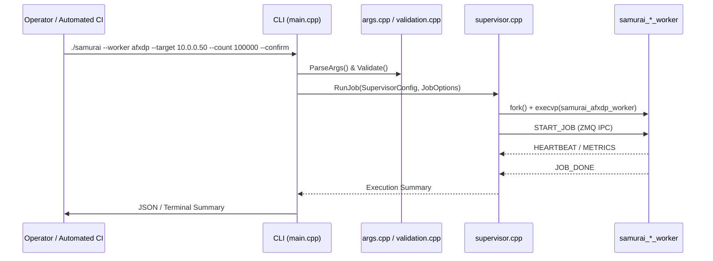

# 26 - Native CLI Architecture Deep Map (`ddos_samurai/cli/`)

This document describes the internal architecture, module breakdown, and execution sequence of the native C++ `samurai` command-line front-end.

---

## 1. Module Breakdown

| C++ Source File | Architectural Responsibility |
| :--- | :--- |
| **`main.cpp`** | CLI entrypoint. Orchestrates argument parsing, profile resolution, validation, and supervisor job invocation. |
| **`args.cpp` / `args.hpp`** | POSIX-compliant argument parsing (`--worker`, `--target`, `--port`, `--count`, etc.). |
| **`validation.cpp` / `validation.hpp`** | Target allowlist verification, socket safety pre-checks, and parameter boundary assertions. |
| **`profiles.cpp` / `profiles.hpp`** | Maps named benchmark profiles (`dev`, `ci_safe`, `dedicated_lab`) to internal operational configurations. |
| **`kpi_gate.cpp` / `kpi_gate.hpp`** | Compares post-execution metrics (RPS, loss ratio, latency percentiles) against strict quality gates. |
| **`reporting.cpp` / `reporting.hpp`** | Formats run results into structured JSON artifacts, Markdown tables, or terminal summaries. |
| **`rfc_suite.cpp` / `rfc_suite.hpp`** | Implements automated RFC positive and negative conformance testing suites. |
| **`../orchestrator/supervisor.cpp`** | Spawns worker processes via `fork()` / `execvp()`, establishing private Unix IPC channels (`ipc:///tmp/samurai_jobs_*`). |

---

## 2. CLI Execution Lifecycle

Lifecycle Sequence Diagram

