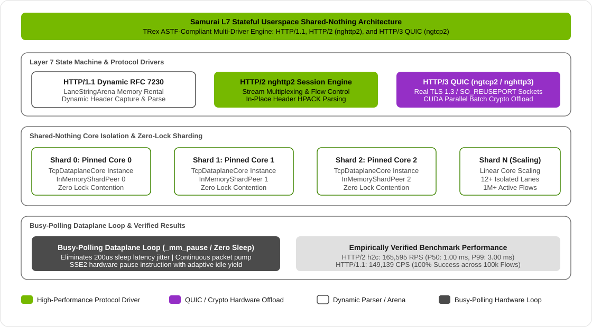

# 28 - Stateful Scenario Engine & Persona Emulation

The Samurai Scenario Engine (`samurai_scenario_worker`) is a high-performance Layer 7 simulation subsystem that emulates realistic client interactions through a formal `Persona -> Flow -> Step` state machine.



---

## 1. Architectural Scope & Capabilities

- **Primary Focus:** High-concurrency Layer 7 stateful session emulation.
- **Transport Drivers:**
  - `http`: Native HTTP/1.1 pipelined socket transport.
  - `http2`: Native HTTP/2 multiplexed streams via `nghttp2`.
  - `l4_tcp`: Userspace lock-striped 64-shard TCP stack (`tcp_dataplane_core.cpp`).
- **Autonomous Session Life-Cycle:** Cookie management, session context variables, dynamic CSRF/OAuth2 token extraction, and response validation.

---

## 2. Scenario Specification Format

Scenarios are authored in structured JSON or illustrated via YAML:
- **Specification Reference:** [`docs/scenario_web_mobile.yaml`](scenario_web_mobile.yaml) and [`docs/41-scenario-json-spec-and-examples.md`](41-scenario-json-spec-and-examples.md).

### Core Top-Level Elements:
- `schema_version`: Data schema versioning.
- `personas`: Client profiles (e.g., Mobile Android, Mobile iOS, Desktop Chrome).
- `flows`: Multi-step sequences (e.g., Login, Search, Checkout, Logout).
- `load_model`: Ramp-up schedules, target Virtual Users (VUs), and concurrency envelopes.
- `sla`: Microsecond latency boundaries and maximum acceptable failure thresholds.

---

## 3. CLI Execution

To execute persona scenarios using the native CLI front-end:

```bash
./build/ddos_samurai/cli/samurai \
  --worker scenario \
  --scenario-file docs/scenario_web_mobile.yaml \
  --scenario-mode enforce \
  --scenario-vus 100000 \
  --scenario-ramp-seconds 120 \
  --scenario-max-session-seconds 60 \
  --confirm
```

### CLI Parameters:
- `--scenario-file <path>`: Path to scenario JSON/YAML definition.
- `--scenario-mode {off, shadow, enforce}`: Operational enforcement mode.
- `--scenario-vus <int>`: Target concurrent virtual users (overrides file default).
- `--scenario-ramp-seconds <int>`: Ramp-up duration in seconds.
- `--scenario-max-session-seconds <int>`: Hard timeout cap for individual sessions.
- `--scenario-sla-profile <name>`: SLA threshold profile override.

---

## 4. Execution Modes

- `off`: Scenario engine disabled; standard synthetic vector execution.
- `shadow`: Executes persona scenarios in parallel with baseline load generation; SLA violations are logged without aborting the test.
- `enforce`: Strict compliance mode; if SLA criteria are breached, the run terminates immediately with exit code `1`.

---

## 5. Step Primitives & Behaviors

The compiler supports deterministic and stochastic primitives:
- `request`: HTTP GET/POST/PUT/DELETE transaction with variable interpolation.
- `pause`: Simulated human think-time (`uniform` or `gaussian` distribution).
- `branch`: Conditional branching based on HTTP status codes or JSON body fields.
- `loop`: Bounded repetition blocks.
- `assert`: Schema and value validation assertions.
- `end_session`: Graceful session teardown and resource release.

**Fault Handling:**
- `on_failure`: `retry`, `skip`, or `abort`.

---

## 6. Telemetry & SLA Metrics

The Scenario Engine exposes comprehensive per-second Prometheus metrics and JSON telemetry:
- `sessions_started`, `sessions_completed`
- `step_attempted`, `step_failed`
- `session_completion_rate`, `step_fail_ratio`
- `ramp_target_vus`, `ramp_actual_vus`, `ramp_accuracy_pct`
- `sla_status` (`pass` / `breached`)
- Per-flow percentiles: `latency_p50_ms`, `latency_p95_ms`, `latency_p99_ms`
