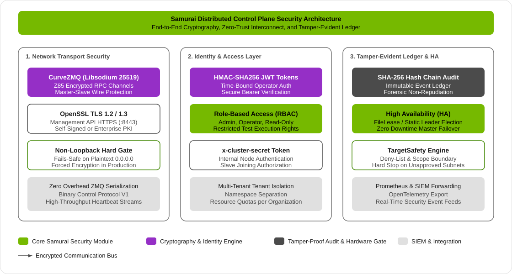

# 31 - Security Release Gates & Acceptance Policy

This document standardizes the automated security gates, compliance verifications, and enterprise acceptance criteria enforced in the release pipeline.

---

## 1. CI/CD Release Gates

1. **Semantic Versioning (SemVer) Guard:**
   - Validates git tags against internal version definitions.
2. **Security Release Gate:**
   - Policy artifact verification and tamper-detection checks.
   - Automated Software Bill of Materials (SBOM) generation (SPDX / CycloneDX).
   - Dependency vulnerability scanning (CVE / advisory databases).
3. **Enterprise Acceptance Gate:**
   - Targeted integration test suites.
   - Benchmark SLO boundary validation.
   - End-to-end security regression re-checks.

---

## 2. Security Tooling Map

- `tools/security_release_gate.sh`: Primary gate orchestrator.
- `tools/generate_sbom.sh`: Multi-language SBOM synthesizer.
- `tools/run_enterprise_acceptance.sh`: Automated acceptance harness.
- `tools/check_slo.py`: Microsecond SLO evaluation engine.
- `tools/sign_release_artifacts.sh`: Cryptographic release artifact signing.

---

## 3. Audit Log Chain Verification

The Distributed Control Plane enforces an append-only SHA-256 hash chain for all RBAC and administrative operations:
- **Writer:** `MasterControlServer::_append_rbac_audit`
- **Verifier:** `tools/verify_audit_chain.py`
- **Cryptographic Fields:**
  - `prev_hash`: SHA-256 hash of the preceding audit record.
  - `entry_hash`: SHA-256 hash over timestamp, subject, action, resource, and `prev_hash`.

---

## 4. Mandatory Release Acceptance Criteria

Before any candidate binary or container image is published:
1. Security Release Gate: **PASS**
2. Enterprise Acceptance Test Suite: **PASS**
3. Container & Helm Lint Verification: **PASS**
4. Distributed RPC & Parser Regression Suites: **PASS**

This strict pipeline prevents benchmark drift, mitigates supply chain vulnerabilities, and delivers auditable compliance evidence for enterprise production deployments.
