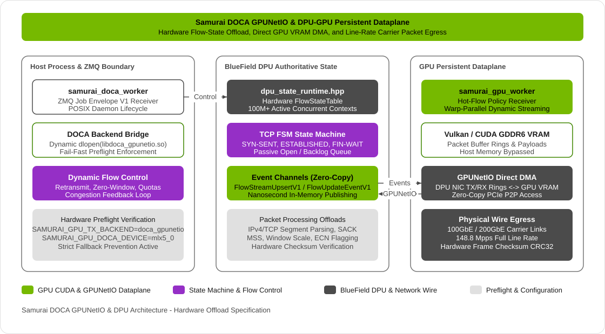

# 33 - DOCA GPUNetIO & DPU-GPU Dataplane Architecture and Migration Status

- **Scope:** Native C++ CUDA Persistent Dataplane, NVIDIA BlueField DPU / DOCA GPUNetIO, Zero-Copy PCIe P2P DMA
- **Current Status:** Fully Integrated in Native C++ Dataplane (`samurai_doca_worker` & `samurai_gpu_worker`)



---

## 1. Executive Architecture

The NVIDIA DOCA GPUNetIO integration enables line-rate packet streaming directly from GPU GDDR6 VRAM to the network interface, completely bypassing Host-CPU memory traversal.

### Core Components:
1. **ZMQ DOCA Worker Daemon (`samurai/zmq/daemon/doca_gpunetio_worker.cpp`):**
   - Independent native daemon managed by `supervisor.cpp`.
   - Listens on `ipc:///tmp/samurai_jobs_*` for job execution envelopes (`JobEnvelopeV1`).
   - Dynamically binds and loads the DOCA GPUNetIO backend via `dlopen(libdoca_gpunetio.so)`.
2. **DPU Authoritative State Runtime (`samurai/gpu_packet_cuda/dpu_state_runtime.hpp`):**
   - Implements hardware-offloaded TCP state machine (CLOSED, SYN-SENT, ESTABLISHED, FIN-WAIT).
   - Manages passive open backlogs, TCB state (`snd_una`, `snd_nxt`, `rcv_nxt`, `cwnd`, `ssthresh`), SACK parsing, and RTO calculations.
3. **DOCA GPUNetIO ABI (`samurai/gpu_packet_cuda/tx_backend_doca_gpunetio.cuh`):**
   - Direct kernel interface mapping DPU NIC TX/RX queues to GPU GDDR6 memory addresses.
4. **GPU Hot-Flow Policy Receiver (`samurai/zmq/daemon/gpu_worker.cpp`):**
   - Streams packet generation bursts according to dynamic flow policies (`FlowStreamUpsertV1` and `FlowUpdateEventV1`).

---

## 2. Runtime Execution Flow

```
[SecOps CLI / Master]
         |
    START_JOB (JobEnvelopeV1)
         v
[samurai_doca_worker Daemon]
         |-- 1. dlopen(libdoca_gpunetio.so) & Verify NIC PCIe Topo
         |-- 2. Allocate DPU TXQ / RXQ Descriptor Rings
         |-- 3. Initialize FlowStateTable (dpu_state_runtime.hpp)
         |
         |-- 4. Publish FlowStreamUpsertV1 / FlowUpdateEventV1 (Zero-Copy)
         v
[samurai_gpu_worker / GDDR6 VRAM]
         |
         |-- 5. Autonomous CUDA Warp Parallel Packet Generation
         |-- 6. Direct GPUNetIO DMA Transfer (GPU VRAM <-> NIC HW Rings)
         v
[Physical 100/200GbE Carrier Wire Egress]
```

1. **Job Initialization:** CLI or Master dispatches `START_JOB` to `samurai_doca_worker` via ZMQ IPC.
2. **Backend Instantiation:** The DOCA worker loads the native hardware driver and validates preflight preconditions.
3. **Queue & Context Setup:** Hardware TX/RX queues and the authoritative `FlowStateTable` are initialized on the DPU.
4. **Policy Synchronization:** Flow policies (`FLOW_STREAM_UPSERT`, `FLOW_UPDATE`) stream to the GPU worker.
5. **Direct DMA Egress:** Packet vectors are transmitted directly over the PCIe bus without Host DDR memory buffering.
6. **Closed-Loop Feedback:** If RX feedback is enabled, incoming ACK/SYN/FIN/RST packets update TCP window scale, retransmits, and quotas in sub-microsecond intervals.

---

## 3. Strict vs. Fallback Preflight Policies

To prevent accidental silent fallback to slower SKB/kernel networking during high-throughput tests, Samurai enforces a strict fail-fast policy:

- `SAMURAI_GPU_TX_BACKEND`: Supported values are `doca_gpunetio`, `af_xdp`, or `af_packet`.
- `SAMURAI_GPU_TX_BACKEND_STRICT=1`: Required during production benchmarks.
- In `doca_gpunetio` mode:
  - `SAMURAI_GPU_DOCA_ENABLE=1` must be set.
  - `SAMURAI_GPU_DOCA_DEVICE` must be specified (e.g. `mlx5_0`).
  - `--xdp-interface` must target the matching network adapter.
- If hardware constraints are not satisfied, the daemon exits immediately with code `0xFF (ERROR)` instead of silently degrading performance.

---

## 4. Verification & Operational Commands

### A) Dry-Run & Unit Contract Testing
Verify the ZMQ ABI, DPU state layout, and backend facade contracts without hardware fixtures:

```bash
# Verify wire contracts and ZMQ message serialization
PYTHONPATH=. pytest tests/test_zmq_wire_contract.py -q
PYTHONPATH=. pytest tests/test_zmq_m3_workers.py -q
PYTHONPATH=. pytest tests/native_gpu/test_backend_facade.py -q
```

### B) Native Hardware Execution (Production Lab)
Run on a bare-metal server equipped with an NVIDIA GPU and BlueField DPU:

```bash
# Run samurai native DOCA GPUNetIO worker
sudo ./build/cli/samurai \
  --worker doca \
  --target 10.0.0.50 \
  --port 80 \
  --protocol tcp \
  --count 50000000 \
  --confirm
```

---

## 5. Related Architecture Documents

- [00-overview.md](./00-overview.md) — Main Architecture Overview
- [05-gpu.md](./05-gpu.md) — GPU CUDA & Accelerator Dataplane
- [21-numa-tx-rx-afxdp-dpdk-dma-guide.md](./21-numa-tx-rx-afxdp-dpdk-dma-guide.md) — NUMA & Kernel-Bypass Memory Guide
- [36-zmq-worker-architecture.md](./36-zmq-worker-architecture.md) — ZMQ IPC Architecture
- [37-dpu-gpu-dataplane-architecture.md](./37-dpu-gpu-dataplane-architecture.md) — DPU/GPU Dataplane Contract Specification
- [45-commodity-gpu-nic-p2p-packet-engine-report.md](./45-commodity-gpu-nic-p2p-packet-engine-report.md) — GPU-NIC P2P Zero-Copy Dataplane Report
- [47-zero-cpu-persistent-dataplane-architecture.md](./47-zero-cpu-persistent-dataplane-architecture.md) — Zero-CPU Persistent Dataplane Architecture
