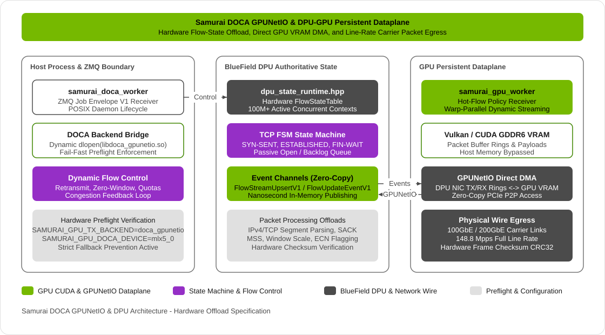

# 37 - DPU/GPU Dataplane Architecture & Contract Specification

This document specifies the technical contract between NVIDIA BlueField DPU / DOCA GPUNetIO and the CUDA persistent packet runtime in Samurai.

---

## 1. Subsystem Ownership Boundaries

| Domain | Responsible Subsystem | Primary Code Artifacts |
|:---|:---|:---|
| **GPU CUDA Packet Runtime** | GPU Layer | `ddos_samurai/gpu_packet_cuda/*` |
| **DPU Authoritative Flow State** | DPU/GPU Contract Layer | `ddos_samurai/gpu_packet_cuda/dpu_state_runtime.hpp` |
| **DOCA GPUNetIO Backend ABI** | GPU CUDA Backend | `ddos_samurai/gpu_packet_cuda/tx_backend_doca_gpunetio.cuh`, `doca_gpunetio_backend.cpp` |
| **ZMQ Process Adapter** | Worker Transport | `ddos_samurai/zmq/daemon/doca_gpunetio_worker.cpp` |

`dpu_state_runtime.hpp` is intentionally maintained within `gpu_packet_cuda` rather than the ZMQ transport directory. It defines the mathematical and memory contracts for GPU hot-flow routing, DPU authoritative state tables, and dynamic congestion control feedback.

---

## 2. Fastpath Execution Flow

1. **Job Dispatch:** Orchestrator delivers `START_JOB` envelope to `samurai_doca_worker`.
2. **Dynamic Binding:** Worker loads the native DOCA runtime via `dlopen(libdoca_gpunetio.so)`.
3. **Queue Creation:** Worker initializes DPU TX and RX hardware descriptor rings.
4. **State Table Instantiation:** `FlowStateTable` creates flow contexts and starts state tracking.
5. **GPU Stream Publishing:** The DPU publishes `FLOW_STREAM_UPSERT` and `FLOW_UPDATE` events directly to the GPU worker.
6. **Zero-Copy DMA Transmission:** Packets are sent via `send_vector` directly from GPU GDDR6 VRAM across the PCIe interconnect.
7. **Closed-Loop Feedback:** When RX feedback is active, `receive_burst` inspects incoming ACK/SYN/FIN/RST segments.
8. **Policy Updates:** Retransmit timers, zero-window probes, and congestion control states are updated and reflected immediately into the GPU streaming policy.

---

## 3. DPU State Runtime Offload

[`dpu_state_runtime.hpp`](file://ddos_samurai/gpu_packet_cuda/dpu_state_runtime.hpp) executes the following hardware-accelerated tasks:
- Manages authoritative `FlowState` entries across millions of concurrent connections.
- Implements the complete RFC 793 / RFC 9293 TCP state machine (CLOSED, LISTEN, SYN-SENT, SYN-RECEIVED, ESTABLISHED, FIN-WAIT, CLOSE-WAIT, LAST-ACK, TIME-WAIT).
- Parses TCP segments with hardware checksum verification: IPv4/TCP headers, MSS, Window Scale, SACK options, and ECN flags.
- Maintains Transmission Control Blocks (TCB): `snd_una`, `snd_nxt`, `rcv_nxt`, `cwnd`, `ssthresh`, and out-of-order reassembly buffers.
- Issues zero-copy event frames: `FlowUpdateEventV1` and `FlowStreamUpsertV1`.
