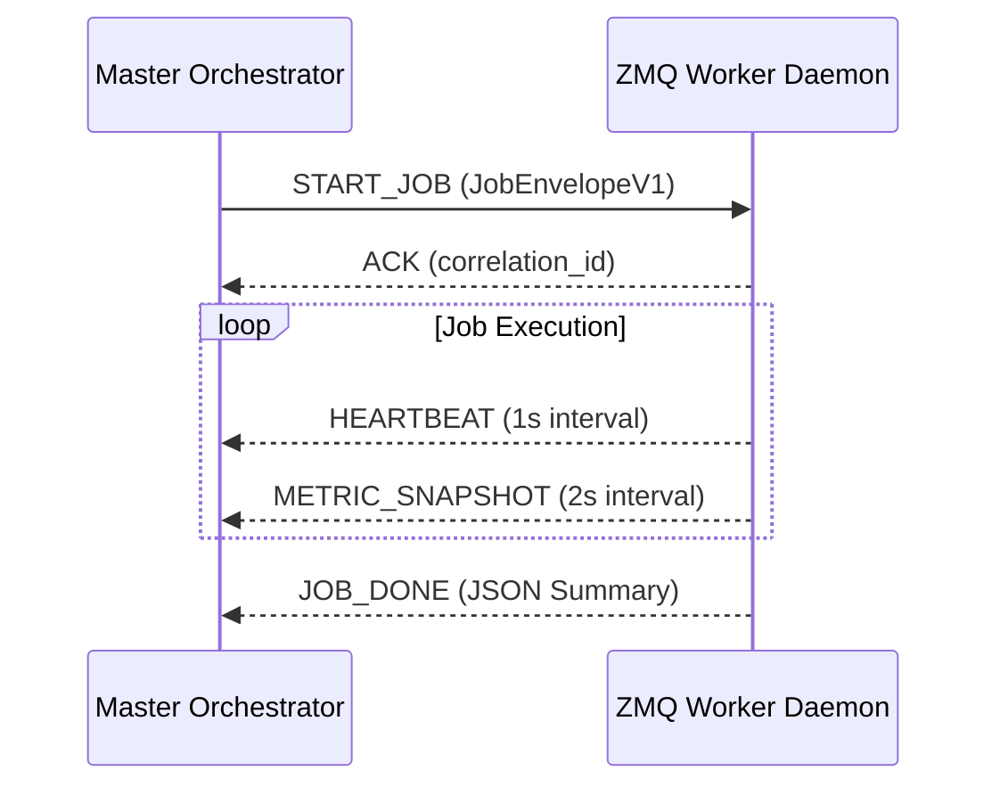

# 39 - Samurai Native Architecture & ZMQ Worker API Reference

## 1. Architectural Overview

Samurai (Release 3.0.0) is an enterprise-grade, high-throughput, low-latency network resilience and stress testing platform built entirely in native C++17.


The platform architecture is organized into three primary layers:
1. **Distributed Control Plane** (C++ `master_coordinator` / `slave_node`): Workload sharding, High Availability (leader election), RBAC, JWT authentication, and Prometheus metrics export.
2. **Dataplane Acceleration Core**:
   - `l4_state_engine` / `tcp_dataplane_core`: 64-shard lock-striped connection flow table and userspace TCP stack.
   - `l7_emu_native`: Epoll and reactor emulation engine supporting HTTP/1.1, HTTP/2 (nghttp2), QUIC/H3 (ngtcp2), DNS, DHCP, IGMP, and IPv6 Neighbor Discovery.
   - `gpu_packet_cuda` / `doca_gpunetio`: CUDA and DOCA GPUNetIO packet synthesis with DPU hardware offloading.
3. **ZMQ Worker Runtime**: Autonomous daemon processes executing isolated dataplane jobs (`samurai_*_worker`).

---

## 2. ZMQ Binary Wire Protocol (V1 & V2)

Every IPC message is prefixed with a tightly packed (`#pragma pack(push, 1)`) 56-byte header:

```
┌─────────────────────────────────────────────────────────┐
│ SamuraiWireHeaderV1 (56 Bytes)                          │
├───────────────────┬────────┬────────────────────────────┤
│ Field             │ Type   │ Description                │
├───────────────────┼────────┼────────────────────────────┤
│ magic             │ uint32 │ 0x534D5249 ("SMRI")        │
│ version           │ uint8  │ 0x01 (V1) or 0x02 (V2)     │
│ msg_type          │ uint8  │ START_JOB, STOP_JOB, etc.  │
│ worker_kind       │ uint8  │ CPU, GPU, DPDK, AF_XDP etc.│
│ reserved          │ uint8  │ Alignment padding          │
│ correlation_id    │ uint64 │ Request/Response match ID  │
│ job_id            │ char[32] Null-terminated job string│
│ payload_len       │ uint32 │ Trailing payload length    │
└───────────────────┴────────┴────────────────────────────┘
```

### Worker Kinds
- `0x01`: `CPU`
- `0x02`: `GPU`
- `0x03`: `DPDK`
- `0x04`: `AF_XDP`
- `0x05`: `DOCA_GPUNETIO`
- `0x06`: `L7`
- `0x07`: `DEFENSE`
- `0x08`: `SCENARIO`

---

## 3. Worker Execution Lifecycle



---

## 4. Stateful Transport Backends

| Backend | CLI Option | Description |
| :--- | :--- | :--- |
| `af_xdp` | `--stateful-runtime-backend af_xdp` | Linux Kernel-Bypass zero-copy XSK ring buffers via `tcp_dataplane` |
| `dpdk` | `--stateful-runtime-backend dpdk` | DPDK PMD `rte_eth_rx_burst` / `rte_eth_tx_burst` ring buffers with direct mbuf mapping |
| `kernel_socket` | `--stateful-runtime-backend kernel` | Standard POSIX socket fallback |

---

## 5. Telemetry & Metrics Schema

`METRIC_SNAPSHOT` messages transmit a binary `MetricSnapshotV1` struct:
- `timestamp_ns`: Monotonic timestamp (nanoseconds)
- `packets_sent`: Successfully transmitted packets count
- `packets_errors`: Transmission drops or driver error count
- `bytes_sent`: Total wire bytes transmitted
- `actual_rps`: Measured packets or requests per second
- `rate_accuracy_pct`: Adherence to target pacing schedule (0.0% – 100.0%)
