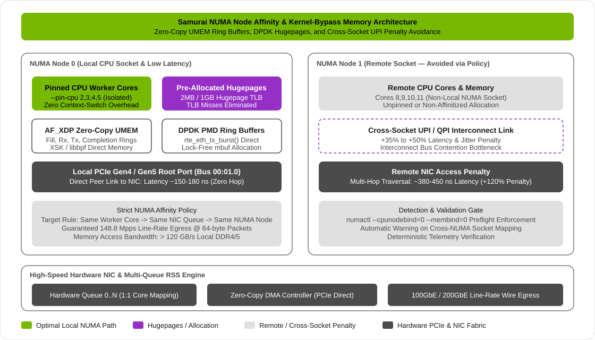

# 39 - RFC Benchmark Baseline Runbook (Privileged Setup and Execution)

> Status: ACTIVE · Created: 2026-08-19
> Purpose: Measure the throughput and latency ceiling of the Samurai High-Throughput Packet Engine using industry-standard RFC testing methodologies (RFC 2544 / RFC 3511 / RFC 8219) on equal footing with TRex, establishing a modern, authoritative performance baseline in an appropriately privileged environment.



This runbook establishes fresh, validated performance baselines to supersede historical and environment-constrained records documented in [`trex_path.md`](../trex_path.md) and [`reports/runs/`](../reports/runs/). Those historical "0 sent / all error" tables were not software defects, but artifacts of unprivileged development environments (`AF_XDP` unavailable + `sender_fallback_policy=fail` + `noop` TX). The procedures below configure the necessary hardware privileges, kernel bypass drivers, and execution parameters.

---

## 0. Prerequisites: Why Elevated Privileges Are Required

| Transmission Path | Required Linux Capability | Technical Rationale |
|---|---|---|
| AF_XDP (`samurai_afxdp_worker`) | `CAP_NET_RAW` + `CAP_NET_ADMIN` | XSK socket creation, UMEM memory registration, and hardware NIC queue binding |
| Raw Socket / L2-L3 TX | `CAP_NET_RAW` | `AF_PACKET` TX_RING buffer mapping and raw Ethernet/IP frame transmission |
| DPDK (`samurai_dpdk_worker`) | Root + `vfio-pci` + Hugepages | Poll Mode Driver (PMD) unbinds device from kernel to drive NIC registers directly |
| Precise Pacing (`SYS_NICE`) | `CAP_SYS_NICE` | Real-time scheduling priority (`SCHED_FIFO`) and CPU core affinity to minimize jitter |

In an unprivileged development environment, none of these acceleration paths can be engaged, resulting in `XDP_UNAVAILABLE`. Official baselines **must** be executed in one of the privileged lab setups described below.

---

## 1. Native Compilation

```bash
cmake -S samurai -B build -DCMAKE_BUILD_TYPE=Release
cmake --build build -j
# Expected targets: samurai (CLI), samurai_*_worker (8 native daemon workers)
# AF_XDP requires libbpf; DPDK requires SAMURAI_WITH_DPDK=1 and libdpdk headers.
```

Optional hardware acceleration backends compile conditionally according to toolchain availability ([`samurai/optional/CMakeLists.txt`](../samurai/optional/CMakeLists.txt)): `libgpu_packet_cuda.so` (via nvcc), `dpdk_pmd_core.so` (via DPDK). If dependencies are missing, they are cleanly skipped.

---

## 2. Privilege Provisioning: Three Operational Options

### Option A: `setcap` File Capabilities (Kernel AF_XDP / Raw Socket Path)

The lightest operational configuration; allows non-root execution by granting specific capabilities to compiled worker binaries:

```bash
sudo setcap cap_net_raw,cap_net_admin,cap_sys_nice+ep ./build/zmq/samurai_afxdp_worker
sudo setcap cap_net_raw,cap_net_admin+ep            ./build/zmq/samurai_cpu_worker

# AF_XDP interface and hardware queue configuration:
export SAMURAI_XDP_INTERFACE=enp2s0     # Dedicated test NIC (see docs/08-config.md)
export SAMURAI_XDP_QUEUE_ID=0
```

### Option B: DPDK Driver (Kernel-Bypass, Line-Rate PPS)

Refer to [`docs/34-dpdk-environment-setup-guide.md`](34-dpdk-environment-setup-guide.md).

```bash
# 1) Validate DPDK host environment
bash tools/check_dpdk_env.sh --report-only

# 2) Reserve 2MB Hugepages
echo 1024 | sudo tee /sys/kernel/mm/hugepages/hugepages-2048kB/nr_hugepages

# 3) Bind dedicated test NIC to vfio-pci (DO NOT bind management interface!)
sudo dpdk-devbind.py --status
sudo dpdk-devbind.py --bind=vfio-pci 0000:3b:00.0

# 4) Compile with DPDK support enabled
SAMURAI_WITH_DPDK=1 cmake -S samurai -B build -DCMAKE_BUILD_TYPE=Release && \
  cmake --build build -j
```

### Option C: Isolated Container / Kubernetes

Ensure the container execution spec includes:
`cap_add: [NET_ADMIN, NET_RAW, SYS_NICE]` (see [`docs/11-docker.md`](11-docker.md)).
For DPDK acceleration, additionally mount `/dev/vfio`, provision hugepage volume mounts, and assign `--privileged` (or `IPC_LOCK`).

---

## 3. Safety Guardrails and Allowlisting

The platform's safety engine unconditionally rejects public routable destination IPs by default (outside RFC 1918, loopback, or CGNAT spaces). Execute baselines against an isolated lab sink, explicitly granting authorization:

```bash
# Recommended: Isolated lab sink endpoint (e.g., traffic sink on 10.0.0.0/8)
--allow-target 10.0.0.5

# If public destination testing is strictly authorized under contractual engagement:
--allow-public-target
```

> [!WARNING]
> Only execute tests against infrastructure you own or have explicit, written authorization to evaluate. A dedicated traffic sink (e.g., an independent host running `iperf3 -s` or a physical loopback cable) provides an ideal destination.

---

## 4. RFC Baseline Execution

```bash
mkdir -p reports/runs/$(date +%Y-%m)/baseline
OUT=reports/runs/$(date +%Y-%m)/baseline

# Execute full RFC benchmark suite (RFC 2544 throughput/latency/loss, RFC 3511 firewall, RFC 8219 IPv6)
sudo -E ./build/cli/samurai \
  --run-rfc-suite all \
  --rfc-report-out $OUT/rfc_all.html \
  --target 10.0.0.5 --port 80 \
  --allow-target 10.0.0.5 \
  --report-json $OUT/rfc_all.json \
  --report-text $OUT/rfc_all.txt
```

To run individual RFC test suites:
- `--run-rfc-suite rfc2544` (Layer 2/3 throughput, frame loss, latency)
- `--run-rfc-suite rfc3511` (Firewall stateful throughput and connection capacity)
- `--run-rfc-suite rfc8219` (IPv6 transition benchmarking)

Architecture references:
[`cli/args.cpp`](../samurai/cli/args.cpp) · [`cli/rfc_suite.cpp`](../samurai/cli/rfc_suite.cpp).

### Execution Validation Checklist

To confirm the run was not hindered by environment restrictions, inspect the following fields in the generated run report:

| Telemetry Field | Expected Healthy Benchmark | Outdated Constrained Record |
|---|---|---|
| `sender_paths_used` | `{"XDP": ...}` or `{"DPDK": ...}` | `{"XDP_UNAVAILABLE": 1}` |
| `runtime_backend` | `native` / hot-path | `legacy` |
| `persistent_tx_backend` | Physical interface name | `noop` |
| `sent_total` | Approximately equal to `attempted_total` | `0` |
| `effective_pps` | > 0 (Matching target line-rate) | `0.0` |

---

## 5. Comparative Evaluation with TRex

On the identical physical interface and network sink, execute a reference run using TRex STL/ASTF, placing RFC 2544 throughput, latency, and packet loss figures side-by-side:

| Metric | TRex Reference | Samurai Packet Engine (This Baseline) |
|---|---|---|
| Max No-Drop Rate (Mpps) | ... | ... |
| p99 Latency (ns) | ... | ... |
| Packet Loss @ Line-Rate (%) | ... | ... |

> [!NOTE]
> Because RFC 2544 methodology is standardized across both testing engines, this comparison provides a direct apples-to-apples benchmark. Outdated figures (~27k pps) resulting from unprivileged `noop` fallback runs must not be included in authoritative comparison tables.

---

## 6. Post-Baseline Procedure

1. Update `reports/runs/README.md` to point to the newly generated baseline directory.
2. Update the `trex_path.md` SUPERSEDED banner with the certified baseline numbers.
3. Move historical unprivileged test records (`reports/runs/artifacts/live_run*`) into `reports/runs/_archive_pre_2026-08/`.
