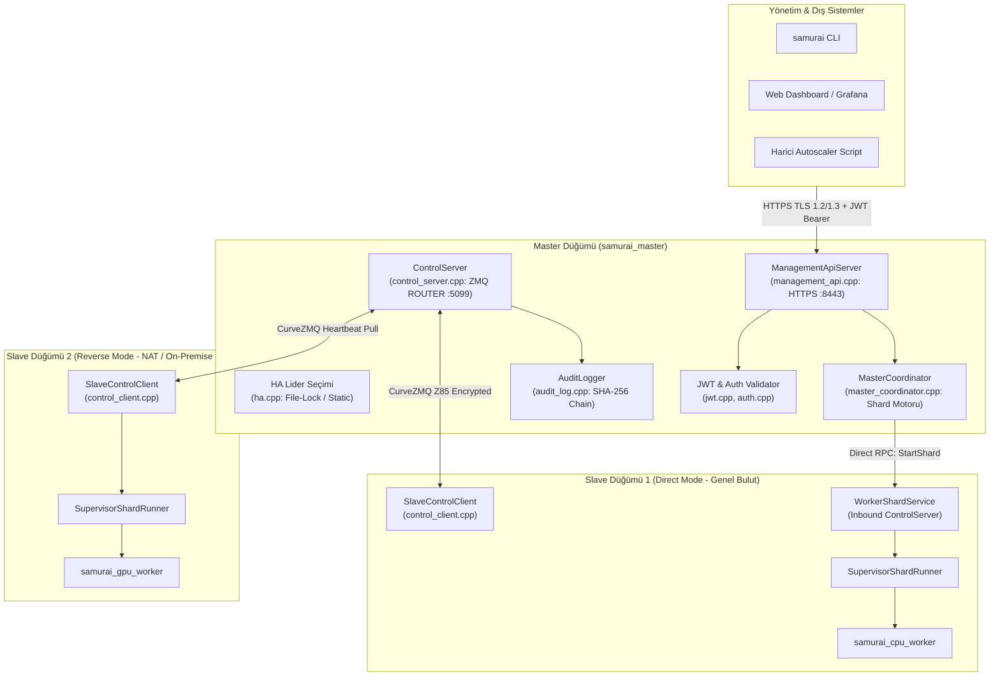
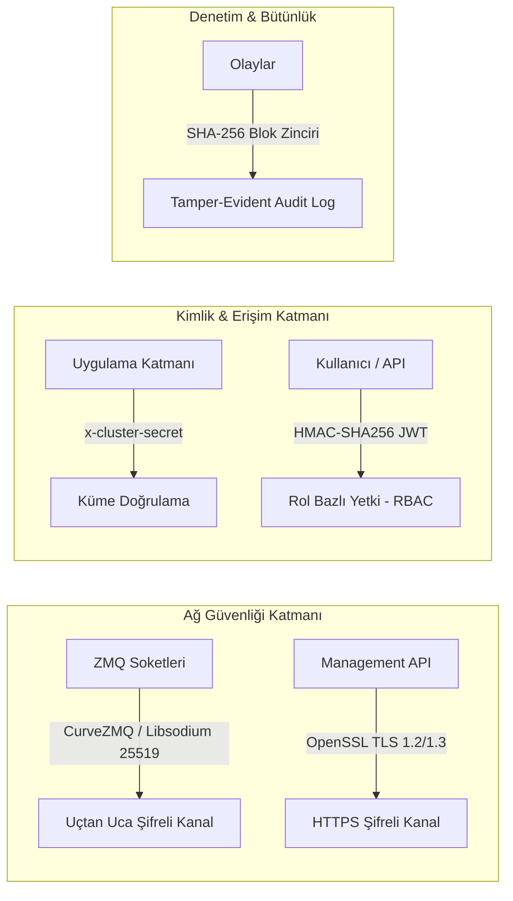
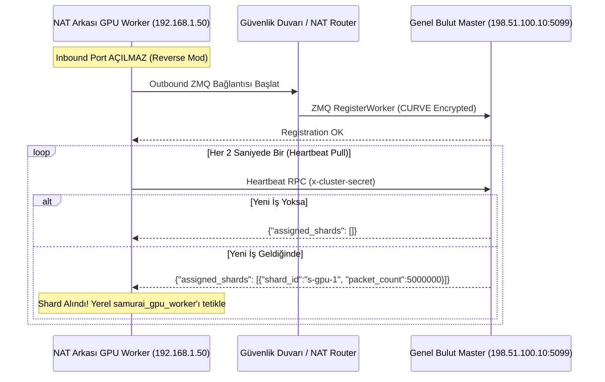
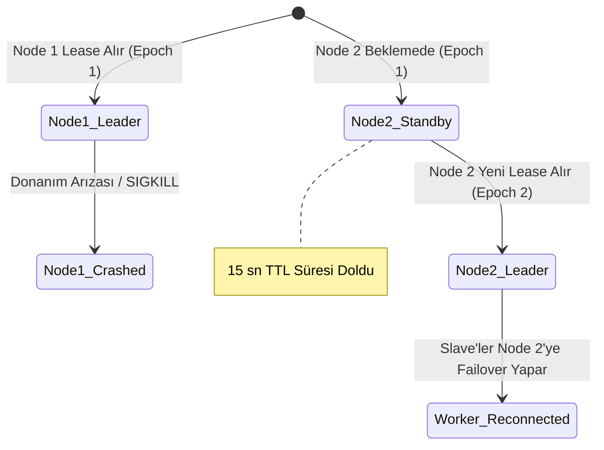

# 40 - Dağıtık Control Plane Kapsamlı Başvuru ve Kullanım Rehberi

Bu belge, **DDoSamurai** projesinin yerel C++ ile geliştirilmiş yüksek performanslı dağıtık kontrol düzlemini (**Distributed Control Plane**) mimarisinden başlayarak en ince yapılandırma ayrıntılarına, güvenlik protokollerine, üretim dağıtım senaryolarına ve zengin pratik kullanım örneklerine kadar tüm detaylarıyla anlatmaktadır.

---

## İçindekiler

1. [Mimarî Genel Bakış ve Bileşenler](#1-mimarî-genel-bakış-ve-bileşenler)
2. [Taşıma Katmanı ve ZMQ Protokolleri](#2-taşıma-katmanı-ve-zmq-protokolleri)
3. [Güvenlik ve Şifreleme (CURVE, TLS, RBAC, JWT, Audit)](#3-güvenlik-ve-şifreleme-curve-tls-rbac-jwt-audit)
4. [Sıfır Kurulumlu Agent Katılımı (Zero-Install `curl | sh`)](#4-sıfır-kurulumlu-agent-katılımı-zero-install-curl--sh)
5. [Yüksek Erişilebilirlik (HA) ve Multi-Master](#5-yüksek-erişilebilirlik-ha-ve-multi-master)
6. [Shard Yönetimi, Dağıtım ve Otomatik Ölçekleme](#6-shard-yönetimi-dağıtım-ve-otomatik-ölçekleme)
7. [HTTP Management REST API Tam Referansı](#7-http-management-rest-api-tam-referansı)
8. [Detaylı Uçtan Uca Uygulama ve Kullanım Senaryoları](#8-detaylı-uçtan-uca-uygulama-ve-kullanım-senaryoları)
  - [Senaryo 1: Yerel Hızlı Geliştirme ve Test (Sandbox Modu)](#senaryo-1-yerel-hızlı-geliştirme-ve-test-sandbox-modu)
  - [Senaryo 2: Üretim Seviyesi Güvenli Multi-Node Kümesi (TLS + CURVE + Secret + Tenant)](#senaryo-2-üretim-seviyesi-güvenli-multi-node-kümesi-tls--curve--secret--tenant)
  - [Senaryo 3: NAT ve Güvenlik Duvarı Arkasındaki Worker'lar (Reverse Mode)](#senaryo-3-nat-ve-güvenlik-duvarı-arkasındaki-workerlar-reverse-mode)
  - [Senaryo 4: Sıfır Kurulumlu Dinamik Agent Katılımı (`curl | sh` ile Canlı Dağıtım)](#senaryo-4-sıfır-kurulumlu-dinamik-agent-katılımı-curl--sh-ile-canlı-dağıtım)
  - [Senaryo 5: Yüksek Erişilebilirlik (HA Active-Passive Failover Testi)](#senaryo-5-yüksek-erişilebilirlik-ha-active-passive-failover-testi)
  - [Senaryo 6: Management REST API Kapsamlı cURL, JWT ve Otomasyon Örnekleri](#senaryo-6-management-rest-api-kapsamlı-curl-jwt-ve-otomasyon-örnekleri)
  - [Senaryo 7: Docker Compose ile İzole Dağıtık Test Kümesi](#senaryo-7-docker-compose-ile-izole-dağıtık-test-kümesi)
  - [Senaryo 8: Python ile Otomatik Telemetri ve Alarm İzleme Scripti](#senaryo-8-python-ile-otomatik-telemetri-ve-alarm-izleme-scripti)
  - [Senaryo 9: Hata Ayıklama ve Sık Karşılaşılan Problemlerin Çözümü (Troubleshooting)](#senaryo-9-hata-ayıklama-ve-sık-karşılaşılan-problemlerin-çözümü-troubleshooting)
9. [CLI Parametreleri ve Çevresel Yapılandırma](#9-cli-parametreleri-ve-çevresel-yapılandırma)

---

## 1. Mimarî Genel Bakış ve Bileşenler

DDoSamurai Dağıtık Kontrol Düzlemi, heterojen altyapılarda (CPU, GPU, DPDK, AF_XDP, AF_PACKET) çalışan yüzlerce worker sürecini tek bir orkestrasyon çatısı altında birleştirmek üzere geliştirilmiştir.




### Kaynak Kod Dosyaları ve Görev Dağılımı (`ddos_samurai/control/`)


| Dosya / Modül                                                                                                                                                                                                             | Görev ve Fonksiyon                                                                                                                                               |
| ------------------------------------------------------------------------------------------------------------------------------------------------------------------------------------------------------------------------- | ---------------------------------------------------------------------------------------------------------------------------------------------------------------- |
| `[daemon/master_main.cpp](file:///home/mehmet/Masaüstü/Python/v11/DDoSamurai/ddos_samurai/control/daemon/master_main.cpp)`                                                                                                | `samurai_master` ikili programı. Liderlik kontrolü, ZMQ kontrol sunucusu, Management REST API, worker bekleme, iş bölme ve telemetri toplama adımlarını yürütür. |
| `[daemon/slave_main.cpp](file:///home/mehmet/Masaüstü/Python/v11/DDoSamurai/ddos_samurai/control/daemon/slave_main.cpp)`                                                                                                  | `samurai_slave` ikili programı. Master'a kaydolur, heartbeat yollar, gelen shard'ları yerel worker süreçlerine (`samurai_*_worker`) iletir.                      |
| `[control_server.cpp](file:///home/mehmet/Masaüstü/Python/v11/DDoSamurai/ddos_samurai/control/control_server.cpp)` / `[.hpp](file:///home/mehmet/Masaüstü/Python/v11/DDoSamurai/ddos_samurai/control/control_server.hpp)` | `ZMQ_ROUTER` soketi üzerinde çalışan asenkron RPC sunucusu. `ZMQ_CURVE_SERVER` yeteneklidir.                                                                     |
| `[control_client.cpp](file:///home/mehmet/Masaüstü/Python/v11/DDoSamurai/ddos_samurai/control/control_client.cpp)` / `[.hpp](file:///home/mehmet/Masaüstü/Python/v11/DDoSamurai/ddos_samurai/control/control_client.hpp)` | `SlaveControlClient` ve `WorkerControlClient` sınıfları. `ZMQ_REQ` soketleri üzerinden failover ve CURVE istemci bağlantılarını yönetir.                         |
| `[management_api.cpp](file:///home/mehmet/Masaüstü/Python/v11/DDoSamurai/ddos_samurai/control/management_api.cpp)` / `[.hpp](file:///home/mehmet/Masaüstü/Python/v11/DDoSamurai/ddos_samurai/control/management_api.hpp)` | Harici framework bağımlılığı olmaksızın POSIX soketleri ve OpenSSL ile çalışan HTTP/1.1 REST API sunucusu.                                                       |
| `[curve.cpp](file:///home/mehmet/Masaüstü/Python/v11/DDoSamurai/ddos_samurai/control/curve.cpp)` / `[.hpp](file:///home/mehmet/Masaüstü/Python/v11/DDoSamurai/ddos_samurai/control/curve.hpp)`                            | Libsodium/LibZMQ Curve25519 anahtar üretimi (`zmq_curve_keypair`) ve genel anahtar türetimi (`zmq_curve_public`) yardımcıları.                                   |
| `[ha.cpp](file:///home/mehmet/Masaüstü/Python/v11/DDoSamurai/ddos_samurai/control/ha.cpp)` / `[.hpp](file:///home/mehmet/Masaüstü/Python/v11/DDoSamurai/ddos_samurai/control/ha.hpp)`                                     | `FileLeaseLeaderElector` (paylaşımlı dosya kilidi) ve `StaticLeaderElector` (statik sıra) sınıfları ile kesintisiz lider seçimi.                                 |
| `[jwt.cpp](file:///home/mehmet/Masaüstü/Python/v11/DDoSamurai/ddos_samurai/control/jwt.cpp)` / `[.hpp](file:///home/mehmet/Masaüstü/Python/v11/DDoSamurai/ddos_samurai/control/jwt.hpp)`                                  | HMAC-SHA256 JWT imza üretimi, doğrulaması ve claim (`sub`, `role`, `tenant_namespace`, `exp`) çözümlemesi.                                                       |
| `[audit_log.cpp](file:///home/mehmet/Masaüstü/Python/v11/DDoSamurai/ddos_samurai/control/audit_log.cpp)` / `[.hpp](file:///home/mehmet/Masaüstü/Python/v11/DDoSamurai/ddos_samurai/control/audit_log.hpp)`                | Kriptografik SHA-256 zincirleme ile kurcalamaya karşı korumalı (tamper-evident) denetim günlüğü.                                                                 |
| `[shard.cpp](file:///home/mehmet/Masaüstü/Python/v11/DDoSamurai/ddos_samurai/control/shard.cpp)` / `[.hpp](file:///home/mehmet/Masaüstü/Python/v11/DDoSamurai/ddos_samurai/control/shard.hpp)`                            | Toplam hedef paket sayısını aktif worker'lara adil biçimde paylaştıran matematiksel shard bölme algoritması.                                                     |


---

## 2. Taşıma Katmanı ve ZMQ Protokolleri

### Kontrol Düzlemi RPC Wire Formatı (`control_wire.hpp`)

ZMQ mesajlaşma hattı üzerinde taşınan tüm veriler JSON gövdeli iki parçalı bir protokoldür:

```json
// İstek (Request Wire Frame)
{
  "method": "RegisterWorker",
  "meta": {
    "x-cluster-secret": "e9b2c3a1f8d4...",
    "x-tenant-namespace": "ecommerce-preprod"
  },
  "body": {
    "worker_id": "slave-node-frankfurt-01",
    "capabilities": {
      "region": "eu-central-1",
      "worker_kind": "cpu",
      "max_pps": "2000000",
      "control_curve_public": "Yq#7K$91..."
    }
  }
}

// Yanıt (Response Wire Frame)
{
  "status": "ok",
  "error": "",
  "body": {
    "registered": true,
    "cluster_id": "cluster-prod-99",
    "heartbeat_interval_ms": 2000,
    "assigned_shards": []
  }
}
```

### Desteklenen Temel RPC Metodları


| Metod             | Yön             | Açıklama                                                                                 |
| ----------------- | --------------- | ---------------------------------------------------------------------------------------- |
| `RegisterWorker`  | Slave -> Master | Worker ilk açıldığında kimliğini, yeteneklerini ve CURVE anahtarını bildirir.            |
| `Heartbeat`       | Slave -> Master | Canlılık sinyali gönderir. Master atanmış yeni shard'ları bu yanıtla iletebilir.         |
| `ReportStats`     | Slave -> Master | Tamamlanan veya çalışan bir shard'ın gönderilen paket ve hata istatistiklerini raporlar. |
| `StartShard`      | Master -> Slave | Belirtilen parametrelerle yeni bir paket üretim shard'ını başlatır.                      |
| `StopShard`       | Master -> Slave | Çalışan bir shard'ı zarifçe (graceful) veya anında durdurur.                             |
| `GetWorkerStatus` | Master -> Slave | Slave üzerindeki süreçlerin sağlık ve CPU/RAM metriklerini çeker.                        |
| `AbortJob`        | Master -> Slave | Acil durumlarda ilgili tüm shard'ları anında düşürür.                                    |


---

## 3. Güvenlik ve Şifreleme (CURVE, TLS, RBAC, JWT, Audit)




### 1. CurveZMQ (Z85 / Libsodium Taşıma Şifrelemesi)

- **Master Tarafı:** `--curve-server-secret <KEY>` parametresi ile `ZMQ_CURVE_SERVER` aktif edilir.
- **Slave Tarafı:** `--curve-server-public <KEY>` ile Master'ın genel anahtarı tanımlanır.
- **Non-Loopback Engeli:** Master `0.0.0.0` IP'sine bağlanırken CURVE belirtilmemişse, parolaların açık metin gitmesini engellemek için sistem **hata verip kapanır**.

### 2. Management API TLS (HTTPS)

- **Özel Sertifika:** `--mgmt-tls --mgmt-tls-cert /path/to/cert.pem --mgmt-tls-key /path/to/key.pem`
- **Geçici Self-Signed:** `--mgmt-tls` verilip cert/key yolları boş bırakılırsa, çalışma anında OpenSSL ile anlık RSA-2048 sertifikası oluşturulur.

### 3. Rol Tabanlı Yetkilendirme (RBAC)

- `admin`: Tam yetki, konfigürasyon, job abort.
- `operator`: İş başlatma, izleme, shard yönetimi.
- `viewer`: Salt-okunur durum ve telemetri görüntüleme.
- `worker`: Yalnızca ZMQ kayıt ve raporlama yetkisi.

---

## 4. Sıfır Kurulumlu Agent Katılımı (Zero-Install `curl | sh`)

Uzak düğümlerde önceden derleme yapmadan, tek bir komutla worker başlatma akışı:

```bash
curl -fsSL https://master-ip:8443/v1/agent/install?token=SECRET_JOIN_TOKEN | sh
```

### Betik Yürütme Detayı:

1. **Manifest İndirilir:** `/v1/agent/manifest?token=...` çekilir.
2. **HMAC Doğrulanır:** `openssl dgst -sha256 -hmac "TOKEN"` ile ilk satırdaki `#hmac <SIG>` eşleştirilir.
3. **Binary Dosyaları Çekilir:** `/v1/agent/blob?name=samurai_slave` ve `/v1/agent/blob?name=samurai_cpu_worker` indirilir.
4. **Checksum Doğrulanır:** `echo "<hash>  $TMP/file" | sha256sum -c -` kontrol edilir.
5. **Slave Başlatılır:** `exec $TMP/samurai_slave --dispatch-mode reverse ...` ile süreç ayağa kalkar.

---

### 4.1 Tetikleme Bağlantısı ile Otomatik Provizyon (Agent Push Provisioner)

Master'ın, genel IP'si ve SSH servisi açık olan uzak hedef sunuculara doğrudan bağlanıp Zero-Install komutunu (`curl | sh`) tetiklemesi ve `samurai_slave`'in Master'a ters (reverse) bağlanmasını sağlaması özelliğidir.

#### A. CLI Üzerinden Başlatma
Master ayağa kalkarken `--provision-*` bayrakları ile hedef sunucu listesi verilerek doğrudan provizyon tetiklenebilir:

```bash
samurai_master \
  --agent-join-token "SUPER_SECRET_TOKEN" \
  --provision-hosts "198.51.100.20:22,198.51.100.21:22" \
  --provision-ssh-user "root" \
  --provision-ssh-key "/root/.ssh/id_ed25519" \
  --provision-worker "cpu" \
  --provision-timeout-s 10
```

#### B. REST API Üzerinden Dinamik Tetikleme (`POST /v1/cluster/provision`)
Master çalışırken operatör veya yönetim paneli HTTP API üzerinden provizyon başlatabilir:

```bash
curl -X POST https://master-ip:8443/v1/cluster/provision \
  -H "Authorization: Bearer ADMIN_TOKEN" \
  -H "Content-Type: application/json" \
  -d '{
    "hosts": ["198.51.100.20:22", "198.51.100.21:22"],
    "ssh_user": "ubuntu",
    "ssh_key_path": "/etc/samurai/deploy_key",
    "worker_kind": "cpu",
    "timeout_s": 10
  }'
```

**Başarılı Yanıt Örneği (200 OK):**
```json
{
  "status": "ok",
  "total": 2,
  "triggered": 2,
  "joined": 2,
  "provisioned": [
    {
      "host": "198.51.100.20",
      "port": 22,
      "triggered": true,
      "worker_joined": true,
      "exit_code": 0,
      "message": "worker joined cluster successfully"
    },
    {
      "host": "198.51.100.21",
      "port": 22,
      "triggered": true,
      "worker_joined": true,
      "exit_code": 0,
      "message": "worker joined cluster successfully"
    }
  ]
}
```

* **Teknik İşleyiş:** Master, arka planda POSIX `fork()`/`execvp()` ile `ssh -o BatchMode=yes -o StrictHostKeyChecking=no -i <key> <user>@<host> "nohup sh -c 'curl ... | sh' >/dev/null 2>&1 &"` komutunu asenkron olarak tetikler ve `timeout_s` süresi boyunca `Servicer::SnapshotWorkers()` tablosunda hedef düğümlerin kalp atışını (Heartbeat) doğrular.

---

## 5. Yüksek Erişilebilirlik (HA) ve Multi-Master

### 5.1 HA Lider Seçimi (bölge içi, active/passive)

Aynı bölgede birden çok master çalıştığında yalnızca **bir** lider iş sürer; diğerleri yedektir.

- **Static Modu:** `--ha-peers node1,node2,node3` listesinde en sol başta bulunan ve ayakta olan düğüm liderdir.
- **File-Lock Modu:** Paylaşımlı depolamada (`NFS`, `GlusterFS` vb.) `/tmp/ddos_samurai_master_lease.json` dosyasını kullanır. Lider düğüm çöktüğünde 15 saniyelik TTL süresi dolunca ikinci master liderliği alır.
- **Redis Modu (`--ha-mode redis`):** Redis üstünde fencing-epoch'lu lease (`RedisLeaseLeaderElector`). Lease anahtarı `--ha-lease-key` (varsayılan `samurai:ha:<tenant|default>:lease`) ile ayarlanır; backend, multi-master ile aynı `--multi-master-redis-url`'dir. Bölge başına "tek aktif master" garantisini gerçek Redis ile sağlar.

### 5.2 Multi-Master Bölge Federasyonu (bölgeler arası, active/active)

Her **bölge** = 1 aktif master + kendi slave'leri. Masterlar paylaşımlı Redis üzerinden birbirine iş delege eder, bölge heartbeat'i ve snapshot'ı yayınlar. Koordinasyon mantığı `control/multimaster.cpp` (`RedisMultiMasterCoordinator`), gerçek backend `control/redis_kvstore.cpp` (hiredis) — `samurai_master`'a `daemon/master_main.cpp` içinde bağlıdır.

**Etkinleştirme bayrakları:**

| Bayrak | Varsayılan | Açıklama |
|---|---|---|
| `--multi-master-enable` | kapalı | Federasyonu aç. Bu bayrakla `--count 0` "yalnızca-servis" (yerel iş yok, sadece delege iş koştur) demektir. |
| `--multi-master-region-id R` | `--target-region` | Bu master'ın bölgesi (boşsa heartbeat/dequeue devre dışı). |
| `--multi-master-redis-url U` | `redis://127.0.0.1:6379/0` | Paylaşılan Redis. |
| `--multi-master-namespace N` | `default` | Anahtar-önek izolasyonu. |
| `--multi-master-heartbeat-ttl-s N` | `15` | Bölge heartbeat TTL. |
| `--multi-master-dequeue-max N` | `3` | Poll başına çekilen delege iş sayısı. |
| `--target-region R` | — | İşi bu bölgeye yönlendir/delege et (bölge farklıysa delegasyon). |

**İşleyiş:**
1. Master, HA lideri ise arka planda periyodik `Heartbeat` + `PublishSnapshot` yayınlar.
2. `--target-region` yerel bölgeden farklıysa birincil iş, hedef bölge kuyruğuna **delege** edilir (`EnqueueJob`); aynı bölge ise yerelde koşar.
3. Master, sinyale kadar bir **servis döngüsünde** kalır: komşu bölgelerden delege edilen işleri `DequeueJobs` ile çekip kendi slave'lerinde `RunSingleJob` ile koşturur ve `delegated_job_done` olayını yayınlar.
4. Tüm bölgelerin snapshot'ı management API `/v1/cluster/summary` → `multi_master_regions` alanından görülür.

> Not: hiredis derlenmemişse veya Redis erişilemezse master **tek bağımsız bölge** olarak sorunsuz çalışmaya devam eder (`MakeKvStore` nullptr döner, koordinatör pasifleşir).

**İki bölgeli hızlı örnek (tek makinede):**
```bash
redis-server --daemonize yes
# us: servis-only master (kendi slave'i ile delege işi bekler)
samurai_master --count 0 --multi-master-enable --multi-master-region-id us \
  --control-listen tcp://0.0.0.0:5099 --management-listen 127.0.0.1:8088 &
samurai_slave --control-endpoints tcp://127.0.0.1:5099 --worker cpu --worker-region us --worker-dir <build>/zmq &
# eu: kendi işini us'e delege eder
samurai_master --count 100000 --multi-master-enable --multi-master-region-id eu \
  --target-region us --control-listen tcp://0.0.0.0:5199 &
```

---

## 6. Shard Yönetimi, Dağıtım ve Otomatik Ölçekleme

`[shard.cpp](file:///home/mehmet/Masaüstü/Python/v11/DDoSamurai/ddos_samurai/control/shard.cpp)` algoritması, paket bölüşümünde artık paketleri ilk worker'lara dengeli biçimde paylaştırır:

$$\text{Shard}_i = \lfloor \frac{\text{Toplam Paket}}{N} \rfloor + (1 \text{ if } i < (\text{Toplam Paket} \bmod N) \text{ else } 0)$$

Örnek: 1.000.001 paket 3 worker'a paylaştırılırken:

- Worker 1: 333.334 paket
- Worker 2: 333.333 paket
- Worker 3: 333.333 paket

---

## 7. HTTP Management REST API Tam Referansı


| Metod  | Uç Nokta              | Gerekli Rol | Başarılı Yanıt Örneği                                                            |
| ------ | --------------------- | ----------- | -------------------------------------------------------------------------------- |
| `GET`  | `/healthz`            | Yok         | `{"status":"ok","db_port":5099}`                                                 |
| `GET`  | `/v1/cluster/summary` | `viewer`    | `{"workers_count":4,"shards_reported_count":4,"current_job":{"job_id":"job-1"}}` |
| `GET`  | `/v1/cluster/workers` | `viewer`    | `[{"worker_id":"slave-01","region":"eu-west","last_heartbeat_ms":1775600010}]`   |
| `GET`  | `/v1/cluster/shards`  | `viewer`    | `[{"shard_id":"s-01","status":"running","packets_sent":500000}]`                 |
| `GET`  | `/v1/cluster/events`  | `viewer`    | `[{"seq":1,"event":"worker_registered","time":1775600000}]`                      |
| `POST` | `/v1/jobs/abort`      | `operator`  | `{"aborted":true,"reason":"operator_abort"}`                                     |
| `POST` | `/v1/cluster/provision` | `operator` / `admin` | `{"status":"ok","total":2,"triggered":2,"joined":2}`                               |
| `GET`  | `/metrics`            | `viewer`    | Prometheus text formatında metrikler                                             |
| `GET`  | `/v1/agent/install`   | Join Token  | Shell installer betiği (`text/x-shellscript`)                                    |
| `GET`  | `/v1/agent/manifest`  | Join Token  | HMAC imzalı manifest (`text/plain`)                                              |
| `GET`  | `/v1/agent/blob`      | Join Token  | Binary octet-stream (`application/octet-stream`)                                 |


---

## 8. Detaylı Uçtan Uca Uygulama ve Kullanım Senaryoları

Bu bölümde, sıfırdan başlayarak en karmaşık kurumsal dağıtımlara kadar 9 adet detaylı senaryo yer almaktadır.

---

### Senaryo 1: Yerel Hızlı Geliştirme ve Test (Sandbox Modu)

**Amaç:** Geliştiricinin kendi bilgisayarında şifreleme ve karmaşık yapılandırmalarla uğraşmadan, yerel loopback üzerinden 1 Master ve 2 Worker ile hızlı bir UDP yük testi yapması.

```bash
# Terminal 1: Master'ı Başlatalım (127.0.0.1 üzerinde dinler)
./build/control/samurai_master \
  --count 100000 \
  --target 127.0.0.1 \
  --port 9999 \
  --protocol udp \
  --size 128 \
  --control-listen tcp://127.0.0.1:5099 \
  --management-listen 127.0.0.1:8080 \
  --expect-workers 2 \
  --wait-workers-s 20
```

```bash
# Terminal 2: 1. Yerel Slave (CPU Worker)
./build/control/samurai_slave \
  --control-endpoints 127.0.0.1:5099 \
  --worker cpu \
  --worker-id "local-worker-cpu-01" \
  --worker-dir ./build/zmq/daemon \
  --dispatch-mode direct
```

```bash
# Terminal 3: 2. Yerel Slave (AF_PACKET Worker)
./build/control/samurai_slave \
  --control-endpoints 127.0.0.1:5099 \
  --worker afpacket \
  --worker-id "local-worker-afpacket-02" \
  --worker-dir ./build/zmq/daemon \
  --dispatch-mode direct
```

**Gözlemlenen Konsol Çıktısı (Master):**

```text
samurai_master: control server on tcp://127.0.0.1:5099
samurai_master: management api on 127.0.0.1:8080 (http)
samurai_master: worker local-worker-cpu-01 registered (1/2)
samurai_master: worker local-worker-afpacket-02 registered (2/2)
samurai_master: dispatching 100000 packets across 2 workers...
samurai_master: shard s-1 (50000 pkts) -> local-worker-cpu-01
samurai_master: shard s-2 (50000 pkts) -> local-worker-afpacket-02
samurai_master: job finished. Total sent: 100000 pkts, errors: 0
```

---

### Senaryo 2: Üretim Seviyesi Güvenli Multi-Node Kümesi (TLS + CURVE + Secret + Tenant)

**Amaç:** Farklı veri merkezlerindeki (Frankfurt, Amsterdam) sunucuları birbirine CurveZMQ, Kurumsal TLS sertifikaları, Cluster Secret ve Tenant İzolasyonu ile bağlamak.

#### 1. Adım: Master İçin CURVE Anahtarları Üretimi

```bash
./build/control/samurai_master --gen-curve-keys
```

*Üretilen Değerler:*

- `PUBLIC_KEY`: `Yq#7K$91v.kLmP!2xWz8&NpQ456789abcdefghij`
- `SECRET_KEY`: `mA1#9Xz.K!pLmN@5rTy8*VbC1234567890abcdef`

#### 2. Adım: Master Düğümünü Başlatma (Frankfurt - `198.51.100.10`)

```bash
./build/control/samurai_master \
  --count 10000000 \
  --target 203.0.113.50 \
  --port 443 \
  --protocol tcp \
  --control-listen tcp://0.0.0.0:5099 \
  --curve-server-secret "mA1#9Xz.K!pLmN@5rTy8*VbC1234567890abcdef" \
  --cluster-secret "UltraGuvenliKurumsalSifre2026" \
  --tenant-namespace "fintech-prod-stress" \
  --management-listen 0.0.0.0:8443 \
  --mgmt-tls \
  --mgmt-tls-cert /etc/ssl/certs/samurai_prod.crt \
  --mgmt-tls-key /etc/ssl/private/samurai_prod.key \
  --expect-workers 2 \
  --wait-workers-s 120
```

#### 3. Adım: 1. Slave Düğümünü Başlatma (Amsterdam - `198.51.100.20`)

```bash
./build/control/samurai_slave \
  --control-endpoints 198.51.100.10:5099 \
  --curve-server-public "Yq#7K$91v.kLmP!2xWz8&NpQ456789abcdefghij" \
  --cluster-secret "UltraGuvenliKurumsalSifre2026" \
  --tenant-namespace "fintech-prod-stress" \
  --worker cpu \
  --worker-id "slave-ams-01" \
  --worker-region "eu-west-ams" \
  --gen-control-curve \
  --dispatch-mode direct
```

#### 4. Adım: 2. Slave Düğümünü Başlatma (Frankfurt Node 2 - `198.51.100.21`)

```bash
./build/control/samurai_slave \
  --control-endpoints 198.51.100.10:5099 \
  --curve-server-public "Yq#7K$91v.kLmP!2xWz8&NpQ456789abcdefghij" \
  --cluster-secret "UltraGuvenliKurumsalSifre2026" \
  --tenant-namespace "fintech-prod-stress" \
  --worker dpdk \
  --worker-id "slave-fra-dpdk-02" \
  --worker-region "eu-central-fra" \
  --gen-control-curve \
  --dispatch-mode direct
```

---

### Senaryo 3: NAT ve Güvenlik Duvarı Arkasındaki Worker'lar (Reverse Mode)

**Amaç:** Bir kurum içi (on-premise) laboratuvarda veya ev ağında NAT arkasında bulunan bir GPU makinesini, genel buluttaki Master'a dışarıdan port açmadan güvenle bağlamak.




```bash
# Slave Başlatma Komutu (Reverse / Pull Modu):
./build/control/samurai_slave \
  --control-endpoints 198.51.100.10:5099 \
  --curve-server-public "Yq#7K$91v.kLmP!2xWz8&NpQ456789abcdefghij" \
  --cluster-secret "UltraGuvenliKurumsalSifre2026" \
  --worker gpu \
  --worker-id "onprem-gpu-lab-01" \
  --dispatch-mode reverse \
  --heartbeat-interval-ms 1000
```

---

### Senaryo 4: Sıfır Kurulumlu Dinamik Agent Katılımı (`curl | sh` ile Canlı Dağıtım)

**Amaç:** Bulutta yeni oluşturulan sanal sunuculara SSH ile girip binary yüklemek yerine `cloud-init` veya tek bir bash satırı ile otomatik dahil etmek.

#### 1. Adım: Master'da Agent Bootstrap Özelliğini Açma

```bash
./build/control/samurai_master \
  --count 20000000 \
  --target 203.0.113.100 \
  --control-listen tcp://0.0.0.0:5099 \
  --curve-server-secret "mA1#9Xz.K!pLmN@5rTy8*VbC1234567890abcdef" \
  --cluster-secret "KurumsalSecret123" \
  --management-listen 0.0.0.0:8443 \
  --mgmt-tls \
  --agent-join-token "JoinSecretToken99" \
  --agent-artifact-dir /opt/samurai/binaries \
  --agent-advertise tcp://198.51.100.10:5099 \
  --agent-worker cpu \
  --agent-dispatch-mode reverse
```

#### 2. Adım: Yeni Sunucuda (Worker) Tek Satır ile Katılım

```bash
curl -fsSLk https://198.51.100.10:8443/v1/agent/install?token=JoinSecretToken99 | sh
```

#### Arka Planda Çalışan Doğrulama Adımlarının Terminal Çıktısı:

```text
[+] samurai-agent: downloading manifest from https://198.51.100.10:8443/v1/agent/manifest
[+] samurai-agent: verifying HMAC-SHA256 signature... OK
[+] samurai-agent: downloading blob samurai_slave... OK (SHA256: 8f4a1c...)
[+] samurai-agent: downloading blob samurai_cpu_worker... OK (SHA256: 3d9e2b...)
[+] samurai-agent: verified; joining tcp://198.51.100.10:5099 (mode=reverse worker=cpu)
[+] samurai_slave: CURVE encryption enabled toward the master
[+] samurai_slave: successfully registered to master with id: node-agent-ubuntu-01
```

---

### Senaryo 5: Yüksek Erişilebilirlik (HA Active-Passive Failover Testi)

**Amaç:** Aktif Master sunucusu beklenmedik şekilde kapandığında (crash / network partition), yedek Master'ın otomatik olarak liderliği devralmasını sağlamak.




```bash
# Master 1 (Aktif Lider Adayı):
./build/control/samurai_master \
  --count 5000000 \
  --ha-mode file-lock \
  --ha-node-id master-eu-primary \
  --ha-lease-path /mnt/nfs_share/samurai_lease.json \
  --control-listen tcp://0.0.0.0:5099

# Master 2 (Yedek Bekleyen Aday):
./build/control/samurai_master \
  --count 5000000 \
  --ha-mode file-lock \
  --ha-node-id master-eu-backup \
  --ha-lease-path /mnt/nfs_share/samurai_lease.json \
  --control-listen tcp://0.0.0.0:5099
```

**Master 2 Terminal Çıktısı (Liderlik Beklerken ve Devralırken):**

```text
samurai_master: not leader (current leader: master-eu-primary, epoch: 1); standing by...
[... 15 saniye sonra Master 1 sonlandırıldığında ...]
samurai_master: lease expired for master-eu-primary!
samurai_master: successfully acquired lease. New Leader: master-eu-backup (epoch: 2)
samurai_master: control server on tcp://0.0.0.0:5099
samurai_master: accepting worker heartbeats and shard dispatches.
```

---

### Senaryo 6: Management REST API Kapsamlı cURL, JWT ve Otomasyon Örnekleri

#### 1. HMAC-SHA256 JWT Token Üretme (Python Script)

Aşağıdaki Python tek satırlık scripti ile geçerli bir `admin` JWT token üretilebilir:

```bash
python3 -c '
import hmac, hashlib, base64, json, time

secret = "MyJwtSecretKey2026"
header = base64.urlsafe_b64encode(json.dumps({"alg":"HS256","typ":"JWT"}).encode()).rstrip(b"=").decode()
payload = base64.urlsafe_b64encode(json.dumps({
    "sub": "mehmet-operator",
    "role": "admin",
    "tenant_namespace": "fintech-prod",
    "exp": int(time.time()) + 3600
}).encode()).rstrip(b"=").decode()

signature = hmac.new(secret.encode(), f"{header}.{payload}".encode(), hashlib.sha256).digest()
sig_b64 = base64.urlsafe_b64encode(signature).rstrip(b"=").decode()

print(f"{header}.{payload}.{sig_b64}")
'
```

#### 2. REST API Sorgulama Örnekleri

```bash
JWT_TOKEN="<YUKARIDA_URETILEN_JWT_TOKEN>"

# 1. Sağlık Kontrolü (Healthcheck)
curl -k -s https://127.0.0.1:8443/healthz | jq .

# 2. Küme Özeti
curl -k -s https://127.0.0.1:8443/v1/cluster/summary \
  -H "Authorization: Bearer $JWT_TOKEN" | jq .

# Örnek Çıktı:
# {
#   "workers_count": 3,
#   "shards_reported_count": 3,
#   "current_job": {
#     "job_id": "job_1775601149",
#     "target": "203.0.113.10",
#     "port": 80,
#     "total_packets": 1000000
#   }
# }

# 3. Tüm Aktif Worker'ları Listeleme
curl -k -s https://127.0.0.1:8443/v1/cluster/workers \
  -H "Authorization: Bearer $JWT_TOKEN" | jq .

# 4. Denetim Günlüğü Olaylarını Çekme (Audit Log)
curl -k -s https://127.0.0.1:8443/v1/cluster/events \
  -H "Authorization: Bearer $JWT_TOKEN" | jq .

# 5. Acil Durum: Çalışan İşi İptal Etme (Abort Job)
curl -k -s -X POST https://127.0.0.1:8443/v1/jobs/abort \
  -H "Authorization: Bearer $JWT_TOKEN" \
  -H "Content-Type: application/json" \
  -d '{"reason": "DDoS test target threshold exceeded"}' | jq .
```

---

### Senaryo 7: Docker Compose ile İzole Dağıtık Test Kümesi

Tüm dağıtık mimariyi tek bir `docker-compose.yml` dosyası ile ayağa kaldırmak:

```yaml
version: '3.8'

services:
  master:
    image: ddos_samurai:latest
    container_name: samurai_master
    command: >
      ./build/control/samurai_master
      --count 1000000
      --target 172.20.0.100
      --port 80
      --control-listen tcp://0.0.0.0:5099
      --cluster-secret "ComposeSecret99"
      --management-listen 0.0.0.0:8080
      --expect-workers 2
      --wait-workers-s 30
    ports:
      - "5099:5099"
      - "8080:8080"
    networks:
      samurai_net:
        ipv4_address: 172.20.0.10

  slave_cpu:
    image: ddos_samurai:latest
    container_name: samurai_slave_cpu
    depends_on:
      - master
    command: >
      ./build/control/samurai_slave
      --control-endpoints 172.20.0.10:5099
      --cluster-secret "ComposeSecret99"
      --worker cpu
      --worker-id "docker-slave-cpu"
      --dispatch-mode direct
    networks:
      samurai_net:
        ipv4_address: 172.20.0.11

  slave_reverse:
    image: ddos_samurai:latest
    container_name: samurai_slave_reverse
    depends_on:
      - master
    command: >
      ./build/control/samurai_slave
      --control-endpoints 172.20.0.10:5099
      --cluster-secret "ComposeSecret99"
      --worker cpu
      --worker-id "docker-slave-reverse"
      --dispatch-mode reverse
    networks:
      samurai_net:
        ipv4_address: 172.20.0.12

networks:
  samurai_net:
    ipam:
      config:
        - subnet: 172.20.0.0/16
```

Çalıştırma:

```bash
docker-compose up --build
```

---

### Senaryo 8: Python ile Otomatik Telemetri ve Alarm İzleme Scripti

Master REST API'sini periyodik sorgulayıp worker kopmalarını veya hata oranlarını tespit eden izleme scripti örneği:

```python
#!/usr/bin/env python3
import time
import requests

MASTER_URL = "https://127.0.0.1:8443"
API_TOKEN = "AdminToken123"
HEADERS = {"Authorization": f"Bearer {API_TOKEN}"}

def monitor_cluster():
    print("[*] DDoSamurai Cluster Monitor başlatıldı...")
    while True:
        try:
            # 1. Küme Özetini Çek
            resp = requests.get(f"{MASTER_URL}/v1/cluster/summary", headers=HEADERS, verify=False, timeout=3)
            if resp.status_code == 200:
                data = resp.json()
                active_workers = data.get("workers_count", 0)
                shards = data.get("shards_reported_count", 0)
                print(f"[STATUS] Aktif Worker: {active_workers} | Raporlanan Shard: {shards}")

                if active_workers < 2:
                    print("[ALARM] DİKKAT: Aktif worker sayısı eşiğin (2) altına düştü!")
            else:
                print(f"[HATA] API Yanıtı: {resp.status_code}")

        except requests.exceptions.RequestException as e:
            print(f"[KRİTİK] Master'a ulaşılamıyor: {e}")

        time.sleep(5)

if __name__ == "__main__":
    monitor_cluster()
```

---

### Senaryo 9: Hata Ayıklama ve Sık Karşılaşılan Problemlerin Çözümü (Troubleshooting)

#### 1. Problem: `refusing to bind the control server to a non-loopback address without CURVE`

- **Neden:** Master'ı `0.0.0.0` veya genel bir IP üzerinde başlatırken `--curve-server-secret` belirtilmemiştir. Sistem, şifrelerin açık metin ağa yayılmasını önlemek için çalışmayı durdurur.
- **Çözüm:** `--gen-curve-keys` ile anahtar üretip `--curve-server-secret` ekleyin veya test amaçlı `--insecure-control` flag'ini kullanın.

#### 2. Problem: `samurai-agent: manifest HMAC mismatch`

- **Neden:** `/v1/agent/install?token=...` ile verilen join token, Master'da belirtilen `--agent-join-token` ile tam eşleşmemektedir veya ağdaki bir proxy veriyi değiştirmiştir.
- **Çözüm:** Token değerinin her iki tarafta birebir aynı olduğunu teyit edin.

#### 3. Problem: `E_RPC endpoint=tcp://192.168.1.20:XXXX` (Zaman Aşımı)

- **Neden:** Slave `direct` modda çalışırken güvenlik duvarı Master'dan gelen gelen (inbound) ZMQ bağlantısını engellemektedir.
- **Çözüm:** Slave'i `--dispatch-mode reverse` modunda başlatın. Böylece bağlantı tek yönlü (outbound) olarak Slave'den Master'a açılır.

#### 4. Problem: `HTTP 401 Unauthorized` / `token_expired`

- **Neden:** Gönderilen JWT token'ın `exp` süresi dolmuş veya JWT secret uyuşmamaktadır.
- **Çözüm:** Yeni bir JWT token üretin veya `--jwt-secret` değerini doğrulayın.

---

## 9. CLI Parametreleri ve Çevresel Yapılandırma

### `samurai_master` Referans Tablosu


| Parametre                  | Tip     | Varsayılan           | Açıklama                                                   |
| -------------------------- | ------- | -------------------- | ---------------------------------------------------------- |
| `--count N`                | Tamsayı | **Zorunlu**          | Gönderilecek toplam paket adedi.                           |
| `--target IP`              | Metin   | `127.0.0.1`          | Hedef IPv4 adresi.                                         |
| `--port N`                 | Tamsayı | `80`                 | Hedef port numarası.                                       |
| `--protocol P`             | Metin   | `udp`                | L4 protokolü (`udp`, `tcp`, `icmp`, `syn_flood` vb.).      |
| `--size N`                 | Tamsayı | `64`                 | Paket boyutu (byte).                                       |
| `--control-listen EP`      | Metin   | `tcp://0.0.0.0:5099` | Master ZMQ RPC dinleme adresi.                             |
| `--cluster-secret S`       | Metin   | `""`                 | Ortak küme parolası (`x-cluster-secret`).                  |
| `--tenant-namespace T`     | Metin   | `""`                 | Çoklu kiracılık izolasyon adı.                             |
| `--curve-server-secret K`  | Metin   | `""`                 | 40 karakter Z85 formatında CURVE sunucu gizli anahtarı.    |
| `--gen-curve-keys`         | Bayrak  | `false`              | Yeni CURVE anahtar çifti üretir ve çıkar.                  |
| `--insecure-control`       | Bayrak  | `false`              | Dış IP'de CURVE olmadan açık metin çalışmaya izin verir.   |
| `--management-listen EP`   | Metin   | `""`                 | HTTP Management API dinleme adresi (örn. `0.0.0.0:8443`).  |
| `--mgmt-tls`               | Bayrak  | `false`              | Management API'de HTTPS/TLS'i aktif eder.                  |
| `--mgmt-tls-cert PATH`     | Metin   | `""`                 | PEM formatlı TLS sertifika zinciri dosyası yolu.           |
| `--mgmt-tls-key PATH`      | Metin   | `""`                 | PEM formatlı TLS özel anahtar dosyası yolu.                |
| `--agent-join-token T`     | Metin   | `""`                 | Zero-install agent katılım token'ı (HMAC anahtarı).        |
| `--agent-artifact-dir DIR` | Metin   | `.`                  | Dağıtılacak binary dosyalarının bulunduğu dizin.           |
| `--agent-advertise EP`     | Metin   | `control-listen`     | Agent'ların bağlanacağı genel Master kontrol adresi.       |
| `--agent-worker NAME`      | Metin   | `cpu`                | Agent'ların çalıştıracağı worker türü (`cpu`, `gpu` vb.).  |
| `--agent-dispatch-mode M`  | Metin   | `reverse`            | Agent'ların çalışacağı dağıtım modu (`reverse`, `auto`).   |
| `--provision-hosts CSV`    | Metin   | `""`                 | SSH ile tetiklenecek hedef sunucular (`host[:port],...`).   |
| `--provision-ssh-user U`   | Metin   | `"root"`             | Hedef sunuculardaki SSH kullanıcı adı.                     |
| `--provision-ssh-key PATH` | Metin   | `""`                 | Hedef sunucular için özel anahtar yolu (örn. `id_ed25519`). |
| `--provision-worker NAME`  | Metin   | `"cpu"`              | Provizyon edilecek worker türü (`cpu`, `bundle` vb.).      |
| `--provision-timeout-s N`  | Tamsayı | `10`                 | SSH tetiklemesi sonrası heartbeat bekleme zaman aşımı (sn).|
| `--expect-workers N`       | Tamsayı | `1`                  | İşi başlatmadan önce bağlanması beklenen worker adedi.     |
| `--wait-workers-s N`       | Tamsayı | `30`                 | Worker'ların kaydolması için tanınan zaman aşımı (saniye). |
| `--ha-mode MODE`           | Metin   | `off`                | HA liderlik modu (`off`, `static`, `file-lock`).           |
| `--ha-node-id ID`          | Metin   | `""`                 | Bu master düğümünün benzersiz kimliği.                     |
| `--ha-lease-path PATH`     | Metin   | `/tmp/...`           | `file-lock` modu için paylaşımlı kira dosya yolu.          |


### `samurai_slave` Referans Tablosu


| Parametre                 | Tip     | Varsayılan        | Açıklama                                                          |
| ------------------------- | ------- | ----------------- | ----------------------------------------------------------------- |
| `--control-endpoints EPS` | Metin   | **Zorunlu**       | Master kontrol adresi (`host:port` veya virgülle çoklu).          |
| `--control-listen EP`     | Metin   | `tcp://0.0.0.0:0` | Direct modda açılacak yerel RPC sunucu adresi.                    |
| `--dispatch-mode MODE`    | Metin   | `direct`          | Dağıtım modu (`direct`, `reverse`, `auto`).                       |
| `--cluster-secret S`      | Metin   | `""`              | Master ile eşleşmesi gereken küme parolası.                       |
| `--tenant-namespace T`    | Metin   | `""`              | Kiracı adı.                                                       |
| `--curve-server-public K` | Metin   | `""`              | Master'ın Z85 CURVE genel anahtarı.                               |
| `--gen-control-curve`     | Bayrak  | `false`           | Inbound port için CURVE anahtarı üretip Master'a bildirir.        |
| `--worker NAME`           | Metin   | `cpu`             | Çalıştırılacak worker binary türü (`cpu`, `gpu`, `afpacket` vb.). |
| `--worker-dir DIR`        | Metin   | `.`               | Worker ikili dosyalarının (`samurai_*_worker`) bulunduğu dizin.   |
| `--worker-id ID`          | Metin   | Hostname          | Worker için benzersiz düğüm kimliği.                              |
| `--worker-region R`       | Metin   | `""`              | Coğrafi bölge etiketi (örn. `eu-central-1`).                      |
| `--heartbeat-interval-ms` | Tamsayı | `2000`            | Canlılık sinyali sıklığı (milisaniye).                            |
| `--register-timeout-s N`  | Tamsayı | `10`              | Kayıt için maksimum bekleme süresi (saniye).                      |
| `--master-timeout-s N`    | Tamsayı | `30`              | Master erişilemez olduğunda çıkış için zaman aşımı (saniye).      |


