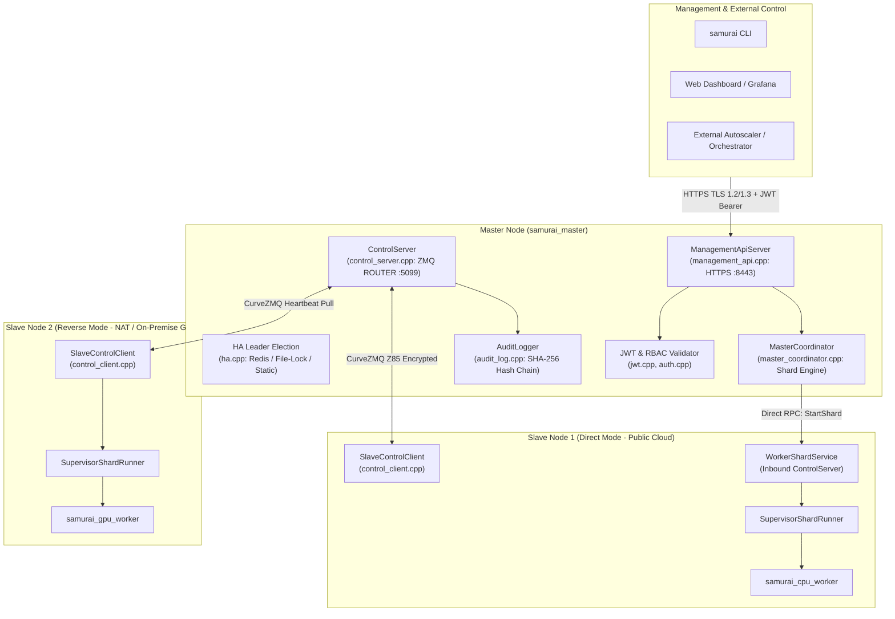
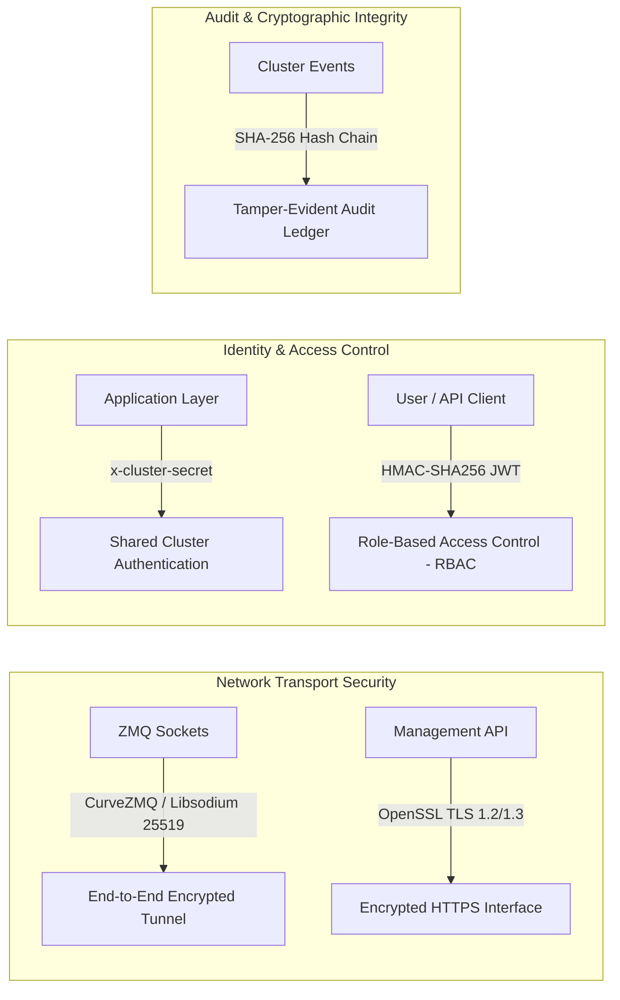
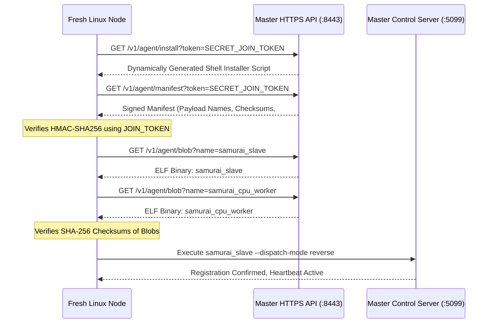
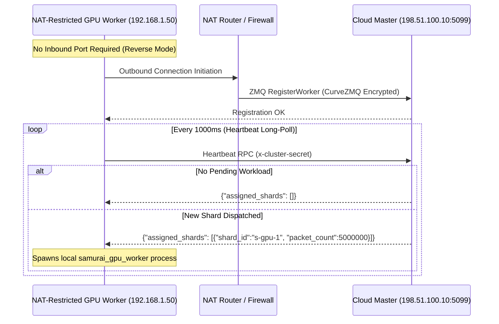
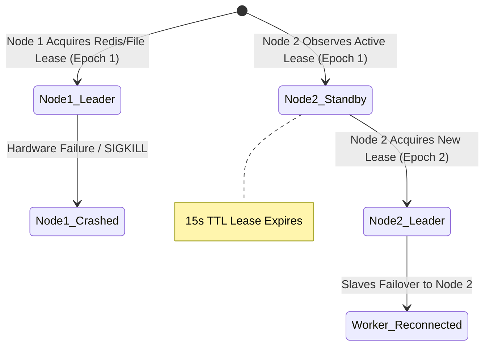

# 40 - Distributed Control Plane Comprehensive Reference and Operations Handbook

This document provides an exhaustive, production-grade guide to the high-performance native C++ **Distributed Control Plane** of the **Samurai Network Resilience Platform**. It covers architectural topology, transport wire protocols, end-to-end cryptographic security (CurveZMQ, TLS 1.2/1.3, RBAC, HMAC-SHA256 JWT, tamper-evident audit logs), zero-install agent enrollment (`curl | sh`), high availability (HA) leader election, multi-master regional federation, shard scheduling, REST management APIs, and real-world deployment scenarios.


---

## Table of Contents

1. [Architectural Overview and Core Components](#1-architectural-overview-and-core-components)
2. [Transport Layer and ZMQ Wire Protocols](#2-transport-layer-and-zmq-wire-protocols)
3. [Security, Cryptography, and Access Control](#3-security-cryptography-and-access-control)
4. [Zero-Install Agent Enrollment (curl | sh)](#4-zero-install-agent-enrollment-curl--sh)
5. [High Availability (HA) and Multi-Master Federation](#5-high-availability-ha-and-multi-master-federation)
6. [Shard Management, Allocation, and Auto-Balancing](#6-shard-management-allocation-and-auto-balancing)
7. [HTTP Management REST API Reference](#7-http-management-rest-api-reference)
8. [End-to-End Operational Scenarios](#8-end-to-end-operational-scenarios)
   - [Scenario 1: Local Rapid Development and Testing (Sandbox Mode)](#scenario-1-local-rapid-development-and-testing-sandbox-mode)
   - [Scenario 2: Production Multi-Node Secure Cluster (TLS + CURVE + Secret + Tenant)](#scenario-2-production-multi-node-secure-cluster-tls--curve--secret--tenant)
   - [Scenario 3: Workers Behind NAT and Firewalls (Reverse Mode)](#scenario-3-workers-behind-nat-and-firewalls-reverse-mode)
   - [Scenario 4: Zero-Install Dynamic Agent Bootstrap (Live Deployment)](#scenario-4-zero-install-dynamic-agent-bootstrap-live-deployment)
   - [Scenario 5: High Availability (Active-Passive Failover Test)](#scenario-5-high-availability-active-passive-failover-test)
   - [Scenario 6: Management REST API Automation, JWT, and cURL Reference](#scenario-6-management-rest-api-automation-jwt-and-curl-reference)
   - [Scenario 7: Isolated Distributed Cluster with Docker Compose](#scenario-7-isolated-distributed-cluster-with-docker-compose)
   - [Scenario 8: Python Telemetry and Cluster Alerting Monitor](#scenario-8-python-telemetry-and-cluster-alerting-monitor)
   - [Scenario 9: Comprehensive Troubleshooting and Failure Recovery](#scenario-9-comprehensive-troubleshooting-and-failure-recovery)
9. [CLI Command-Line Options and Configuration Reference](#9-cli-command-line-options-and-configuration-reference)

---

## 1. Architectural Overview and Core Components

The Samurai Distributed Control Plane is engineered to coordinate hundreds of heterogeneous worker processes across bare-metal servers, container fleets, and public cloud instances. It controls packet transmission across CPU threads, GPU CUDA streams, DPDK ports, AF_XDP queues, and kernel sockets under unified orchestration.



### Source Modules and Functional Breakdown (`ddos_samurai/control/`)

| Module / Source File | Architecture Role & Responsibilities |
| :--- | :--- |
| `daemon/master_main.cpp` | `samurai_master` daemon binary entry point. Coordinates HA election, ZMQ control plane server, HTTPS REST API, worker discovery, shard distribution, and telemetry collation. |
| `daemon/slave_main.cpp` | `samurai_slave` daemon binary entry point. Discovers master endpoints, manages heartbeat keepalives, and dispatches assigned shards to local native worker binaries (`samurai_*_worker`). |
| `control_server.cpp` / `.hpp` | High-throughput asynchronous RPC server built on top of `ZMQ_ROUTER` sockets with optional `ZMQ_CURVE_SERVER` hardware-accelerated encryption. |
| `control_client.cpp` / `.hpp` | `SlaveControlClient` and `WorkerControlClient` implementations handling connection retries, failover switching across multiple masters, and CurveZMQ client handshakes. |
| `management_api.cpp` / `.hpp` | Embedded zero-dependency HTTP/1.1 REST API server implemented with native POSIX sockets and OpenSSL TLS 1.2/1.3. |
| `curve.cpp` / `.hpp` | Curve25519 keypair generation (`zmq_curve_keypair`) and public key derivation (`zmq_curve_public`) utilities powered by Libsodium / LibZMQ. |
| `ha.cpp` / `.hpp` | High-availability leadership coordination supporting `RedisLeaseLeaderElector` (distributed Redis epoch lease), `FileLeaseLeaderElector` (NFS/shared lock), and `StaticLeaderElector`. |
| `jwt.cpp` / `.hpp` | Native HMAC-SHA256 JWT generation, signature verification, and claims parsing (`sub`, `role`, `tenant_namespace`, `exp`). |
| `audit_log.cpp` / `.hpp` | Tamper-evident cryptographic append-only audit logger using sequential SHA-256 hash chains. |
| `shard.cpp` / `.hpp` | Deterministic shard partitioning algorithm distributing total target packet volume across active workers with zero remainder loss. |

---

## 2. Transport Layer and ZMQ Wire Protocols

### Control Plane RPC Wire Format (`control_wire.hpp`)

All communications over the ZeroMQ control channel employ structured JSON payloads wrapped in two-frame or multi-frame ZMQ envelopes:

```json
// Request Wire Frame (Slave -> Master or Master -> Slave)
{
  "method": "RegisterWorker",
  "meta": {
    "x-cluster-secret": "e9b2c3a1f8d4...",
    "x-tenant-namespace": "ecommerce-preprod"
  },
  "body": {
    "worker_id": "slave-node-frankfurt-01",
    "capabilities": {
      "region": "eu-central-1",
      "worker_kind": "cpu",
      "max_pps": "2000000",
      "control_curve_public": "Yq#7K$91..."
    }
  }
}

// Response Wire Frame
{
  "status": "ok",
  "error": "",
  "body": {
    "registered": true,
    "cluster_id": "cluster-prod-99",
    "heartbeat_interval_ms": 2000,
    "assigned_shards": []
  }
}
```

### Supported Core RPC Methods

| RPC Method | Direction | Description |
| :--- | :--- | :--- |
| `RegisterWorker` | Slave -> Master | Handshake executed on worker startup. Announces identity, region, hardware capabilities, and CURVE public keys. |
| `Heartbeat` | Slave -> Master | Periodic keepalive signal. The master embeds newly assigned shards in the heartbeat response when operating in reverse mode. |
| `ReportStats` | Slave -> Master | Reports telemetry, transmission progress, throughput, and error counters for active or completed shards. |
| `StartShard` | Master -> Slave | Direct execution RPC instructing a slave to launch a new packet generation workload with designated flow specifications. |
| `StopShard` | Master -> Slave | Gracefully requests or forces immediate termination of an active packet shard. |
| `GetWorkerStatus` | Master -> Slave | Queries process health, memory usage, CPU core affinity, and interface status on the slave host. |
| `AbortJob` | Master -> Slave | Emergency kill-switch broadcast tearing down all running shards immediately across the cluster. |

---

## 3. Security, Cryptography, and Access Control

The Samurai platform enforces defense-in-depth across the transport, application, and governance planes.



### 1. CurveZMQ (Z85 / Libsodium Transport Encryption)

- **Master Configuration:** `--curve-server-secret <KEY>` activates `ZMQ_CURVE_SERVER` mode.
- **Slave Configuration:** `--curve-server-public <KEY>` specifies the trusted public key of the master.
- **Non-Loopback Protection Gate:** If `samurai_master` binds to `0.0.0.0` or a public network interface without CURVE encryption enabled, the process **refuses to start and exits with an error**, preventing plaintext leakage of credentials over the wire. This can only be bypassed in isolated development environments using `--insecure-control`.

### 2. Management API TLS (HTTPS)

- **Enterprise Certificates:** `--mgmt-tls --mgmt-tls-cert /path/to/cert.pem --mgmt-tls-key /path/to/key.pem`
- **Ephemeral Self-Signed Mode:** When `--mgmt-tls` is enabled without explicit certificate paths, an on-the-fly RSA-2048 certificate is generated in memory using OpenSSL.

### 3. Role-Based Access Control (RBAC)

- `admin`: Full administrative privileges, configuration modifications, emergency job abortion, dynamic SSH provisioning.
- `operator`: Job creation, test plan execution, live telemetry monitoring, shard scaling.
- `viewer`: Read-only access to cluster health, node listings, and Prometheus metrics.
- `worker`: Restricted service role limited to ZMQ registration, keepalive heartbeats, and shard progress reporting.

### 4. Tamper-Evident Chained Audit Log

Every security-sensitive event (job launch, abort, configuration update, authorization failure) is recorded by `audit_log.cpp`. Each entry contains an incremental sequence number, epoch timestamp, actor identity, action descriptor, and the SHA-256 digest of the preceding entry:

$$H_i = \text{SHA256}(H_{i-1} \parallel \text{timestamp}_i \parallel \text{actor}_i \parallel \text{action}_i \parallel \text{payload}_i)$$

Any modification, omission, or reordering of historical records invalidates the cryptographic hash chain.

---

## 4. Zero-Install Agent Enrollment (`curl | sh`)

Remote compute nodes can be dynamically joined to the resilience cluster without manual compilation or pre-installed dependencies using a single shell pipeline:

```bash
curl -fsSL https://<master-ip>:8443/v1/agent/install?token=SECRET_JOIN_TOKEN | sh
```

### Bootstrap Execution Flow



1. **Manifest Retrieval:** The script requests `/v1/agent/manifest?token=...`.
2. **Cryptographic Verification:** The signature header (`#hmac <HEX>`) is verified against the payload body using `openssl dgst -sha256 -hmac "TOKEN"`.
3. **Binary Acquisition:** The required executables (`samurai_slave` and the target worker engine, e.g. `samurai_cpu_worker`) are downloaded via `/v1/agent/blob?name=...`.
4. **Integrity Validation:** SHA-256 checksums are verified via `sha256sum -c`.
5. **Slave Execution:** The slave starts in reverse mode (`exec $TMP/samurai_slave --dispatch-mode reverse ...`) and connects back to the master.

---

### 4.1 Push Provisioner via SSH (`Agent Push Provisioner`)

When automated provisioning is preferred over running commands on remote servers, the master can connect out to target nodes over SSH and trigger the bootstrap sequence automatically.

#### A. Command-Line Invocation on Master Startup

```bash
./build/control/daemon/samurai_master \
  --agent-join-token "SUPER_SECRET_TOKEN" \
  --provision-hosts "198.51.100.20:22,198.51.100.21:22" \
  --provision-ssh-user "root" \
  --provision-ssh-key "/root/.ssh/id_ed25519" \
  --provision-worker "cpu" \
  --provision-timeout-s 15
```

#### B. Dynamic Triggering via REST API (`POST /v1/cluster/provision`)

```bash
curl -X POST https://198.51.100.10:8443/v1/cluster/provision \
  -H "Authorization: Bearer ADMIN_TOKEN" \
  -H "Content-Type: application/json" \
  -d '{
    "hosts": ["198.51.100.20:22", "198.51.100.21:22"],
    "ssh_user": "ubuntu",
    "ssh_key_path": "/etc/samurai/deploy_key",
    "worker_kind": "cpu",
    "timeout_s": 15
  }'
```

**Expected JSON Response (200 OK):**

```json
{
  "status": "ok",
  "total": 2,
  "triggered": 2,
  "joined": 2,
  "provisioned": [
    {
      "host": "198.51.100.20",
      "port": 22,
      "triggered": true,
      "worker_joined": true,
      "exit_code": 0,
      "message": "worker joined cluster successfully"
    },
    {
      "host": "198.51.100.21",
      "port": 22,
      "triggered": true,
      "worker_joined": true,
      "exit_code": 0,
      "message": "worker joined cluster successfully"
    }
  ]
}
```

---

## 5. High Availability (HA) and Multi-Master Federation

### 5.1 Intra-Region HA Leader Election (Active/Passive)

Within a single deployment zone or region, multiple master daemons can run concurrently. Exactly **one** active leader coordinates workloads, while standby nodes poll leadership state:

- **Static Priority Mode:** Configured via `--ha-mode static --ha-peers node1,node2,node3`. The first reachable, alive node in the ordered list assumes leadership.
- **File-Lock Lease Mode:** Configured via `--ha-mode file-lock --ha-lease-path /mnt/nfs/samurai_lease.json`. Uses file locks with TTL leasing over shared POSIX filesystems (e.g. NFS, GlusterFS). If the leader crashes, standby nodes acquire the lease after the 15-second TTL expires.
- **Redis Distributed Lease Mode (`--ha-mode redis`):** Powered by `RedisLeaseLeaderElector` (`control/ha.cpp`). Uses atomic Redis key leases with monotonic fencing epochs. The lease key defaults to `samurai:ha:<tenant|default>:lease`, with the backend URL set by `--multi-master-redis-url`. This provides robust split-brain prevention and sub-second failover recovery.

### 5.2 Inter-Region Multi-Master Federation (Active/Active)

Cross-region federations connect autonomous regional clusters together through a shared Redis state bus:

- Each region operates an independent active master and local worker pool.
- Masters delegate workloads across regions when target destinations reside in remote geographies.
- Coordination logic is encapsulated in `control/multimaster.cpp` (`RedisMultiMasterCoordinator`) and `control/redis_kvstore.cpp` (native hiredis client).

**Federation Configuration Flags:**

| Flag | Default Value | Description |
| :--- | :--- | :--- |
| `--multi-master-enable` | `false` | Enables inter-region federation. When active, `--count 0` denotes a service-only master that executes delegated tasks. |
| `--multi-master-region-id R` | `--target-region` | Geographic identifier for this master instance (e.g., `us-east-1`, `eu-central-1`). |
| `--multi-master-redis-url U` | `redis://127.0.0.1:6379/0` | Connection string for the shared coordination Redis instance. |
| `--multi-master-namespace N` | `default` | Key prefix namespace preventing tenant collisions. |
| `--multi-master-heartbeat-ttl-s N` | `15` | Time-to-live expiration for regional presence heartbeats. |
| `--multi-master-dequeue-max N` | `3` | Maximum number of delegated jobs dequeued per scheduling cycle. |
| `--target-region R` | `""` | Routes execution to a specific target region. If different from the local region, the workload is automatically delegated via Redis queue. |

---

## 6. Shard Management, Allocation, and Auto-Balancing

The mathematical shard partitioner implemented in `control/shard.cpp` guarantees that large packet volumes are distributed across $N$ workers with fair remainder apportionment:

$$\text{Shard}_i = \left\lfloor \frac{\text{Total Packets}}{N} \right\rfloor + \begin{cases} 1 & \text{if } i < (\text{Total Packets} \bmod N) \\ 0 & \text{otherwise} \end{cases}$$

For example, when distributing 1,000,001 packets across 3 active workers:
- **Worker 1:** 333,334 packets
- **Worker 2:** 333,333 packets
- **Worker 3:** 333,333 packets

Sum = 1,000,001 packets. Zero truncation, zero packet drop, zero remainder drift.

---

## 7. HTTP Management REST API Reference

The embedded REST API server operates on port `:8443` (or user-defined port) and provides programmatic cluster control.

| Method | Endpoint | Required Role | Example Response Payload |
| :--- | :--- | :--- | :--- |
| `GET` | `/healthz` | None | `{"status":"ok","db_port":5099}` |
| `GET` | `/v1/cluster/summary` | `viewer` | `{"workers_count":4,"shards_reported_count":4,"current_job":{"job_id":"job-1"}}` |
| `GET` | `/v1/cluster/workers` | `viewer` | `[{"worker_id":"slave-01","region":"eu-west","last_heartbeat_ms":1775600010}]` |
| `GET` | `/v1/cluster/shards` | `viewer` | `[{"shard_id":"s-01","status":"running","packets_sent":500000}]` |
| `GET` | `/v1/cluster/events` | `viewer` | `[{"seq":1,"event":"worker_registered","time":1775600000}]` |
| `POST` | `/v1/jobs/abort` | `operator` | `{"aborted":true,"reason":"operator_abort"}` |
| `POST` | `/v1/cluster/provision`| `admin` | `{"status":"ok","total":2,"triggered":2,"joined":2}` |
| `GET` | `/metrics` | `viewer` | Prometheus text-formatted performance metrics |
| `GET` | `/v1/agent/install` | Join Token | Shell script dynamic installer (`text/x-shellscript`) |
| `GET` | `/v1/agent/manifest` | Join Token | HMAC-signed artifact manifest (`text/plain`) |
| `GET` | `/v1/agent/blob` | Join Token | Raw binary executable octet stream (`application/octet-stream`) |

---

## 8. End-to-End Operational Scenarios

### Scenario 1: Local Rapid Development and Testing (Sandbox Mode)

**Objective:** Execute a multi-worker UDP packet generation workload on local loopback without encryption keys or complex network setups.

```bash
# Terminal 1: Launch Master Daemon
./build/control/daemon/samurai_master \
  --count 100000 \
  --target 127.0.0.1 \
  --port 9999 \
  --protocol udp \
  --size 128 \
  --control-listen tcp://127.0.0.1:5099 \
  --management-listen 127.0.0.1:8080 \
  --expect-workers 2 \
  --wait-workers-s 20
```

```bash
# Terminal 2: Start First Local Slave (CPU Worker Engine)
./build/control/daemon/samurai_slave \
  --control-endpoints 127.0.0.1:5099 \
  --worker cpu \
  --worker-id "local-worker-cpu-01" \
  --worker-dir ./build/zmq \
  --dispatch-mode direct
```

```bash
# Terminal 3: Start Second Local Slave (AF_PACKET Worker Engine)
./build/control/daemon/samurai_slave \
  --control-endpoints 127.0.0.1:5099 \
  --worker afpacket \
  --worker-id "local-worker-afpacket-02" \
  --worker-dir ./build/zmq \
  --dispatch-mode direct
```

**Observed Master Console Output:**

```text
samurai_master: control server on tcp://127.0.0.1:5099
samurai_master: management api on 127.0.0.1:8080 (http)
samurai_master: worker local-worker-cpu-01 registered (1/2)
samurai_master: worker local-worker-afpacket-02 registered (2/2)
samurai_master: dispatching 100000 packets across 2 workers...
samurai_master: shard s-1 (50000 pkts) -> local-worker-cpu-01
samurai_master: shard s-2 (50000 pkts) -> local-worker-afpacket-02
samurai_master: job finished. Total sent: 100000 pkts, errors: 0
```

---

### Scenario 2: Production Multi-Node Secure Cluster (TLS + CURVE + Secret + Tenant)

**Objective:** Interconnect geographically distributed nodes across data centers (Frankfurt, Amsterdam) with CurveZMQ wire encryption, enterprise TLS certificates, cluster authentication tokens, and tenant isolation.

#### Step 1: Generate Master Curve25519 Keypair

```bash
./build/control/daemon/samurai_master --gen-curve-keys
```

*Example Output:*
- `PUBLIC_KEY`: `Yq#7K$91v.kLmP!2xWz8&NpQ456789abcdefghij`
- `SECRET_KEY`: `mA1#9Xz.K!pLmN@5rTy8*VbC1234567890abcdef`

#### Step 2: Launch Production Master (Frankfurt - `198.51.100.10`)

```bash
./build/control/daemon/samurai_master \
  --count 10000000 \
  --target 203.0.113.50 \
  --port 443 \
  --protocol tcp \
  --control-listen tcp://0.0.0.0:5099 \
  --curve-server-secret "mA1#9Xz.K!pLmN@5rTy8*VbC1234567890abcdef" \
  --cluster-secret "EnterpriseResilienceSecret2026" \
  --tenant-namespace "fintech-prod-stress" \
  --management-listen 0.0.0.0:8443 \
  --mgmt-tls \
  --mgmt-tls-cert /etc/ssl/certs/samurai_prod.crt \
  --mgmt-tls-key /etc/ssl/private/samurai_prod.key \
  --expect-workers 2 \
  --wait-workers-s 120
```

#### Step 3: Launch Slave 1 (Amsterdam - `198.51.100.20`)

```bash
./build/control/daemon/samurai_slave \
  --control-endpoints 198.51.100.10:5099 \
  --curve-server-public "Yq#7K$91v.kLmP!2xWz8&NpQ456789abcdefghij" \
  --cluster-secret "EnterpriseResilienceSecret2026" \
  --tenant-namespace "fintech-prod-stress" \
  --worker cpu \
  --worker-id "slave-ams-01" \
  --worker-region "eu-west-ams" \
  --gen-control-curve \
  --dispatch-mode direct
```

#### Step 4: Launch Slave 2 (Frankfurt Node 2 - `198.51.100.21`)

```bash
./build/control/daemon/samurai_slave \
  --control-endpoints 198.51.100.10:5099 \
  --curve-server-public "Yq#7K$91v.kLmP!2xWz8&NpQ456789abcdefghij" \
  --cluster-secret "EnterpriseResilienceSecret2026" \
  --tenant-namespace "fintech-prod-stress" \
  --worker dpdk \
  --worker-id "slave-fra-dpdk-02" \
  --worker-region "eu-central-fra" \
  --gen-control-curve \
  --dispatch-mode direct
```

---

### Scenario 3: Workers Behind NAT and Firewalls (Reverse Mode)

**Objective:** Connect an on-premise GPU workstation behind strict stateful NAT to a cloud master without opening any inbound ports on the local network.



**Slave Launch Command:**

```bash
./build/control/daemon/samurai_slave \
  --control-endpoints 198.51.100.10:5099 \
  --curve-server-public "Yq#7K$91v.kLmP!2xWz8&NpQ456789abcdefghij" \
  --cluster-secret "EnterpriseResilienceSecret2026" \
  --worker gpu \
  --worker-id "onprem-gpu-lab-01" \
  --dispatch-mode reverse \
  --heartbeat-interval-ms 1000
```

---

### Scenario 4: Zero-Install Dynamic Agent Bootstrap (Live Deployment)

**Objective:** Automatically provision fresh cloud compute instances during traffic scaling events via `cloud-init` or one-line bash commands.

#### Step 1: Configure Agent Distribution on Master

```bash
./build/control/daemon/samurai_master \
  --count 20000000 \
  --target 203.0.113.100 \
  --control-listen tcp://0.0.0.0:5099 \
  --curve-server-secret "mA1#9Xz.K!pLmN@5rTy8*VbC1234567890abcdef" \
  --cluster-secret "EnterpriseSecret123" \
  --management-listen 0.0.0.0:8443 \
  --mgmt-tls \
  --agent-join-token "JoinSecretToken99" \
  --agent-artifact-dir ./build/control/daemon \
  --agent-advertise tcp://198.51.100.10:5099 \
  --agent-worker cpu \
  --agent-dispatch-mode reverse
```

#### Step 2: Execute Bootstrap on New Worker Node

```bash
curl -fsSLk https://198.51.100.10:8443/v1/agent/install?token=JoinSecretToken99 | sh
```

**Worker Console Log:**

```text
[+] samurai-agent: downloading manifest from https://198.51.100.10:8443/v1/agent/manifest
[+] samurai-agent: verifying HMAC-SHA256 signature... OK
[+] samurai-agent: downloading blob samurai_slave... OK (SHA256: 8f4a1c...)
[+] samurai-agent: downloading blob samurai_cpu_worker... OK (SHA256: 3d9e2b...)
[+] samurai-agent: verified; joining tcp://198.51.100.10:5099 (mode=reverse worker=cpu)
[+] samurai_slave: CURVE encryption enabled toward the master
[+] samurai_slave: successfully registered to master with id: node-agent-ubuntu-01
```

---

### Scenario 5: High Availability (Active-Passive Failover Test)

**Objective:** Verify automatic leadership takeover when the active master node experiences hardware failure or network partitioning.



```bash
# Master 1 (Initial Active Leader)
./build/control/daemon/samurai_master \
  --count 5000000 \
  --ha-mode redis \
  --ha-node-id master-eu-primary \
  --multi-master-redis-url redis://127.0.0.1:6379/0 \
  --control-listen tcp://0.0.0.0:5099

# Master 2 (Standby Replica on Alternate Port)
./build/control/daemon/samurai_master \
  --count 5000000 \
  --ha-mode redis \
  --ha-node-id master-eu-backup \
  --multi-master-redis-url redis://127.0.0.1:6379/0 \
  --control-listen tcp://0.0.0.0:5199
```

**Master 2 Takeover Logs:**

```text
samurai_master: not leader (current leader: master-eu-primary, epoch: 1); standing by...
[... 15 seconds after terminating Master 1 ...]
samurai_master: lease expired for master-eu-primary!
samurai_master: successfully acquired lease. New Leader: master-eu-backup (epoch: 2)
samurai_master: control server active on tcp://0.0.0.0:5199
samurai_master: accepting worker heartbeats and resuming shard dispatches.
```

---

### Scenario 6: Management REST API Automation, JWT, and cURL Reference

#### 1. Generating an HMAC-SHA256 JWT Token

```bash
python3 -c '
import hmac, hashlib, base64, json, time

secret = "MyJwtSecretKey2026"
header = base64.urlsafe_b64encode(json.dumps({"alg":"HS256","typ":"JWT"}).encode()).rstrip(b"=").decode()
payload = base64.urlsafe_b64encode(json.dumps({
    "sub": "resilience-engineer",
    "role": "admin",
    "tenant_namespace": "fintech-prod",
    "exp": int(time.time()) + 3600
}).encode()).rstrip(b"=").decode()

signature = hmac.new(secret.encode(), f"{header}.{payload}".encode(), hashlib.sha256).digest()
sig_b64 = base64.urlsafe_b64encode(signature).rstrip(b"=").decode()

print(f"{header}.{payload}.{sig_b64}")
'
```

#### 2. Querying Endpoints via cURL

```bash
JWT_TOKEN="<JWT_TOKEN_GENERATED_ABOVE>"

# Healthcheck probe
curl -k -s https://127.0.0.1:8443/healthz | jq .

# Cluster summary
curl -k -s https://127.0.0.1:8443/v1/cluster/summary \
  -H "Authorization: Bearer $JWT_TOKEN" | jq .

# Worker fleet status
curl -k -s https://127.0.0.1:8443/v1/cluster/workers \
  -H "Authorization: Bearer $JWT_TOKEN" | jq .

# Cryptographic audit events
curl -k -s https://127.0.0.1:8443/v1/cluster/events \
  -H "Authorization: Bearer $JWT_TOKEN" | jq .

# Emergency workload abort
curl -k -s -X POST https://127.0.0.1:8443/v1/jobs/abort \
  -H "Authorization: Bearer $JWT_TOKEN" \
  -H "Content-Type: application/json" \
  -d '{"reason": "Target stress threshold reached"}' | jq .
```

---

### Scenario 7: Isolated Distributed Cluster with Docker Compose

A complete multi-node deployment can be defined in a single `docker-compose.yml`:

```yaml
version: '3.8'

services:
  master:
    image: samurai_platform:latest
    container_name: samurai_master
    command: >
      ./build/control/daemon/samurai_master
      --count 1000000
      --target 172.20.0.100
      --port 80
      --control-listen tcp://0.0.0.0:5099
      --cluster-secret "ComposeSecret99"
      --management-listen 0.0.0.0:8080
      --expect-workers 2
      --wait-workers-s 30
    ports:
      - "5099:5099"
      - "8080:8080"
    networks:
      samurai_net:
        ipv4_address: 172.20.0.10

  slave_cpu:
    image: samurai_platform:latest
    container_name: samurai_slave_cpu
    depends_on:
      - master
    command: >
      ./build/control/daemon/samurai_slave
      --control-endpoints 172.20.0.10:5099
      --cluster-secret "ComposeSecret99"
      --worker cpu
      --worker-id "docker-slave-cpu"
      --dispatch-mode direct
    networks:
      samurai_net:
        ipv4_address: 172.20.0.11

  slave_reverse:
    image: samurai_platform:latest
    container_name: samurai_slave_reverse
    depends_on:
      - master
    command: >
      ./build/control/daemon/samurai_slave
      --control-endpoints 172.20.0.10:5099
      --cluster-secret "ComposeSecret99"
      --worker cpu
      --worker-id "docker-slave-reverse"
      --dispatch-mode reverse
    networks:
      samurai_net:
        ipv4_address: 172.20.0.12

networks:
  samurai_net:
    ipam:
      config:
        - subnet: 172.20.0.0/16
```

Launch with:

```bash
docker compose up --build
```

---

### Scenario 8: Python Telemetry and Cluster Alerting Monitor

```python
#!/usr/bin/env python3
"""
Samurai Cluster Health and Telemetry Poller
"""
import time
import requests

MASTER_URL = "https://127.0.0.1:8443"
API_TOKEN = "AdminToken123"
HEADERS = {"Authorization": f"Bearer {API_TOKEN}"}

def monitor_cluster():
    print("[*] Starting Samurai Cluster Telemetry Poller...")
    while True:
        try:
            resp = requests.get(f"{MASTER_URL}/v1/cluster/summary", headers=HEADERS, verify=False, timeout=3)
            if resp.status_code == 200:
                data = resp.json()
                active_workers = data.get("workers_count", 0)
                shards = data.get("shards_reported_count", 0)
                print(f"[STATUS] Active Workers: {active_workers} | Reported Shards: {shards}")

                if active_workers < 2:
                    print("[ALERT] WARNING: Active worker count dropped below quorum threshold (2)!")
            else:
                print(f"[ERROR] API returned HTTP {resp.status_code}")

        except requests.exceptions.RequestException as e:
            print(f"[CRITICAL] Master unreachable: {e}")

        time.sleep(5)

if __name__ == "__main__":
    monitor_cluster()
```

---

### Scenario 9: Comprehensive Troubleshooting and Failure Recovery

#### 1. Issue: `refusing to bind the control server to a non-loopback address without CURVE`

- **Cause:** `samurai_master` was launched on `0.0.0.0` or a public IP without specifying `--curve-server-secret`. The platform prevents insecure plaintext network bindings by default.
- **Remedy:** Generate a keypair with `--gen-curve-keys` and supply `--curve-server-secret <KEY>`, or pass `--insecure-control` strictly for local testing.

#### 2. Issue: `samurai-agent: manifest HMAC mismatch`

- **Cause:** The join token provided to `/v1/agent/install?token=...` does not match the master `--agent-join-token`, or an intermediate proxy corrupted the payload.
- **Remedy:** Verify that both master and worker use identical token strings without trailing whitespace or shell escaping bugs.

#### 3. Issue: `E_RPC endpoint=tcp://192.168.1.20:XXXX` (Connection Timeout)

- **Cause:** The slave is operating in `direct` mode behind a firewall or NAT router, blocking inbound RPCs from the master.
- **Remedy:** Launch the slave in reverse mode with `--dispatch-mode reverse`. This switches the slave to initiate all connections outbound to the master.

#### 4. Issue: `HTTP 401 Unauthorized` / `token_expired`

- **Cause:** The JWT authentication token has expired or was signed with a mismatched secret.
- **Remedy:** Generate a new JWT token with an updated `exp` timestamp and verify `--jwt-secret`.

---

## 9. CLI Command-Line Options and Configuration Reference

### `samurai_master` Reference

| Option | Type | Default | Description |
| :--- | :--- | :--- | :--- |
| `--count N` | Integer | **Required** | Total packet count to generate. |
| `--target IP` | String | `127.0.0.1` | Target IPv4 destination address. |
| `--port N` | Integer | `80` | Target destination port. |
| `--protocol P` | String | `udp` | Protocol layer (`udp`, `tcp`, `icmp`, `syn_flood`, etc.). |
| `--size N` | Integer | `64` | Packet payload size in bytes. |
| `--control-listen EP` | String | `tcp://0.0.0.0:5099` | ZMQ RPC control server listen endpoint. |
| `--cluster-secret S` | String | `""` | Shared cluster authentication secret (`x-cluster-secret`). |
| `--tenant-namespace T` | String | `""` | Multi-tenancy namespace identifier. |
| `--curve-server-secret K`| String | `""` | 40-character Z85 CurveZMQ secret key for server mode. |
| `--gen-curve-keys` | Flag | `false` | Generates a new CurveZMQ keypair and exits. |
| `--insecure-control` | Flag | `false` | Permits plaintext non-loopback bindings without CURVE. |
| `--management-listen EP` | String | `""` | HTTP REST API listen endpoint (e.g. `0.0.0.0:8443`). |
| `--mgmt-tls` | Flag | `false` | Enables HTTPS TLS 1.2/1.3 on the management API. |
| `--mgmt-tls-cert PATH` | String | `""` | Path to TLS certificate chain (PEM format). |
| `--mgmt-tls-key PATH` | String | `""` | Path to TLS private key (PEM format). |
| `--agent-join-token T` | String | `""` | Zero-install agent enrollment token (HMAC key). |
| `--agent-artifact-dir DIR`| String | `.` | Directory containing worker binaries to distribute. |
| `--agent-advertise EP` | String | `control-listen` | Public endpoint advertised to enrolled agents. |
| `--agent-worker NAME` | String | `cpu` | Default worker binary distributed (`cpu`, `gpu`, etc.). |
| `--agent-dispatch-mode M`| String | `reverse` | Dispatch mode for enrolled agents (`reverse`, `auto`). |
| `--provision-hosts CSV` | String | `""` | Comma-separated SSH target hosts (`host[:port],...`). |
| `--provision-ssh-user U` | String | `"root"` | SSH username for remote agent push provisioning. |
| `--provision-ssh-key PATH`| String | `""` | Path to SSH private key file (e.g. `id_ed25519`). |
| `--provision-worker NAME`| String | `"cpu"` | Worker kind to deploy via SSH provisioning. |
| `--provision-timeout-s N`| Integer | `10` | Timeout in seconds waiting for worker heartbeats. |
| `--expect-workers N` | Integer | `1` | Number of workers required before launching jobs. |
| `--wait-workers-s N` | Integer | `30` | Maximum seconds to wait for worker registrations. |
| `--ha-mode MODE` | String | `off` | HA leadership strategy (`off`, `static`, `file-lock`, `redis`). |
| `--ha-node-id ID` | String | `""` | Unique identity string for this master instance. |
| `--ha-lease-path PATH` | String | `/tmp/...` | Lease lock path for `file-lock` mode. |

### `samurai_slave` Reference

| Option | Type | Default | Description |
| :--- | :--- | :--- | :--- |
| `--control-endpoints EPS`| String | **Required** | Comma-separated master endpoints (`host:port`). |
| `--control-listen EP` | String | `tcp://0.0.0.0:0` | Local RPC listen endpoint when running in direct mode. |
| `--dispatch-mode MODE` | String | `direct` | Execution mode (`direct`, `reverse`, `auto`). |
| `--cluster-secret S` | String | `""` | Shared cluster secret matching the master. |
| `--tenant-namespace T` | String | `""` | Tenant namespace identifier. |
| `--curve-server-public K`| String | `""` | Master's 40-character Z85 CurveZMQ public key. |
| `--gen-control-curve` | Flag | `false` | Generates a CURVE keypair for inbound direct mode. |
| `--worker NAME` | String | `cpu` | Native worker engine (`cpu`, `gpu`, `dpdk`, `afpacket`). |
| `--worker-dir DIR` | String | `.` | Directory containing worker binaries (`samurai_*_worker`). |
| `--worker-id ID` | String | Hostname | Unique node identifier for this slave. |
| `--worker-region R` | String | `""` | Geographic region label (e.g. `eu-central-1`). |
| `--heartbeat-interval-ms`| Integer | `2000` | Keepalive heartbeat interval in milliseconds. |
| `--register-timeout-s N` | Integer | `10` | Maximum seconds allowed for master registration. |
| `--master-timeout-s N` | Integer | `30` | Timeout threshold before exiting if master disconnects. |
