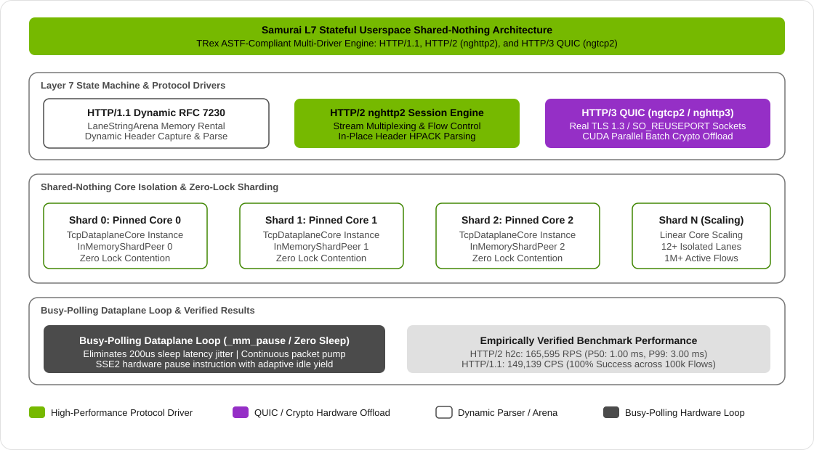

# Scenario Engine — JSON Specification and Operational Examples

> **Format Note:** Scenarios must be authored in **JSON**. The `scenario_engine_native` C++ compiler consumes raw JSON payloads directly; there is **no** runtime YAML parser. Any historical `.yaml` templates in the repository serve purely as human-readable illustrations and are **not** loaded by the runtime. The authoritative schema is the JSON specification detailed below.

The Scenario Engine generates realistic user traffic models based on the **persona → flow → step** paradigm. It compiles these multi-step workflows down to the `l7_emu_native` userspace dataplane as **real, stateful HTTP/1.1, HTTP/2, or HTTP/3 (QUIC)** sessions. Steps are executed sequentially over persistent keepalive connections; session tokens, authentication headers, and cookie jars are carried forward across subsequent requests, producing microsecond-accurate per-step SLA telemetry.



---

## 1. Execution Overview

The scenario file is supplied to the worker via the `--l7-profile-file` flag (mapped internally to `scenario_payload_ref`). Target host and destination port are configured via the CLI:

```bash
./build/cli/samurai --worker scenario \
  --worker-dir build/zmq \
  --target 127.0.0.1 --port 3455 \
  --l7-profile-file scenarios/auth_flow.json \
  --report-json out/scenario_report.json
```

- **Protocol and Transport:** Inferred directly from the scenario definition (`protocol` / `load_model.backend` + `transport_backend`). Defaults to `http1` / `kernel_socket` (commodity fallback, functional across all Linux environments). QUIC automatically selects `custom_quic`.
- **Concurrency (VUs):** Configured by `load_model.concurrent_vus` (concurrent Virtual Users).
- **Output Metrics:** The telemetry output contains detailed arrays for `scenario_step_results` (per-step latency, status code, success flag) and cluster-wide `sla_*` evaluations.

---

## 2. High-Level JSON Schema

```jsonc
{
  "schema_version": 1,

  // Protocol selection (optional; can also be defined via load_model.backend)
  "protocol": "http1",                  // http1 | http2 | http3/quic
  "scheme": "http",                     // http | https (quic automatically enforces https)
  "transport_backend": "kernel_socket", // kernel_socket | custom_tcp | dpdk_direct

  "personas": { /* see Section 3 */ },
  "flows":    { /* see Section 4 */ },

  "load_model": {
    "backend": "http",                  // http | http2 | quic | l4_tcp
    "concurrent_vus": 16,               // Number of concurrent Virtual Users (VUs)
    "ramp_seconds": 0,
    "transport": "kernel_socket"        // Optional; does not override top-level transport_backend
  },

  "sla": {
    "min_completion_rate": 0.95,        // Ratio of completed sessions >= 0.95
    "max_step_fail_ratio": 0.05,        // Step failure ratio <= 0.05
    "max_latency_p95_ms": 200,          // p95 latency threshold in ms (optional)
    "max_connect_timeout_ratio": 1.0,   // For L4/TCP scenarios
    "max_retransmit_ratio": 1.0
  }
}
```

---

## 3. Persona Specification

A Persona models a specific client profile, encapsulating browser/device identity, default headers, cookies, retry rules, and timeout policies. The `weight` field determines the probabilistic distribution of Virtual Users across defined personas.

```jsonc
"personas": {
  "web_user": {
    "device_profile": "web",
    "headers": {
      "User-Agent": "Mozilla/5.0 (X11; Linux x86_64) AppleWebKit/537.36 (KHTML, like Gecko) Chrome/124.0.0.0 Safari/537.36",
      "Accept": "application/json"
    },
    "cookies": {},
    "retry_policy":   { "max_retries": 1 },
    "timeout_policy": { "request_timeout_ms": 4000, "session_timeout_ms": 30000 },
    "weight": 0.7
  },
  "mobile_user": {
    "device_profile": "mobile",
    "headers": { "User-Agent": "Mozilla/5.0 (Linux; Android 14) AppleWebKit/537.36 Mobile Safari/537.36" },
    "retry_policy":   { "max_retries": 2 },
    "timeout_policy": { "request_timeout_ms": 5000 },
    "weight": 0.3
  }
}
```

---

## 4. Flow and Step Specification

A Flow represents an ordered sequence of execution steps bound to a specific Persona. HTTP request steps (`type: request`) drive the stateful L7 engine, while `end_session` gracefully tears down the connection.

### Step Fields (HTTP and Transport)

| Field | Description |
| :--- | :--- |
| `type` | Step action: `request`, `pause`, `end_session` (or L4/TCP primitives: `tcp_connect`, `tcp_send`, `tcp_expect`, `tcp_close`, `tls_connect`, `dns_resolve`, `dhcp_acquire`, `arp_resolve`, `igmp_join`, `ipv6_nd_solicit`). |
| `method` | HTTP method verb (`GET`, `POST`, `PUT`, `DELETE`, etc.). |
| `path` | Request URI path; supports dynamic variable substitution via `{{variable_name}}`. |
| `headers` | Key-value dictionary of HTTP request headers; values support `{{variable_name}}` interpolation. |
| `body_template` | Request body string for `POST`/`PUT` payloads; supports `{{variable_name}}` interpolation. |
| `think_time` | Object `{ "min_ms", "max_ms", "mean_ms", "stddev_ms", "distribution" }` — client pause duration following step execution. |
| `token_variable_name` | Name of the session variable where the captured token or value will be stored. |
| `token_source` | Extraction source: `cookie` (default) \| `header` \| `body_json`. |
| `token_path` | Target key path: header name for `header` source; JSON dot-path for `body_json` (e.g., `accessToken`, `data.token`). |
| `on_failure` | Failure handling strategy: `retry` (default) \| `abort` \| `continue`. |
| `repeat`, `probability` | Optional step loop iteration count and probabilistic execution factor. |

### Dynamic Variable Substitution

Variables extracted from earlier server responses are dynamically substituted in subsequent `path`, `headers`, and `body_template` fields using the `{{variable}}` syntax:

```json
{
  "type": "request",
  "method": "GET",
  "path": "/api/orders/{{orderId}}",
  "headers": {
    "Authorization": "Bearer {{jwt}}"
  }
}
```

### Token Extraction Mechanisms

| Extraction Context | `token_source` | `token_path` | Native Operation Dispatched |
| :--- | :--- | :--- | :--- |
| `Set-Cookie` header (`sid=...`) | `cookie` | *(omitted)* | `CAPTURE_COOKIE` |
| Response header (`X-Auth-Token`) | `header` | `x-auth-token` | `CAPTURE_HEADER` |
| JSON response body (`{"accessToken":"..."}`) | `body_json` | `accessToken` | `CAPTURE_BODY_JSON` |

---

## 5. Practical Scenario Examples

### Example 1 — Multi-Step Browsing Flow (Web and Mobile Personas)

```json
{
  "schema_version": 1,
  "protocol": "http1",
  "personas": {
    "web_user":    { "device_profile": "web",    "headers": { "Accept": "text/html" }, "weight": 0.7 },
    "mobile_user": { "device_profile": "mobile", "headers": { "Accept": "text/html" }, "weight": 0.3 }
  },
  "flows": {
    "browse": {
      "persona": "web_user",
      "steps": [
        { "type": "request", "method": "GET", "path": "/" },
        { "type": "request", "method": "GET", "path": "/products",
          "think_time": { "min_ms": 300, "max_ms": 1200 } },
        { "type": "request", "method": "GET", "path": "/cart" },
        { "type": "end_session" }
      ]
    }
  },
  "load_model": { "backend": "http", "concurrent_vus": 16 },
  "sla": { "min_completion_rate": 0.98, "max_latency_p95_ms": 150 }
}
```

---

### Example 2 — Stateful Authentication: JSON Body JWT Extraction (Bearer Token)

In modern REST APIs, authentication endpoints return tokens within the JSON response body (`{"accessToken":"eyJ..."}`). Specifying `token_source: body_json` extracts the token into session state, enabling subsequent requests to inject `Authorization: Bearer {{jwt}}`:

```json
{
  "schema_version": 1,
  "protocol": "http1",
  "personas": {
    "api_user": { "device_profile": "api", "headers": { "Accept": "application/json" }, "weight": 1.0 }
  },
  "flows": {
    "auth_session": {
      "persona": "api_user",
      "steps": [
        {
          "type": "request", "method": "POST", "path": "/api/auth/login",
          "headers": { "Content-Type": "application/json" },
          "body_template": "{\"email\":\"resilience_test@example.com\",\"password\":\"S3curePass!\"}",
          "token_variable_name": "jwt",
          "token_source": "body_json",
          "token_path": "accessToken"
        },
        {
          "type": "request", "method": "GET", "path": "/api/auth/me",
          "headers": { "Authorization": "Bearer {{jwt}}" },
          "think_time": { "mean_ms": 200 }
        },
        {
          "type": "request", "method": "GET", "path": "/api/notifications",
          "headers": { "Authorization": "Bearer {{jwt}}" }
        },
        {
          "type": "end_session"
        }
      ]
    }
  },
  "load_model": { "backend": "http", "concurrent_vus": 32 },
  "sla": { "min_completion_rate": 0.99, "max_step_fail_ratio": 0.01, "max_latency_p95_ms": 120 }
}
```

---

### Example 3 — Stateful Session Cookies (`Set-Cookie` Propagation)

```json
{
  "schema_version": 1,
  "protocol": "http1",
  "personas": { "web": { "device_profile": "web", "weight": 1.0 } },
  "flows": {
    "login_browse": {
      "persona": "web",
      "steps": [
        {
          "type": "request", "method": "POST", "path": "/login",
          "body_template": "user=admin&pass=samurai2026",
          "headers": { "Content-Type": "application/x-www-form-urlencoded" },
          "token_variable_name": "session", "token_source": "cookie"
        },
        { "type": "request", "method": "GET", "path": "/dashboard" },
        { "type": "request", "method": "GET", "path": "/profile" },
        { "type": "end_session" }
      ]
    }
  },
  "load_model": { "backend": "http", "concurrent_vus": 8 },
  "sla": { "min_completion_rate": 0.95 }
}
```

> **Note:** When using `token_source: cookie`, captured `Set-Cookie` attributes are automatically retained inside the virtual user's cookie jar and injected into all downstream requests via standard `Cookie` headers without requiring explicit `{{session}}` markers.

---

### Example 4 — Stateful HTTP/3 (QUIC) Flow

Executing against modern HTTP/3 endpoints requires setting `protocol: http3`. Transport backend automatically initializes to `custom_quic` and forces TLS `https`:

```json
{
  "schema_version": 1,
  "protocol": "http3",
  "personas": { "api_user": { "device_profile": "api", "weight": 1.0 } },
  "flows": {
    "h3_auth": {
      "persona": "api_user",
      "steps": [
        {
          "type": "request", "method": "POST", "path": "/api/auth/login",
          "body_template": "{\"email\":\"quic_tester@example.com\",\"password\":\"H3Secret!\"}",
          "headers": { "Content-Type": "application/json" },
          "token_variable_name": "jwt", "token_source": "body_json", "token_path": "accessToken"
        },
        {
          "type": "request", "method": "GET", "path": "/api/season/current",
          "headers": { "Authorization": "Bearer {{jwt}}" }
        },
        {
          "type": "end_session"
        }
      ]
    }
  },
  "load_model": { "backend": "quic", "concurrent_vus": 16 },
  "sla": { "min_completion_rate": 0.98, "max_latency_p95_ms": 180 }
}
```

---

### Example 5 — Header-Based Token Capture

```json
{
  "type": "request",
  "method": "POST",
  "path": "/oauth/token",
  "token_variable_name": "access",
  "token_source": "header",
  "token_path": "x-access-token"
}
```

---

## 6. Telemetry Output and SLA Verification

Upon test completion, the scenario execution report contains:

- `scenario_dataplane`: `l7_emu_native_real_http` (confirming real kernel socket or userspace execution).
- `scenario_step_results[]`: Per-step record array containing `{ status_code, latency_ms, success, protocol }`.
- `sla_passed`, `sla_latency_p95_ms`, `sla_*`: Overall and threshold-specific SLA evaluations.
- **QUIC Extensions:** For HTTP/3 workloads, additional metrics include `quic_scenario_steps_passed`, `quic_scenario_step_pass_ratio`, `quic_scenario_state_carry_ready`, and `quic_scenario_step_latency_ms_avg/max`.

For independent verification, metrics should be cross-correlated against target endpoint telemetry via Prometheus counters (`http_request_duration_seconds_count`).
