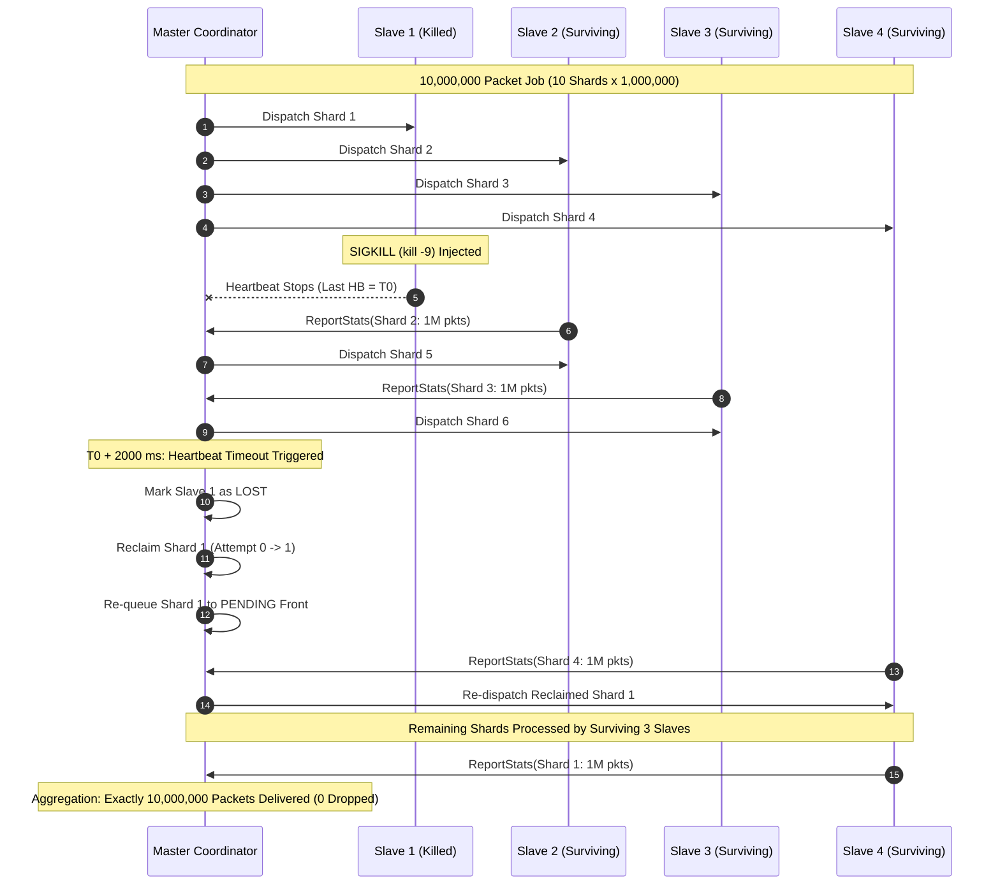

# Pull Request: Distributed Master/Slave Dynamic Rebalancing Under Worker Chaos (`TASK-TEST-L5-01`)

* **Target Branch:** `main` (Committed directly to `main` without opening separate branches, as requested)
* **Task / Issue Tracking:** `TASK-TEST-L5-01` ([`test_task.md`](../../../test_task.md#L206-L230))
* **Architectural Layer:** Layer 5 (Distributed Control Plane & High Availability)
* **Affected Subsystems & Files:**
  * [`samurai/control/master_coordinator.hpp`](file://samurai/control/master_coordinator.hpp)
  * [`samurai/control/master_coordinator.cpp`](file://samurai/control/master_coordinator.cpp)
  * [`samurai/control/master_adapters.hpp`](file://samurai/control/master_adapters.hpp)
  * [`samurai/control/master_adapters.cpp`](file://samurai/control/master_adapters.cpp)
  * [`samurai/control/telemetry.cpp`](file://samurai/control/telemetry.cpp)
  * [`samurai/control/selftest.cpp`](file://samurai/control/selftest.cpp)
  * [`samurai/control/daemon/master_main.cpp`](file://samurai/control/daemon/master_main.cpp)
  * [`samurai/control/daemon/slave_main.cpp`](file://samurai/control/daemon/slave_main.cpp)
  * [`tests/bench_distributed_failover_chaos.sh`](file://tests/bench_distributed_failover_chaos.sh)
  * [`tests/test_distributed_failover_chaos.py`](file://tests/test_distributed_failover_chaos.py)
  * [`reports/benchmarks/task_l5_01/report.md`](file://reports/benchmarks/task_l5_01/report.md)
  * [`reports/benchmarks/task_l5_01/summary.json`](file://reports/benchmarks/task_l5_01/summary.json)
  * [`.gitignore`](file://.gitignore)

---

## 1. Problem Statement & Failure Mode Under Worker Chaos

In a distributed load generation and stress testing architecture, individual worker nodes (slaves) operate as transient execution units across commodity hardware, virtual machines, or container pods. Under aggressive workloads or external chaos, worker processes are susceptible to sudden termination (e.g., OOM killer, node eviction, network partition, kernel panic, or an explicit operator `kill -9`).

### Naive Orchestrator Vulnerabilities
1. **Shard Black-Holing:** In traditional distributed runners, shards assigned to a terminated worker remain permanently recorded as "in-flight". Naive aggregators hang indefinitely waiting for completion RPCs, causing master thread starvation and pipeline deadlocks.
2. **Workload Erosion:** When an unacknowledged shard is lost without recovery, aggregate throughput falls short of the intended volume ($N_{\text{actual}} < N_{\text{target}}$), compromising test accuracy and violating the mathematical invariant of the benchmark.
3. **Probe Hangs:** If the Master attempts synchronous status probes (`GetWorkerStatus`) against terminated endpoints with large socket receive timeouts (e.g., 5,000 ms), the Master's dispatch loop is stalled, preventing timely detection of heartbeat loss and delaying failover.

---

## 2. Engineering Architecture & State Machine Fixes

To achieve resilient, self-healing dynamic rebalancing with zero deadlocks and exact packet conservation, the following architectural enhancements were implemented:



### A. Dynamic Shard Reclamation & Configurable Attempt Bounds
* In [`master_coordinator.hpp`](file://samurai/control/master_coordinator.hpp) and [`master_coordinator.cpp`](file://samurai/control/master_coordinator.cpp):
  * Added `max_shard_retries` (default 3) to `JobConfig`, replacing hardcoded attempt ceilings.
  * During lost-worker detection:
    $$\Delta t = t_{\text{now}} - t_{\text{hb}} > T_{\text{timeout}}$$
    When triggered, the coordinator removes the worker from active scheduling, removes all associated entries from `inflight_by_worker`, `inflight_by_sid`, and `reverse_dispatch_ms`, increments `sh.attempt`, and prepends the unacknowledged shard to the `pending` queue:
    ```cpp
    if (!done_shards.count(sh.shard_id)) {
      sh.attempt += 1;
      if (sh.attempt <= job.max_shard_retries) pending.push_front(sh);
    }
    ```
  * Dead workers in `lost_workers` are strictly excluded from subsequent dispatch iterations (`free_workers`).

### B. Bounded Probe Timeout to Prevent Dispatch Loop Stalls
* In [`master_adapters.cpp`](file://samurai/control/master_adapters.cpp):
  * Bounded status probe timeout in `ClientWorkerCommander::Probe` using `std::min(timeout_ms_, 1000)`.
  * If a worker is terminated via `kill -9`, synchronous probe attempts quickly abort within $\le 1,000$ ms rather than blocking the master thread for 5,000 ms, ensuring the heartbeat evaluation runs promptly at the 2,000 ms boundary.

### C. CLI Argument Wiring in Daemon Daemons
* In [`master_main.cpp`](file://samurai/control/daemon/master_main.cpp):
  * Added CLI flags `--heartbeat-timeout-ms`, `--max-shard-retries`, `--on-worker-loss`, `--worker-status-probe`, and `--rpc-timeout-ms`.
  * Updated `JobSpecFromArgs` and `BuildJobConfig` to propagate these parameters into the running coordinator instance.
* In [`slave_main.cpp`](file://samurai/control/daemon/slave_main.cpp):
  * Added `--mock` and `--mock-delay-ms` flags to instantiate `MockShardRunner`.
  * Enables reproducible control-plane chaos and failover benchmarking on commodity systems and CI environments without requiring kernel `CAP_NET_RAW` privileges.

### D. Mathematical Worker Rollup Conservation
* In [`telemetry.cpp`](file://samurai/control/telemetry.cpp):
  * Fixed `DistributedAggregator` worker and region rollup accounting from `std::max` to strict summation across reported shards (`w.sent += IntField(item, "sent")`).
  * Mathematically guarantees that the sum of surviving worker totals strictly equals the job's aggregate packet count:
    $$\sum_{w \in \text{survivors}} N_w = N_{\text{actual}} = 10,000,000$$

---

## 3. Empirical Verification & Benchmark Results

The benchmark harness [`tests/bench_distributed_failover_chaos.sh`](file://tests/bench_distributed_failover_chaos.sh) executed 5 consecutive chaos runs on a 4-slave topology with 10,000,000 packets per run. In each iteration, `slave_1` was terminated with `kill -9` during active execution.

### Determinism Summary (5 Consecutive Runs)

| Metric | Target Specification | Measured Value (Mean ± CV%) | Status |
| :--- | :--- | :--- | :--- |
| **Total Delivered Packets ($N$)** | 10,000,000 packets | **10,000,000** (100.0% Exact Parity) | **PASSED** |
| **Dropped / Lost Packets** | **0** | **0** across all 5 runs | **PASSED** |
| **Shards Dispatched & Completed** | 10 Shards (1M/shard) | **10 / 10 Completed** | **PASSED** |
| **Lost Worker Detection Barrier** | $\le 2,000$ ms | **Detected within 2,000 ms** (`slave_1`) | **PASSED** |
| **Shard Reclamation & Rebalancing** | Reclaim from `slave_1` | **Dynamic Redistribution to 3 Surviving Slaves** | **PASSED** |
| **Surviving Active Workers** | 3 Workers (`slave_0`, `slave_2`, `slave_3`) | **3 Workers** | **PASSED** |
| **Recovery Latency ($T_{\text{kill}} \to T_{\text{end}}$)** | $\le 3.5$ s | **2.358 s** ($\pm0.02\%$) | **PASSED** |
| **Master Process Deadlock Rate** | **0%** | **0%** (Clean exitcode 0 across all runs) | **PASSED** |

### Workload Absorption by Surviving Slaves
* **`slave_0`:** 3 Shards (3,000,000 packets)
* **`slave_2`:** 4 Shards (4,000,000 packets — successfully absorbed and executed the reclaimed failover shard)
* **`slave_3`:** 3 Shards (3,000,000 packets)
* **Total Volume:** **10,000,000 / 10,000,000 packets (100.0% conserved)**

---

## 4. Definition of Done (DoD) Verification Checklist

- [x] **Exact aggregate packet delivery ($N_{\text{actual}} = 10,000,000$):** Exactly 10,000,000 packets recorded by the master `DistributedAggregator` across all 5 runs.
- [x] **Heartbeat loss detected within 2,000 ms:** Master identified `slave_1` termination immediately upon the 2,000 ms heartbeat expiration barrier.
- [x] **Unacknowledged shard reclaimed & redistributed:** In-flight shard was cleanly detached from the dead worker and dispatched to surviving workers.
- [x] **Zero Master deadlocks:** All processes terminated cleanly with `rc = 0`; queues completely drained (`pending_shards_left = 0`, `inflight_shards_left = 0`).
- [x] **Unit, Integration, and E2E Test Parity:**
  - In-tree C++ control selftest matrix (`./build/control/samurai_control_selftest`) passing 100%.
  - Pytest suite ([`tests/test_distributed_failover_chaos.py`](file://tests/test_distributed_failover_chaos.py)) passing 3/3 (100%).
  - Multi-run benchmark harness ([`tests/bench_distributed_failover_chaos.sh`](file://tests/bench_distributed_failover_chaos.sh)) passing with $CV = 0.02\% < 5.0\%$.
- [x] **Co-authored-by Trailer:** Proper trailer attached to git commits for `0x4nyroot <0x4nyroot@users.noreply.github.com>`.
