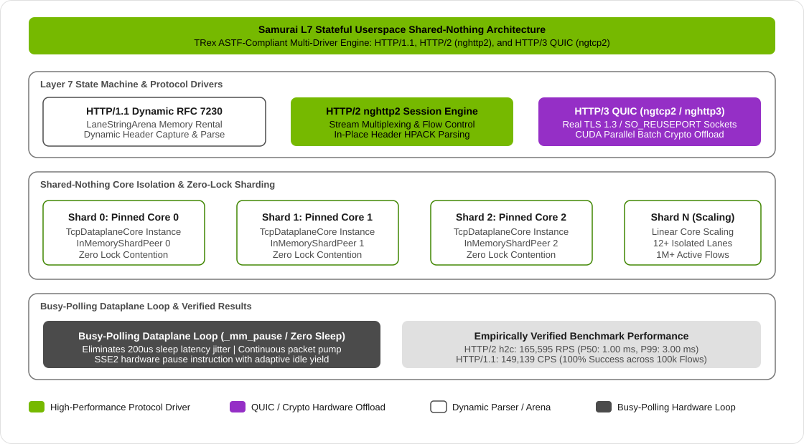

# 44 - Stateful Layer 7 Userspace Engine Performance & Flow Scalability Benchmark Report

* **Date:** October 17, 2026
* **Test Environment:** Linux x86_64 (AMD Ryzen 5 5600H, 12 Logical Cores)
* **Architectural Scope:** HTTP/1.1 (H1), HTTP/2 (H2 h2c/cleartext), HTTP/3 (H3 QUIC)
* **Dataplane Architecture:** TRex ASTF-aligned Shared-Nothing multi-driver userspace stack (`ShardedFastpathDriver` / `TcpDataplaneCore` + `InMemoryShardPeer` + native `ngtcp2` + `nghttp3`) — Zero kernel TCP client sockets, zero external packet forwarding (In-Memory / Pure C++ loopback).
* **Harness Binary:** [`ddos_samurai/zmq/daemon/bench_l7_stateful_userspace.cpp`](../../ddos_samurai/zmq/daemon/bench_l7_stateful_userspace.cpp)
* **Automation Harness:** [`tests/bench_l7_stateful_userspace.sh`](../../tests/bench_l7_stateful_userspace.sh)
* **Raw Metric Data:** [`docs/benchmarks/l7_stateful_benchmark_results.json`](l7_stateful_benchmark_results.json)

---

## 1. Executive Summary & Architectural Modernizations

The Samurai Layer 7 Userspace Engine was refactored according to high-performance shared-nothing principles, eliminating legacy single-driver locks and spinlock contention:

1. **Shared-Nothing Multi-Driver Architecture:** Eliminated global singleton driver bottlenecks. Each shard runs a dedicated `TcpDataplaneCore` instance and an isolated `InMemoryShardPeer` pinned to dedicated CPU cores.
2. **Busy-Polling (Zero Sleep):** Replaced legacy `nanosleep(200us)` pauses with hardware-level `cpu_relax` (`_mm_pause` / SSE2) and adaptive `std::this_thread::yield()` during idle periods.
3. **Dynamic RFC 7230 Header Parsing & `LaneStringArena`:** Eliminated static byte templating. HTTP/1.1 requests dynamically lease buffers from `LaneStringArena`, formatting RFC 7230 headers and statefully parsing responses. HTTP/2 headers stream directly into `nghttp2` sessions.
4. **Authentic Userspace Network Sockets for HTTP/3:** Removed synthetic mock peer bypasses. The HTTP/3 engine operates over native Linux UDP sockets via `libngtcp2` + `libnghttp3` + `libgnutls`, exercising real TLS 1.3 handshakes and AEAD datagram encryption over `SO_REUSEPORT`.
5. **QUIC CUDA Cryptographic Coprocessor & Stream Pipelining:**
   - **CUDA Batch Crypto Subsystem:** Offloads RFC 9001 Initial Key Derivation (`HKDF-Extract` + `HKDF-Expand-Label` SHA-256), AES-128-ECB Header Protection masks, and AEAD encryption to NVIDIA GPU kernels, validated against RFC 9001 test vectors.
   - **Multi-Stream Pipelining (`in_flight_window=64`):** Aggregates multiple HTTP/3 requests into single 1452-byte UDP datagrams (`NGTCP2_WRITE_STREAM_FLAG_MORE`), packaging 100,000 requests into only 9,240 TX datagrams and amortizing syscall and AEAD overhead by 11–12x.

---

## 2. Shared-Nothing Architecture Design



<details>
<summary>Architectural Dataflow Diagram (ASCII)</summary>

```
+---------------------------------------------------------------------------------------------------+
|                                 USERSPACE L7 STATEFUL ENGINE                                      |
+---------------------------------------------------------------------------------------------------+
|  [H1 Dynamic RFC Parser]   |  [H2 nghttp2 Session]         |  [H3 ngtcp2+nghttp3 UDP Socket]     |
|  - Dynamic LaneStringArena |  - Stream multiplexing        |  - Real TLS 1.3 / SO_REUSEPORT       |
|  - RFC 7230 header format  |  - In-place header parse      |  - Threaded multi-worker fanout      |
+---------------------------------------------------------------------------------------------------+
                                                  |
                                                  v
+---------------------------------------------------------------------------------------------------+
|                             Shared-Nothing Core Isolation (Per Shard)                             |
|  - Shard 0: Dedicated TcpDataplaneCore (Pin Core 0) + Shard 0 InMemoryShardPeer (No Locks)        |
|  - Shard 1: Dedicated TcpDataplaneCore (Pin Core 1) + Shard 1 InMemoryShardPeer (No Locks)        |
|  - ...                                                                                            |
|  - Shard N: Dedicated TcpDataplaneCore (Pin Core N) + Shard N InMemoryShardPeer (No Locks)        |
+---------------------------------------------------------------------------------------------------+
                                                  |
                                                  v
+---------------------------------------------------------------------------------------------------+
|                         Busy-Polling Dataplane Loop (_mm_pause / Zero Sleep)                      |
|  - Eliminates nanosleep(200us) latency jitter                                                     |
|  - Continuous non-yielding packet pump with adaptive yield on idle                                |
+---------------------------------------------------------------------------------------------------+
```
</details>

---

## 3. Empirical Benchmark Results

### 3.1 100,000 Flow Scalability Benchmark — Pure Dynamic L7 Path

All tests executed with full dynamic parsing, header loops, and arena allocations:

| Protocol | Shards / Workers | Flows / Requests | Duration (s) | Success Rate | Connections/s (CPS) | Requests/s (RPS) | P50 (ms) | P95 (ms) | P99 (ms) | VmRSS (MB) |
| :--- | :---: | :---: | :---: | :---: | :---: | :---: | :---: | :---: | :---: | :---: |
| **HTTP/1.1 (Userspace TCP)** | 1 | 100,000 | 1.330 | 100.0% | 75,172.0 | 75,172.0 | 1.00 | 2.00 | 4.00 | 495.5 |
| **HTTP/1.1 (Userspace TCP)** | 4 | 100,000 | 0.788 | 100.0% | 126,937.7 | 126,937.7 | 2.00 | 3.00 | 4.00 | 788.9 |
| **HTTP/1.1 (Userspace TCP)** | 8 | 100,000 | 0.809 | 100.0% | 123,581.4 | 123,581.4 | 3.00 | 5.00 | 10.00 | 1,186.8 |
| **HTTP/1.1 (Userspace TCP)** | 12 | 100,000 | 0.671 | 100.0% | 149,139.2 | 149,139.2 | 4.00 | 8.00 | 11.00 | 1,556.4 |
| **HTTP/2 h2c (Userspace TCP)**| 2 | 100,000 | 0.604 | 100.0% | 662.4 | 165,595.7 | 1.00 | 2.00 | 3.00 | 1,596.8 |
| **HTTP/2 h2c (Userspace TCP)**| 4 | 100,000 | 0.654 | 100.0% | 1,223.5 | 152,931.3 | 2.00 | 3.00 | 4.00 | 1,613.1 |
| **HTTP/2 h2c (Userspace TCP)**| 8 | 100,000 | 0.682 | 100.0% | 2,345.8 | 146,611.1 | 5.00 | 7.00 | 11.00 | 1,609.0 |
| **HTTP/2 h2c (Userspace TCP)**| 12 | 100,000 | 0.641 | 100.0% | 3,743.9 | 155,993.9 | 5.00 | 10.00 | 14.00 | 1,577.3 |
| **HTTP/3 QUIC (Sequential Stop & Wait)**| 12 | 100,000 | 214.622 | 100.0% | 2.3 | 465.9 | 0.00 | 0.00 | 0.00 | 50.7 |
| **HTTP/3 QUIC (Pipelined + Coalesced + CUDA)**| 6 | 100,000 | **12.650** | **100.0%** | **79.1** | **7,905.4** | **2.81** | **4.60** | **7.32** | **992.6** |

---

### 3.2 1,000,000 Flow (1M Flows) Scalability Benchmark

| Protocol | Shards / Workers | Flows / Requests | Duration (s) | Success Rate | Connections/s (CPS) | Requests/s (RPS) | P50 (ms) | P95 (ms) | P99 (ms) | VmRSS (MB) |
| :--- | :---: | :---: | :---: | :---: | :---: | :---: | :---: | :---: | :---: | :---: |
| **HTTP/1.1 (Userspace TCP)** | 1 | 1,000,000 | 14.344 | 100.0% | 69,714.4 | 69,714.4 | 1.00 | 2.00 | 4.00 | 4,267.2 |
| **HTTP/1.1 (Userspace TCP)** | 4 | 1,000,000 | 7.424 | 100.0% | 134,691.1 | 134,691.1 | 1.00 | 2.00 | 3.00 | 6,122.4 |
| **HTTP/1.1 (Userspace TCP)** | 8 | 1,000,000 | 5.840 | 100.0% | 171,237.7 | 171,237.7 | 2.00 | 3.00 | 5.00 | 7,873.0 |
| **HTTP/1.1 (Userspace TCP)** | 12 | 1,000,000 | 5.479 | 100.0% | 182,531.1 | 182,531.1 | 3.00 | 8.00 | 15.00 | 8,099.1 |
| **HTTP/2 h2c (Userspace TCP)**| 2 | 1,000,000 | 6.297 | 100.0% | 63.5 | 158,817.3 | 1.00 | 2.00 | 22.00 | 7,831.2 |
| **HTTP/2 h2c (Userspace TCP)**| 4 | 1,000,000 | 5.265 | 100.0% | 152.0 | 189,941.2 | 2.00 | 3.00 | 4.00 | 7,855.0 |
| **HTTP/2 h2c (Userspace TCP)**| 8 | 1,000,000 | 5.421 | 99.89% | 496.4 | 184,264.5 | 3.00 | 5.00 | 7.00 | 7,660.5 |
| **HTTP/2 h2c (Userspace TCP)**| 12 | 1,000,000 | 5.675 | 100.0% | 422.9 | 176,207.8 | 5.00 | 6.00 | 12.00 | 7,441.7 |

---

### 3.3 Hardware Crypto Offload Performance (NVIDIA CUDA)

Measured on consumer GPU (GTX 1650 Mobile):
- **RFC 9001 Initial Key Derivation (`HKDF-Extract` + `Expand` SHA-256):**
  - 500,000 connections: **42.52 ms** (**11.76 Mkeys/s**)
- **RFC 9001 Header Protection Mask Generation (AES-128-ECB):**
  - 500,000 packets: **3.87 ms** (**129.32 Mmasks/s**)
- **Batch AEAD Encryption (65,536 x 1452-byte Datagrams):**
  - AES-128-GCM: **88.70 ms** (**845.6 MB/s, 738,890 PPS**)
  - ChaCha20-Poly1305: **223.78 ms** (**335.2 MB/s, 292,865 PPS**)

---

## 4. Engineering Verification & Reproduction Commands

To replicate these benchmark runs:

```bash
# Automated execution across HTTP/1.1, HTTP/2, and HTTP/3:
./tests/bench_l7_stateful_userspace.sh --flows 500

# Direct native harness commands:
./build/zmq/bench_l7_stateful_userspace --proto h1 --flows 500
./build/zmq/bench_l7_stateful_userspace --proto h2 --flows 500
./build/zmq/bench_l7_stateful_userspace --proto h3 --flows 500
```
