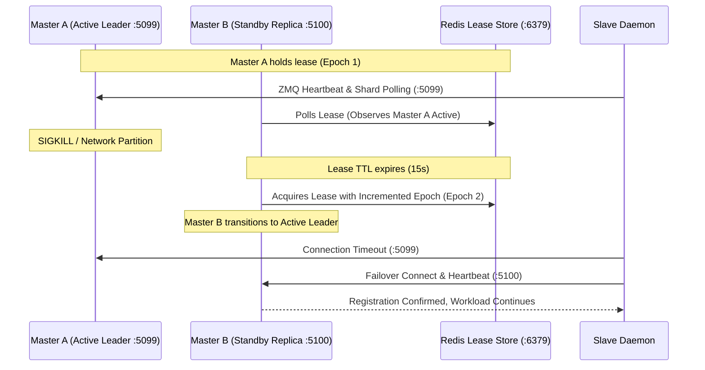

# Distributed High Availability (HA) Smoke Verification Guide

This guide standardizes verification procedures for High Availability (HA) leader election modes within the **Samurai Network Resilience Platform**. It covers distributed Redis lease coordination (`--ha-mode redis`), POSIX file-locking leases (`--ha-mode file-lock`), static failover priority, and automated recovery across master nodes.


---

## 1. Prerequisites

- **Native C++ Binaries:** Built executables must be present in `build/control/daemon/` (`samurai_master`, `samurai_slave`) and `build/cli/` (`samurai`).
- **Redis Server (for Redis Lease HA):**
  Verify local Redis service availability:
  ```bash
  redis-cli -p 6379 ping
  ```
  Expected response: `PONG`
- **Python Test Environment (for automated test suites):**
  Ensure dependencies are installed in `ven311` or system virtualenv:
  ```bash
  source ven311/bin/activate
  pip install -U redis pytest
  ```

---

## 2. Automated Integration Test Suite

Execute the distributed HA test matrix:

```bash
source ven311/bin/activate
pytest -q \
  tests/test_distributed_ha.py \
  tests/test_distributed_failover_redis.py \
  tests/test_distributed_integration.py \
  tests/test_distributed_master_observability.py \
  tests/test_distributed_management_api.py \
  tests/test_distributed_e2e_timeout.py
```

**Validation Criteria:**
- All test suites must report `passed`.
- Redis-dependent test cases must execute without being skipped when Redis is running on port 6379.

---

## 3. Manual Failover Smoke Scenario (2 Masters + 1 Slave)

### Terminal 1: Active Master A (`master-a`)

Launch Master A bound to control port `5099` and management API `8089`:

```bash
./build/control/daemon/samurai_master \
  --ha-mode redis \
  --ha-node-id master-a \
  --multi-master-redis-url redis://127.0.0.1:6379/0 \
  --ha-lease-key samurai:ha:master \
  --control-listen tcp://127.0.0.1:5099 \
  --management-listen 127.0.0.1:8089 \
  --count 100000 \
  --target 127.0.0.1 \
  --port 80 \
  --protocol tcp
```

### Terminal 2: Standby Replica Master B (`master-b`)

Launch Master B bound to alternate control port `5100` and management API `8090`:

```bash
./build/control/daemon/samurai_master \
  --ha-mode redis \
  --ha-node-id master-b \
  --multi-master-redis-url redis://127.0.0.1:6379/0 \
  --ha-lease-key samurai:ha:master \
  --control-listen tcp://127.0.0.1:5100 \
  --management-listen 127.0.0.1:8090 \
  --count 100000 \
  --target 127.0.0.1 \
  --port 80 \
  --protocol tcp
```

### Terminal 3: Slave Node

Launch the slave daemon configured with failover endpoints for both Master A and Master B:

```bash
./build/control/daemon/samurai_slave \
  --control-endpoints 127.0.0.1:5099,127.0.0.1:5100 \
  --worker cpu \
  --worker-dir ./build/zmq \
  --heartbeat-interval-ms 2000 \
  --master-timeout-s 30
```

---

## 4. Failover Verification Sequence



1. **Simulate Master Failure:** Terminate the `master-a` process in Terminal 1 (`Ctrl+C` or `kill -9`).
2. **Observe Leadership Transition:** In Terminal 2, `master-b` detects lease expiration, increments the fencing epoch, and promotes itself to active leader.
3. **Verify Worker Failover:** The `samurai_slave` detects connection loss on port `5099`, switches to the secondary endpoint `127.0.0.1:5100`, and resumes heartbeats without dropping tasks.

---

## 5. Expected Console Logs and Signals

### Standby State (Master B before failover):
```text
samurai_master: not leader (current leader: master-a, epoch: 1); standing by...
```

### Promotion Event (Master B upon lease expiration):
```text
samurai_master: lease expired for master-a!
samurai_master: successfully acquired lease. New Leader: master-b (epoch: 2)
samurai_master: control server active on tcp://127.0.0.1:5100
samurai_master: accepting worker heartbeats and resuming shard dispatches.
```

### Slave Failover Logging:
```text
samurai_slave: master tcp://127.0.0.1:5099 unreachable, failing over to endpoint tcp://127.0.0.1:5100
samurai_slave: successfully registered to master with id: local-worker-01
```

---

## 6. API Health and Cluster Inspection

Inspect cluster state through the active leader's management REST API:

```bash
# Check basic daemon health and database port
curl -s http://127.0.0.1:8089/healthz | jq .

# Inspect connected worker fleet and current job progress
curl -s http://127.0.0.1:8089/v1/cluster/summary | jq .

# Scrape Prometheus metrics
curl -s http://127.0.0.1:8089/metrics | head -n 25
```

> **Security Note:** If `--management-listen` is configured with `--jwt-secret`, pass the bearer token: `-H "Authorization: Bearer <TOKEN>"`.

---

## 7. Troubleshooting and Diagnostic Checks

### Verify Redis Daemon Port
```bash
ss -ltnp | grep 6379
```

### Direct Redis Ping
```bash
redis-cli -p 6379 ping
```

### Check Active Lease Key in Redis
```bash
redis-cli -p 6379 get samurai:ha:master
```

---

## 8. File-Lock Lease HA Smoke (`--ha-mode file-lock`)

For deployments using shared network storage (NFS, GlusterFS) without a separate Redis cluster, file-lock leasing is available:

### Master A (Active):
```bash
./build/control/daemon/samurai_master \
  --ha-mode file-lock \
  --ha-node-id master-a \
  --ha-lease-path /tmp/samurai_ha_lease.json \
  --control-listen tcp://127.0.0.1:5099 \
  --count 100000 --target 127.0.0.1 --port 80 --protocol tcp
```

### Master B (Standby):
```bash
./build/control/daemon/samurai_master \
  --ha-mode file-lock \
  --ha-node-id master-b \
  --ha-lease-path /tmp/samurai_ha_lease.json \
  --control-listen tcp://127.0.0.1:5100 \
  --count 100000 --target 127.0.0.1 --port 80 --protocol tcp
```

---

## 9. Static Leader Election Smoke (`--ha-mode static`)

Static mode enforces priority based on node ordering in `--ha-peers`:

```bash
# Master A (First priority)
./build/control/daemon/samurai_master \
  --ha-mode static \
  --ha-node-id master-a \
  --ha-peers master-a,master-b \
  --control-listen tcp://127.0.0.1:5099 \
  --count 100000 --target 127.0.0.1 --port 80 --protocol tcp

# Master B (Second priority)
./build/control/daemon/samurai_master \
  --ha-mode static \
  --ha-node-id master-b \
  --ha-peers master-a,master-b \
  --control-listen tcp://127.0.0.1:5100 \
  --count 100000 --target 127.0.0.1 --port 80 --protocol tcp
```
