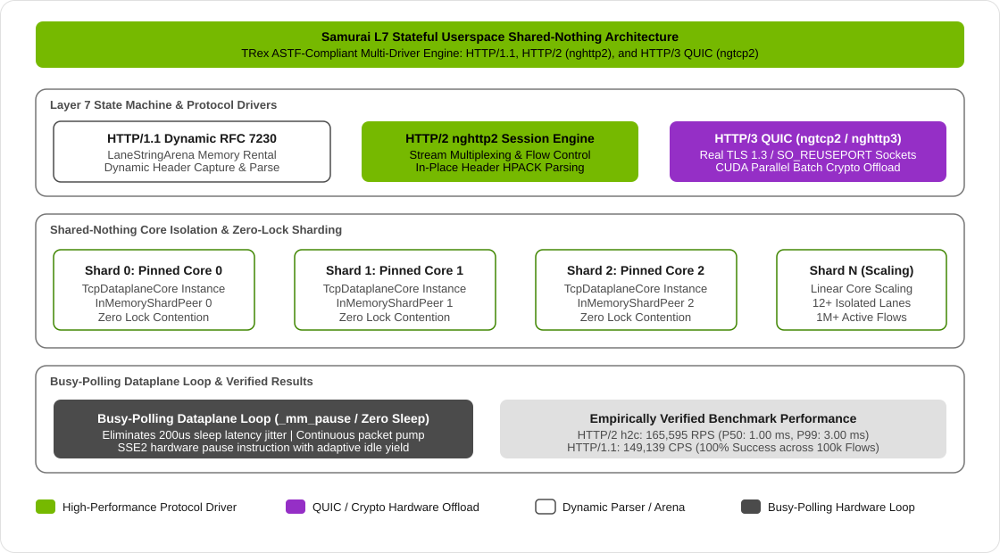
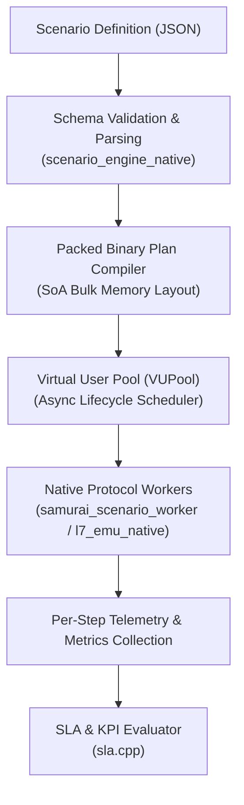

# Scenario Engine Architecture and Execution Pipeline

This document provides a comprehensive technical overview of the Scenario Engine within the **Samurai Network Resilience Platform**. It details the native execution pipeline, memory layouts, virtual user (VU) scheduling, multi-protocol stateful execution (HTTP/1.1, HTTP/2, HTTP/3 QUIC, and L4 TCP), and SLA/KPI evaluation gates.



---

## 1. Overview and Design Principles

The Scenario Engine executes complex, multi-stage stateful workloads that simulate realistic client traffic. Unlike stateless packet generators that emit uncoordinated bursts, the Scenario Engine enforces a strict **Persona → Flow → Step** hierarchy:

- **Persona:** Defines device parameters, TLS fingerprints, default HTTP headers, timeout budgets, and probabilistic concurrency weight.
- **Flow:** An ordered sequence of protocol steps executed on behalf of a persona.
- **Step:** An atomic operation (HTTP request, TCP connection establishment, data frame transmission, token extraction, or think-time pause).

The engine operates on a shared-nothing, per-core architecture implemented in native C++ (`scenario_engine_native` and `l7_emu_native`), delivering sub-microsecond latency accounting and line-rate performance.

---

## 2. Native Execution Pipeline



### Pipeline Stages

1. **Schema Parsing and Validation:**
   The native parser ingests raw JSON scenario files, validates structural constraints, verifies variable dependencies (`{{variable}}`), and checks timeout policies.
2. **Packed Plan Compilation:**
   Raw session definitions are compiled into packed memory buffers using a Structure of Arrays (SoA) layout (`compile_session_plans_packed_bulk_soa`). This maximizes CPU cache locality and eliminates pointer chasing during high-throughput execution.
3. **VU Lifecycle Streaming:**
   The `VUPool` instantiates and paces virtual user lifecycle batches (`build_vu_lifecycle_batches`, `iter_vu_lifecycle_batches`). Each VU maintains its own cookie jar, connection state, and extracted session variables.
4. **Dataplane Execution:**
   The compiled plans are executed across native worker threads (`samurai_scenario_worker` or `l7_emu_native`) over kernel sockets, userspace TCP stacks (`custom_tcp`), or DPDK/AF_XDP interfaces.
5. **Telemetry and SLA Analysis:**
   Latency percentiles, step status codes, connection retry counts, and token extraction results are evaluated against configured SLA thresholds.

### CLI Invocation

Scenarios are dispatched using the native Samurai CLI:

```bash
./build/cli/samurai --worker scenario \
  --worker-dir build/zmq \
  --target 127.0.0.1 --port 80 \
  --l7-profile-file scenarios/auth_flow.json \
  --report-json out/scenario_report.json
```

---

## 3. Layer 4 (L4 TCP) Stateful Mode

When configured with `load_model.backend: l4_tcp`, the engine operates directly at the transport layer, verifying stateful TCP stack behavior under stress.

### Supported L4 Step Primitives

- `tcp_connect`: Initiates a three-way handshake (SYN -> SYN-ACK -> ACK) and records connection establishment latency.
- `tcp_send`: Transmits raw payload bytes or structured application frames over the established socket.
- `tcp_expect`: Blocks until expected byte patterns, regex expressions, or byte counts are received from the peer within a timeout deadline.
- `tcp_close`: Issues a graceful FIN teardown or abrupt RST reset.

### Transport Drivers

- **Kernel Socket Driver:** Operates via standard Linux non-blocking sockets with `epoll` or `io_uring` event notification.
- **Userspace TCP Driver (`custom_tcp`):** Bypasses kernel networking, executing the full TCP sliding window, retransmission queue, and congestion control loop entirely in userspace over raw frames.

---

## 4. Layer 7 (HTTP/1.1, HTTP/2, HTTP/3 QUIC) Stateful Mode

When evaluating application-layer gateways and reverse proxies, the engine drives realistic HTTP sessions:

### Session State Propagation

- **Connection Persistence:** Requests within a single flow execute over persistent keepalive TCP connections or multiplexed HTTP/2 / HTTP/3 streams.
- **Dynamic Variable Carry:** Dynamic values extracted from server responses (such as CSRF tokens, session IDs, or OAuth bearer tokens) are stored in thread-local symbol tables and interpolated into subsequent requests (`{{token_name}}`).
- **Extraction Sources:** Supports extracting tokens from `Set-Cookie` response headers (`token_source: cookie`), HTTP header values (`token_source: header`), or JSON response bodies using dot-path notation (`token_source: body_json`).

---

## 5. Service Level Agreement (SLA) Engine

The SLA evaluation subsystem (`scenario_engine_native/sla.cpp`) verifies that the system under test satisfies operational quality thresholds:

| Metric Key | Type | Description |
| :--- | :--- | :--- |
| `min_completion_rate` | Float ($0.0 - 1.0$) | Minimum acceptable ratio of successfully completed flows to total attempted flows. |
| `max_step_fail_ratio` | Float ($0.0 - 1.0$) | Maximum allowed ratio of failed individual steps across all virtual users. |
| `max_latency_p95_ms` | Float | 95th percentile response latency ceiling in milliseconds. |
| `max_connect_timeout_ratio` | Float ($0.0 - 1.0$) | Maximum permitted ratio of connection timeouts during TCP handshake phases. |
| `max_retransmit_ratio` | Float ($0.0 - 1.0$) | Maximum allowed ratio of retransmitted TCP packets relative to total packets sent. |

---

## 6. KPI Gate Evaluation (Scenario Scope)

For automated CI/CD gating and resilience regression testing, the scenario engine enforces strict pass/fail KPI boundaries:

- $\text{scenario\_tcp\_connect\_timeout\_ratio} \le \text{scenario\_tcp\_connect\_timeout\_max}$
- $\text{scenario\_tcp\_retransmit\_ratio} \le \text{scenario\_tcp\_retransmit\_max}$

These ratios are automatically calculated from low-level socket statistics:
- `tcp_connect_attempts`: Total connection attempts initiated.
- `tcp_connect_established`: Successful three-way handshakes completed.
- `tcp_retransmit_count`: Retransmission events detected by the TCP stack.
