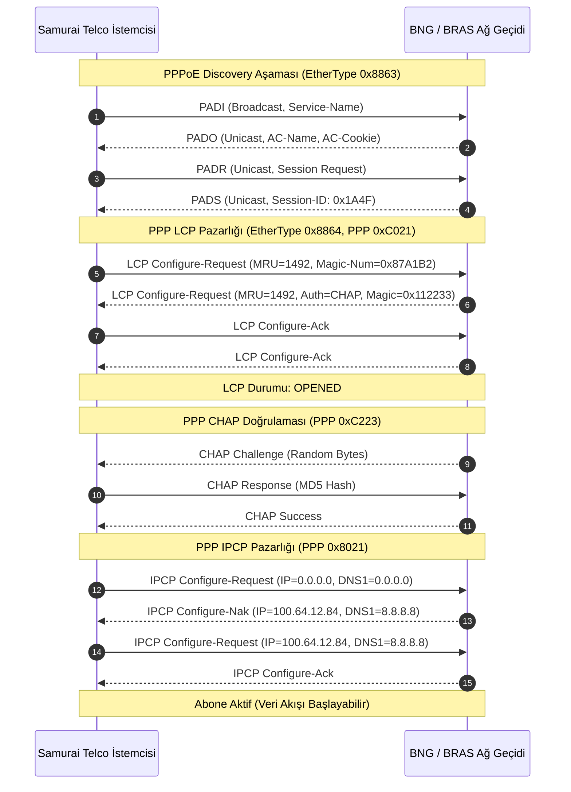
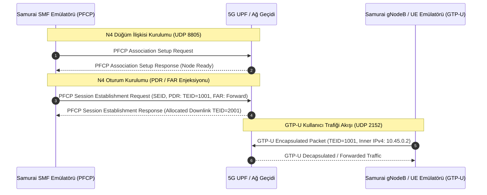

# Durumlu ve Durumsuz Telekom Protokolleri Spesifikasyonu
## Doküman No: 02_STATEFUL_AND_STATELESS_PROTOCOLS.md

> **Yazar:** Samurai Core Architecture Team  
> **Tarih:** 29 Ekim 2026  
> **Aktif Git Dalı:** `feat/telecom-engine-integration`  
> **Konum:** `ddos_samurai/plan/02_STATEFUL_AND_STATELESS_PROTOCOLS.md`  
> **Bağlantılı Dokümanlar:**  
> - [`README.md`](file:///home/mehmet/Masaüstü/Python/v11/DDoSamurai/plan/README.md)  
> - [`01_TELCO_ENGINE_ARCHITECTURE.md`](file:///home/mehmet/Masaüstü/Python/v11/DDoSamurai/plan/01_TELCO_ENGINE_ARCHITECTURE.md)  
> - [`03_DIRECTORY_STRUCTURE_AND_CPP_SKELETONS.md`](file:///home/mehmet/Masaüstü/Python/v11/DDoSamurai/plan/03_DIRECTORY_STRUCTURE_AND_CPP_SKELETONS.md)  

---

## 1. Genel Bakış ve Tek Protokol Odaklı Geliştirme Stratejisi

Telekom ağlarının stres ve uyumluluk testlerinde iki temel trafik sınıfı bulunur:
1. **Durumlu (Stateful) Protokoller:** İki yönlü anlaşma (handshake), oturum durumu (session state), zamanlayıcılar (retransmission/keepalive) ve sıralı FSM (Finite State Machine) gerektiren protokoller. Bir BNG veya UPF'in kontrol düzlemi (Control Plane) ve oturum tablosu limitlerini test eder.
2. **Durumsuz (Stateless) Protokoller:** Oturum geçmişi tutmayan, saf hat hızında (wire-speed line rate) yüksek PPS ile üretilen, başlık manipülasyonu (VLAN/QinQ, GTP-U tünelleme) odaklı test trafiği. BNG ve UPF'in veri düzlemi (Data Plane / Fastpath) ASIC veya CPU yönlendirme kapasitesini test eder.

### 1.1 Mühendislik İlkesi: "Single Protocol First" (Önce Tek Protokolde Uçtan Uca Başarı)
İlk sürümde PPPoE, DHCP, BFD, GTP-U ve PFCP'nin hepsini aynı anda bitirmeye çalışmak mimari dağılmaya ve test edilemeyen yarı-bitmiş kodlara yol açar.
- **Faz 1 (Öncelikli Odak):** Yalnızca **PPPoE (Discovery + LCP/PAP/CHAP/IPCP)** baştan sona doğru çalışan, tek worker, artan abone, multi-worker ve dağıtık kümede test edilen referans protokol olarak tamamlanacaktır.
- **Faz 2:** DHCPv4/v6 kira çarkı ve genişletilmiş BFD entegrasyonu.
- **Faz 3:** Mobil 5G UPF tünelleri (GTP-U ve PFCP N4).

---

## 2. Faz 1: PPPoE Abone Yığını Uçtan Uca Spesifikasyonu (RFC 2516, RFC 1661, RFC 1332, RFC 1334/1994)

PPPoE Discovery paketlerini yüksek hızda basmak ile yüz binlerce abonenin durumunu takip etmek, zaman aşımlarını yönetmek ve LCP/IPCP oturumunu ayakta tutmak çok farklı mühendislik zorluklarıdır.

### 2.1 PPPoE Aşamaları ve FSM Durum Geçişleri

1. **PPPoE Discovery (Keşif Aşaması - RFC 2516 - EtherType 0x8863):**
   - **PADI (Active Discovery Initiation):** İstemci broadcast (FF:FF:FF:FF:FF:FF) olarak `Service-Name` etiketiyle gönderir.
   - **PADO (Active Discovery Offer):** BRAS unicast olarak teklif verir (`AC-Name` etiketi içerir).
   - **PADR (Active Discovery Request):** İstemci seçilen BRAS'a oturum talebi gönderir.
   - **PADS (Active Discovery Session-confirmation):** BRAS benzersiz bir `Session-ID` tahsis eder. Oturum kurulur.
   - **PADT (Active Discovery Terminate):** Taraflardan biri oturumu sonlandırmak için gönderir.

2. **PPP Link Control Protocol (LCP - RFC 1661 - PPP 0xC021):**
   - FSM Durumları: `INITIAL`, `STARTING`, `CLOSED`, `STOPPED`, `CLOSING`, `STOPPING`, `REQ_SENT`, `ACK_RCVD`, `ACK_SENT`, `OPENED`.
   - Opsiyon Pazarlığı: MRU (Maximum Receive Unit - varsayılan 1492), Authentication Protocol (PAP: 0xC023 veya CHAP: 0xC223), Magic-Number (döngü tespiti).
   - Canlılık Takibi (Keepalive): `Echo-Request` ve `Echo-Reply` paketleri ile hattın canlılığı saniyede bir doğrulanır.

3. **Kimlik Doğrulama (Authentication):**
   - **PAP (Password Authentication Protocol - RFC 1334):** `Authenticate-Request` -> `Authenticate-Ack` / `Authenticate-Nak`.
   - **CHAP (Challenge Handshake Authentication Protocol - RFC 1994):** BRAS `Challenge` gönderir, istemci `MD5(ID + Password + Challenge)` yanıtlar.

4. **Network Control Protocol (IPCP - RFC 1332 / IPv6CP - RFC 5072):**
   - IPCP: İstemci `0.0.0.0` talep eder, BRAS `Nak` ile gerçek IP ve Primary/Secondary DNS sunucularını bildirir. İstemci `Configure-Ack` ile onaylar.

### 2.2 PPPoE FSM Durum Geçiş Tablosu (State Machine Matrix)

| Mevcut Durum | Girdi Olayı (Event) | Sonraki Durum | Tetiklenen Eylem (Action / Packet TX) | Zamanlayıcı (HTW Slot) |
|---|---|---|---|---|
| `IDLE` | `START_SESSION` | `DISCOVERING` | PADI paketi üretilir ve ağa broadcast basılır | 100ms (PADO bekleme) |
| `DISCOVERING` | `RX PADO` (Teklif Alındı) | `DISCOVERING` | PADR oturum talebi seçilen BRAS'a gönderilir | 100ms (PADS bekleme) |
| `DISCOVERING` | `RX PADS` (Oturum Onaylandı) | `AUTHENTICATING` | Session-ID kaydedilir; PPP LCP Configure-Req gönderilir | 100ms (LCP Ack bekleme) |
| `DISCOVERING` | `DISCOVERY_TIMEOUT` | `DISCOVERING` / `FAILED` | Retry sayacı artırılır; max_retries aşıldıysa oturum FAILED | Exponential backoff |
| `AUTHENTICATING`| `RX LCP Conf-Ack` | `AUTHENTICATING` | PPP PAP Authenticate-Req veya CHAP Response iletilir | 200ms (Auth Ack bekleme)|
| `AUTHENTICATING`| `RX Auth-Success` | `AUTHENTICATING` | PPP IPCP Configure-Req (0.0.0.0 talep) gönderilir | 100ms (IPCP Nak/Ack) |
| `AUTHENTICATING`| `RX IPCP Conf-Nak` (IP Geldi) | `AUTHENTICATING` | Atanan IP ile IPCP Configure-Req tekrar gönderilir | 100ms |
| `AUTHENTICATING`| `RX IPCP Conf-Ack` | `ESTABLISHED` | Abone IP ve DNS'i kaydedilir; veri trafiği serbest bırakılır | 1s (LCP Echo Keepalive)|
| `ESTABLISHED` | `TICK (1s)` | `ESTABLISHED` | LCP Echo-Request gönderilir (Magic Number kontrolü) | 1s (Echo-Reply bekleme)|
| `ESTABLISHED` | `RX LCP Echo-Reply` | `ESTABLISHED` | Keepalive sayacı sıfırlanır, `last_activity_tsc` güncellenir| 1s sonraki Echo |
| `ESTABLISHED` | `ECHO_TIMEOUT (3x)` | `TERMINATING` | PADT veya LCP Terminate-Req gönderilir | 100ms |
| `ESTABLISHED` | `STOP_SESSION` (Teardown)| `TERMINATING` | BRAS'a PADT gönderilir | 100ms |
| `TERMINATING` | `RX PADT` / `TIMEOUT` | `IDLE` | Oturum bağlamı havuza iade edilir (`ReleaseSession`) | Yok |

---

## 3. Faz 2: IPoE / DHCPv4 & DHCPv6 ve BFD

### 3.1 IPoE DHCPv4 (RFC 2131)
- **DORA Süreci:** `DISCOVER` -> `OFFER` -> `REQUEST` -> `ACK`.
- **Kira Yönetimi (Lease FSM):**
  - T1 Zamanlayıcısı (0.5 * Lease Time): Unicast `REQUEST` ile sunucuya yenileme talebi iletilir.
  - T2 Zamanlayıcısı (0.875 * Lease Time): Broadcast `REQUEST` ile tüm ağda yeniden bağlama denenir.
  - Sona Erme (Expiration): IP serbest bırakılır (`RELEASE`).
- **Option 82 (Relay Agent Information):** BNG veya OLT tarafından eklenen `Circuit-ID` ve `Remote-ID` değerlerinin test edilmesi.

### 3.2 BFD (Bidirectional Forwarding Detection - RFC 5880 / 5881)
- Mikro-saniye seviyesinde hızlı hat arıza tespiti (10ms iletim, 30ms algılama).
- Samurai bünyesindeki [`BfdEngine`](file:///home/mehmet/Masaüstü/Python/v11/DDoSamurai/ddos_samurai/l7_emu_native/l2l3_stack/bfd_engine.hpp) doğrudan yeniden kullanılır.

---

## 4. Faz 3: 4G/5G Mobil Çekirdek Tünelleri (Open5GS Modeli)

### 4.1 GTPv1-U (3GPP TS 29.281)
- **Tünel Mekanizması:** UDP Port 2152 üzerinde çalışır.
- **TEID (Tunnel Endpoint Identifier):** 32-bit benzersiz tünel kimliği. Her abone/akış için uplink ve downlink TEID çifti yönetilir.
- **Yol Yönetimi:** `Echo Request` / `Echo Reply` mesajları ile UPF düğümünün canlılığı izlenir.

### 4.2 PFCP (3GPP TS 29.244 - N4 Arayüzü)
- SMF rolünü simüle ederek UPF'e PDR (Packet Detection Rule) ve FAR (Forwarding Action Rule) enjekte eder.

---

## 5. Durumsuz Telekom Trafik Üreteçleri (Stateless Generators)

Veri düzlemi kapasitesini sınırlarına kadar zorlamak için FSM maliyeti olmayan saf paket üreteçleri:

### 5.1 Yüksek Hızlı Durumsuz GTP-U Basıcı (Stateless GTP-U Flooder)
- Milyonlarca rastgele veya sıralı TEID içeren UDP/GTP-U paketlerini hat hızında (wire-speed) basarak UPF'in Hardware Offloaded Decapsulation sınırlarını test eder.

### 5.2 Taşıyıcı Ethernet QinQ ve VLAN Atlama (802.1ad / 802.1Q)
- Dış Etiket (Service Tag - 0x88A8) ve İç Etiket (Customer Tag - 0x8100) kombinasyonlarıyla saniyede yüz binlerce farklı etiket basarak BNG'nin TCAM ve VLAN arama sınırlarını tüketir.

### 5.3 Raw ARP & ICMP Tarama (Subnet Saturation)
- Ağ geçidi yönlendiricisinin ARP tablosunu tüketmek için rastgele IP adreslerine yüksek PPS ile ARP Request fırtınası başlatır (CoPP stres testi).

---

## 6. Karşılaştırma Matrisi: Durumlu vs Durumsuz Motorlar

| Özellik | Durumlu Protokoller (Stateful) | Durumsuz Protokoller (Stateless) |
|---|---|---|
| **Birincil Hedef** | BNG / UPF Kontrol Düzlemi & FSM Limitleri | Ağ Kartı, ASIC & UPF Veri Düzlemi Hat Hızı |
| **Metrikler** | CPS (Calls/Sec), Kurulum Gecikmesi (ms), Yeniden Deneme %, Timeout % | PPS (Packets/Sec), BPS (Bits/Sec), Jitter, Frame Loss % |
| **Oturum Tablosu** | 128-Bayt `TelcoSessionContext` (O(1) HTW bağlı) | Yok (Belleksiz, sabit şablon mbuf iteratörü) |
| **İşlemci Dağılımı** | Slowpath / Kontrol Çekirdeği (Core 1) | Fastpath Çekirdekleri (Cores 2..N) |
| **Öncelikli Protokol** | **PPPoE (Faz 1 Odak)**, ardından DHCP/BFD/GTP | Stateless GTP-U, QinQ Flood, ARP Burst |
