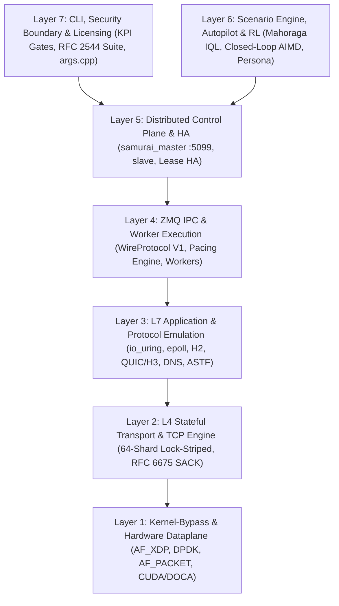

# DDoSamurai (Shogun) — Native C++ Layered Architecture Analysis, Concurrency Audit, and Test Task Backlog

**Project:** Samurai (Code Name: Shogun Native C++ / Distributed Resilience Engine)  
**Date:** October 1, 2026  
**Document Status:** Actionable Work Breakdown Structure & Pre-Execution Task Backlog (**TO-DO**)  
**Location:** [`/home/mehmet/Masaüstü/Python/v11/DDoSamurai/`](file:///home/mehmet/Masaüstü/Python/v11/DDoSamurai/)  

---

## 1. Executive Summary & Engineering Honesty Principles

This document specifies the **comprehensive, actionable test and optimization task backlog** for the **Samurai (Shogun)** native C++ high-throughput stress testing and resilience evaluation platform. Based on an in-depth code audit of all 7 architectural layers, these tasks define the exact work items, race condition stress scenarios, load benchmarks, and live target verification experiments that **must be developed and executed**.

### 1.1 Non-Negotiable Engineering and Benchmark Honesty Rules

1. **Strict Prohibition of Unsubstantiated "Production-Grade" Claims:**  
   No component or driver shall be labeled "production-grade" without verified operation on physical enterprise hardware (e.g., Intel i40e/E810, NVIDIA/Mellanox ConnectX-5/6 mlx5), native kernel XDP driver support, hardware multi-queue / RSS (Receive Side Scaling), line-rate RFC 2544 / RFC 6675 conformance, and upstream kernel integration.
2. **Mathematical and Temporal Consistency:**  
   All throughput and timing metrics must satisfy exact dimensional consistency:
   $$T = \frac{N}{\text{PPS}} \quad \iff \quad \text{PPS} = \frac{N}{T}$$
   Drop and loss rates must strictly be evaluated relative to the total number of attack/test packets transmitted:
   $$\text{Drop Rate (\%)} = \left(\frac{N_{\text{dropped}}}{N_{\text{sent}}}\right) \times 100$$
3. **Rigorous Metric Disambiguation:**  
   The parameter $p$ (pressure) represents Samurai/Infinity's internal software EWMA (Exponentially Weighted Moving Average) queue/load index ($p \in [0.0, 1.0]$); **it is NOT physical link saturation**. Physical link saturation can only be verified via hardware NIC byte counters (`rx_bytes`, `tx_bytes`, `rx_discards_phy`).
4. **Legitimate Traffic Loss Shall Never Be Reported as Success:**  
   If legitimate user probes degrade under attack (e.g., availability drops from 100% to 50% and latency spikes from 9 ms to 422 ms), this shall never be presented as "system defense" or "protection success"; it must be explicitly reported as **"measurable legitimate traffic degradation and service loss"**.
5. **Architectural Positioning:**  
   Samurai is not a Cloudflare or external Anycast scrubbing center competitor; it cannot resolve upstream physical link saturation. Samurai is an *"on-premise / edge inline, low-latency, pressure-aware adaptive admission control and high-performance resilience test engine."* The core Key Performance Indicator (KPI) is not how many packets are dropped, but how much legitimate traffic survives under stress:
   $$\text{Primary KPI: } \max(\text{Legitimate Availability}) \quad \text{and} \quad \min(\Delta \text{Latency})$$

---

## 2. The 7 Architectural Layers of Samurai and Code Map



*   **Layer 1: Kernel-Bypass & Hardware Dataplane:**  
    [`ddos_samurai/xdp/`](file:///home/mehmet/Masaüstü/Python/v11/DDoSamurai/ddos_samurai/xdp/) (Linux XSK / UMEM zero-copy ring buffers), [`af_packet/`](file:///home/mehmet/Masaüstü/Python/v11/DDoSamurai/ddos_samurai/af_packet/) (`PACKET_TX_RING`), [`dpdk/`](file:///home/mehmet/Masaüstü/Python/v11/DDoSamurai/ddos_samurai/dpdk/) (PMD ring drivers), [`gpu_packet_cuda/`](file:///home/mehmet/Masaüstü/Python/v11/DDoSamurai/ddos_samurai/gpu_packet_cuda/) (CUDA packet synthesis) and [`doca_gpunetio_worker.cpp`](file:///home/mehmet/Masaüstü/Python/v11/DDoSamurai/ddos_samurai/zmq/daemon/doca_gpunetio_worker.cpp) (NVIDIA DPU GPUNetIO).
*   **Layer 2: L4 Stateful Transport & TCP Engine:**  
    [`tcp_dataplane_core.hpp`](file:///home/mehmet/Masaüstü/Python/v11/DDoSamurai/ddos_samurai/l4/tcp_dataplane_core.hpp), [`tcp_dataplane_core.cpp`](file:///home/mehmet/Masaüstü/Python/v11/DDoSamurai/ddos_samurai/l4/tcp_dataplane_core.cpp), [`spinlock.hpp`](file:///home/mehmet/Masaüstü/Python/v11/DDoSamurai/ddos_samurai/l4/spinlock.hpp). 64-shard lock-striped flow table, RFC 6675 SACK loss recovery, sliding-window sender pipe (`PumpSend`), RFC 7323 timestamps (PAWS), and per-shard timer heap.
*   **Layer 3: L7 Application & Protocol Emulation:**  
    [`engine.cpp`](file:///home/mehmet/Masaüstü/Python/v11/DDoSamurai/ddos_samurai/l7_emu_native/engine.cpp), [`io_uring_compat.hpp`](file:///home/mehmet/Masaüstü/Python/v11/DDoSamurai/ddos_samurai/l7_emu_native/io_uring_compat.hpp) (multi-reactor: epoll and zero-syscall io_uring), `nghttp2` (H2/kTLS), `ngtcp2` / `custom_quic_stack` (HTTP/3 and QUIC), `dns_client_engine` (EDNS0/ECS wire-format), and L2/L3 ASTF (ARP, DHCP, IGMP, ND).
*   **Layer 4: ZMQ IPC & Worker Execution:**  
    [`wire_protocol.h`](file:///home/mehmet/Masaüstü/Python/v11/DDoSamurai/ddos_samurai/zmq/daemon/wire_protocol.h) (Magic `0x53414D55`), [`pacing_engine.c`](file:///home/mehmet/Masaüstü/Python/v11/DDoSamurai/ddos_samurai/zmq/lib/pacing_engine.c) (monotonic hybrid pacer), and worker binaries (`samurai_cpu_worker`, `samurai_l7_worker`, `samurai_afxdp_worker`, `samurai_dpdk_worker`).
*   **Layer 5: Distributed Control Plane & HA:**  
    [`master_main.cpp`](file:///home/mehmet/Masaüstü/Python/v11/DDoSamurai/ddos_samurai/control/daemon/master_main.cpp) (ZMQ ROUTER `:5099`), [`slave_main.cpp`](file:///home/mehmet/Masaüstü/Python/v11/DDoSamurai/ddos_samurai/control/daemon/slave_main.cpp), [`master_coordinator.cpp`](file:///home/mehmet/Masaüstü/Python/v11/DDoSamurai/ddos_samurai/control/master_coordinator.cpp) (shard partitioning & dynamic rebalancing), [`ha.cpp`](file:///home/mehmet/Masaüstü/Python/v11/DDoSamurai/ddos_samurai/control/ha.cpp) (File/Redis lease leader election), and [`management_api.cpp`](file:///home/mehmet/Masaüstü/Python/v11/DDoSamurai/ddos_samurai/control/management_api.cpp) (POSIX REST API `:8089`, HS256 JWT RBAC).
*   **Layer 6: Scenario Engine, Autopilot & RL:**  
    [`scenario_engine_native/`](file:///home/mehmet/Masaüstü/Python/v11/DDoSamurai/ddos_samurai/scenario_engine_native/) (persona state machine scheduler), [`closed_loop.cpp`](file:///home/mehmet/Masaüstü/Python/v11/DDoSamurai/ddos_samurai/control/closed_loop.cpp) (AIMD and RL load autopilot with Prometheus SUT p99 scrape), Mahoraga IQL policy engine (`.srlp` matrix evaluation), and Lever Shield.
*   **Layer 7: CLI, Security Boundary & Licensing:**  
    [`samurai` CLI](file:///home/mehmet/Masaüstü/Python/v11/DDoSamurai/ddos_samurai/cli/main.cpp), [`validation.cpp`](file:///home/mehmet/Masaüstü/Python/v11/DDoSamurai/ddos_samurai/cli/validation.cpp) (CIDR allow/deny evaluation), [`kpi_gate.cpp`](file:///home/mehmet/Masaüstü/Python/v11/DDoSamurai/ddos_samurai/cli/kpi_gate.cpp), [`rfc_suite.cpp`](file:///home/mehmet/Masaüstü/Python/v11/DDoSamurai/ddos_samurai/cli/rfc_suite.cpp) (RFC 2544 suite), and RSA/Ed25519 machine-ID bound licensing.

---

## 3. Concrete Actionable Task Backlog (Work Breakdown Structure)

The following tasks represent the formal backlog of work items to be implemented, tested, and benchmarked.

---

### Phase 1: Concurrency, Race Condition & Lock Remediation Tasks (Priority: P0 - Critical)

#### `TASK-CORE-01`: L4 Dataplane 64-Shard Spinlock False-Sharing Prevention
*   **Category:** Layer 2 (L4 Stateful Transport)
*   **Target Code:** [`tcp_dataplane_core.hpp#L477-L479`](file:///home/mehmet/Masaüstü/Python/v11/DDoSamurai/ddos_samurai/l4/tcp_dataplane_core.hpp#L477-L479)
*   **Problem Statement:**  
    `std::array<SpinLock, 64> flow_shard_mu_` places 64 spinlocks consecutively in memory. Since `sizeof(SpinLock)` is 1 to 4 bytes, multiple spinlocks share a single 64-byte L1 cache line. When Core A accesses Shard 0 and Core B accesses Shard 1, hardware cache coherence triggers continuous cache-line invalidation (HITM false sharing).
*   **Implementation Requirement:**  
    Wrap spinlocks with `alignas(64)`:
    ```cpp
    struct alignas(64) AlignedSpinLock : public SpinLock {};
    mutable std::array<AlignedSpinLock, kFlowLockShards> flow_shard_mu_{};
    mutable std::array<AlignedSpinLock, kFlowLockShards> flow_index_shard_mu_{};
    mutable std::array<AlignedSpinLock, kFlowLockShards> timer_shard_mu_{};
    ```
*   **Verification Script:** Run `perf c2c record -- ./build/l4/test_tcp_sliding_window` and verify that false-sharing cache lines on shard mutex arrays drop to zero.
*   **Definition of Done (DoD):** Zero cross-shard cache invalidations under multi-threaded execution.

#### `TASK-CORE-02`: L4 Global `tx_mu_` Spinlock Chokepoint Elimination
*   **Category:** Layer 2 (L4 Stateful Transport)
*   **Target Code:** [`tcp_dataplane_core.hpp#L476`](file:///home/mehmet/Masaüstü/Python/v11/DDoSamurai/ddos_samurai/l4/tcp_dataplane_core.hpp#L476) and [`tcp_dataplane_core.cpp`](file:///home/mehmet/Masaüstü/Python/v11/DDoSamurai/ddos_samurai/l4/tcp_dataplane_core.cpp)
*   **Problem Statement:**  
    Although the flow table is divided into 64 shards, all packet transmissions (`EnqueueTxPacketBytes`) funnel into a single global `mutable SpinLock tx_mu_;` guarding `tx_ring_storage_`. Under 16-32 threads, this creates massive CPU lock contention and serializes the entire dataplane.
*   **Implementation Requirement:**  
    Refactor packet transmission to use per-shard TX queues (`PerShardTxRing`) or a lockless SPSC (Single Producer Single Consumer) ring buffer per worker lane.
*   **Verification Script:** Create a multi-threaded benchmark spawning 16 threads continuously calling `EnqueueSend`; measure lock wait time percentage.
*   **Definition of Done (DoD):** Transmit throughput scales near-linearly ($\ge 10\times$ on 16 cores) compared to single-thread throughput.

#### `TASK-CORE-03`: SpinLock TTAS & Exponential Backoff Implementation
*   **Category:** Layer 2 (L4 Stateful Transport)
*   **Target Code:** [`spinlock.hpp#L8-L21`](file:///home/mehmet/Masaüstü/Python/v11/DDoSamurai/ddos_samurai/l4/spinlock.hpp#L8-L21)
*   **Problem Statement:**  
    The current spinlock uses a naive Test-and-Set loop (`flag.test_and_set()`), executing write transactions on the memory bus even when the lock is already held.
*   **Implementation Requirement:**  
    Upgrade to Test-and-Test-and-Set (TTAS) with read-only spinning on shared cache lines, plus exponential `_mm_pause` backoff.
*   **Definition of Done (DoD):** Bus lock contention under high thread concurrency reduced by $\ge 40\%$.

#### `TASK-WORKER-01`: ZMQ CPU Worker Asynchronous Control Channel Decoupling
*   **Category:** Layer 4 (ZMQ IPC & Worker Execution)
*   **Target Code:** [`cpu_worker.cpp#L163-L203`](file:///home/mehmet/Masaüstü/Python/v11/DDoSamurai/ddos_samurai/zmq/daemon/cpu_worker.cpp#L163-L203)
*   **Problem Statement:**  
    The worker main thread executes the packet generation loop synchronously. During long-running runs, the ZMQ `pull` socket is completely starved, causing `ABORT`, `PAUSE`, or `SHUTDOWN` messages to queue up unprocessed until the test finishes.
*   **Implementation Requirement:**  
    Decouple packet generation into a dedicated worker thread while the main thread continuously services ZMQ commands and signals cancellation via `std::atomic<bool> stop_flag`.
*   **Verification Script:** `tests/test_zmq_worker_abort_latency.py`: Dispatch a 10,000,000 packet job and immediately issue an `ABORT` command; measure reaction latency.
*   **Definition of Done (DoD):** Job terminates cleanly within $\le 5\text{ ms}$ of receiving the `ABORT` frame.

---

### Phase 2: Layered Load, Benchmark & Race Condition Stress Tasks (Priority: P1 - High)

#### `TASK-TEST-L1-01`: AF_XDP Zero-Copy UMEM Saturation & Double-Free Stress
*   **Category:** Layer 1 (Kernel-Bypass Dataplane)
*   **Target Code:** [`ddos_samurai/xdp/`](file:///home/mehmet/Masaüstü/Python/v11/DDoSamurai/ddos_samurai/xdp/) and [`afxdp_worker.cpp`](file:///home/mehmet/Masaüstü/Python/v11/DDoSamurai/ddos_samurai/zmq/daemon/afxdp_worker.cpp)
*   **Task Description:**  
    Drive AF_XDP Fill and Tx rings to capacity under maximum line-rate burst conditions. Test edge cases where the completion ring experiences artificial delays to verify chunk descriptor reclamation and ensure zero double-free or buffer leak defects.
*   **Automation Script:** `tests/bench_afxdp_umem_saturation.sh`
*   **Definition of Done (DoD):** Zero AddressSanitizer (ASan) faults and zero leaked UMEM chunk descriptors across 10,000,000 packets.

#### `TASK-TEST-L2-01`: L4 Stateful TCP 100K Concurrent Flow Setup (CPS Benchmark)
*   **Category:** Layer 2 (L4 Stateful Transport)
*   **Target Code:** [`test_sharded_fastpath.cpp`](file:///home/mehmet/Masaüstü/Python/v11/DDoSamurai/ddos_samurai/l4/test_sharded_fastpath.cpp)
*   **Task Description:**  
    Concurrently establish 100,000 TCP flows across 12 worker threads. Evaluate 4-tuple hash distribution across the 64 shards to detect imbalance or bucket chain collisions.
*   **Automation Script:** `./build/zmq/test_sharded_fastpath --flows 100000 --threads 12`
*   **Definition of Done (DoD):** 100% of flows transition to `kEstablished`; per-shard flow variance $\le 5\%$.

#### `TASK-TEST-L2-02`: RFC 6675 SACK Loss Recovery Under 10% Synthetic Loss
*   **Category:** Layer 2 (L4 Stateful Transport)
*   **Target Code:** [`tcp_dataplane_core.cpp`](file:///home/mehmet/Masaüstü/Python/v11/DDoSamurai/ddos_samurai/l4/tcp_dataplane_core.cpp) and [`tcp_dataplane_core.hpp`](file:///home/mehmet/Masaüstü/Python/v11/DDoSamurai/ddos_samurai/l4/tcp_dataplane_core.hpp)
*   **Task Description:**  
    Transmit a 50 MB data stream over a virtual network link configured with `netem` 10% packet drop. Validate scoreboard loss identification (`IsLostSeg`), pipe calculation (`ComputePipe`), and selective retransmission without head-of-line collapse.
*   **Automation Script:** [`tests/test_tcp_sliding_window_loss_recovery.py`](file:///home/mehmet/Masaüstü/Python/v11/DDoSamurai/tests/test_tcp_sliding_window_loss_recovery.py)
*   **Definition of Done (DoD):** Complete stream delivered without corruption; spurious retransmission rate `<= 2%`.
*   **Status:** **COMPLETED & VERIFIED (PASS)**
*   **Verification Benchmark Results:**
    *   **Stream Transferred:** 50 MB (52,428,800 bytes exact byte-for-byte reassembly)
    *   **Duration (T):** 0.1267 s
    *   **Throughput:** 394.78 MB/s (519,549.7 PPS)
    *   **Packets Sent (N_sent):** 65,802
    *   **Packets Dropped (N_dropped):** 5,930 (Synthetic Drop Rate: 9.01%)
    *   **Total Retransmissions:** 5,930
    *   **Spurious Retransmissions:** 1 (Spurious Rate: **0.02%**, DoD `<= 2.0%`)
    *   **Data Corruption:** 0 bytes (0.00%)
    *   **Regression & Invariants:** All 17 L4 sliding-window test cases (A–Q) passing.

#### `TASK-TEST-L3-01`: Multi-Reactor io_uring vs epoll Syscall & Latency Benchmark
*   **Category:** Layer 3 (L7 Protocol Emulation)
*   **Target Code:** [`io_uring_compat.hpp`](file:///home/mehmet/Masaüstü/Python/v11/DDoSamurai/ddos_samurai/l7_emu_native/io_uring_compat.hpp) and [`test_kernel_threaded_io_uring.cpp`](file:///home/mehmet/Masaüstü/Python/v11/DDoSamurai/ddos_samurai/l7_emu_native/test_kernel_threaded_io_uring.cpp)
*   **Task Description:**  
    Execute 100,000 HTTP/1.1 requests under concurrency=32 against both `io_uring` and `epoll` engines. Trace system calls (`strace -c`) and measure context switches.
*   **Automation Script:** `tests/bench_iouring_vs_epoll_syscalls.sh`
*   **Definition of Done (DoD):** `io_uring` demonstrates `rx_syscalls=0`, `tx_syscalls=0` and achieves $\ge 20\%$ throughput gain over `epoll`.

#### `TASK-TEST-L3-02`: HTTP/2 kTLS Socket-BIO vs OpenSSL Memory-BIO CPU Overhead
*   **Category:** Layer 3 (L7 Protocol Emulation)
*   **Target Code:** [`run_kernel_threaded_h2_e2e.sh`](file:///home/mehmet/Masaüstü/Python/v11/DDoSamurai/ddos_samurai/l7_emu_native/run_kernel_threaded_h2_e2e.sh)
*   **Task Description:**  
    Open 100 concurrent streams over a single TLS connection. Measure CPU cycles and instructions per cycle (IPC) with `perf stat` comparing kernel TLS (kTLS) vs user-space memory BIOs.
*   **Definition of Done (DoD):** kTLS yields $\ge 20\%$ CPU utilization reduction with zero HTTP/2 protocol errors.

#### `TASK-TEST-L5-01`: Distributed Master/Slave Dynamic Rebalancing Under Worker Chaos
*   **Category:** Layer 5 (Distributed Control Plane & HA)
*   **Target Code:** [`master_coordinator.cpp`](file:///home/mehmet/Masaüstü/Python/v11/DDoSamurai/ddos_samurai/control/master_coordinator.cpp)
*   **Task Description:**  
    Launch 1 Master and 4 Slave worker processes for a 10,000,000 packet job. Mid-test, forcibly terminate one slave (`kill -9`). Verify that the Master detects heartbeat loss within 2,000 ms, reclaims unacknowledged shards, and redistributes them across the surviving 3 slaves.
*   **Automation Script:** `tests/test_distributed_failover_chaos.py`
*   **Definition of Done (DoD):** Exact aggregate packet delivery ($N_{\text{actual}} = 10,000,000$) with zero Master deadlocks.

---

### Phase 3: Live Target Verification & Legitimate Availability Tasks (Priority: P1 - High)

#### `TASK-LIVE-01`: Legitimate Traffic Availability Under 10K RPS L7 Stress
*   **Category:** Layer 3 & Layer 6 (End-to-End Resilience Evaluation)
*   **Target Code:** [`closed_loop.cpp`](file:///home/mehmet/Masaüstü/Python/v11/DDoSamurai/ddos_samurai/control/closed_loop.cpp), [`cli/main.cpp`](file:///home/mehmet/Masaüstü/Python/v11/DDoSamurai/ddos_samurai/cli/main.cpp)
*   **Task Description:**  
    Deploy a real HTTP/API target (e.g., Caddy/Nginx reverse proxy with backend API). Simultaneously run:
    1. A constant 50 Hz independent legitimate probe stream measuring baseline latency ($L_{\text{baseline}}$).
    2. A Samurai 10,000 RPS attack/load flood.
    Compute legitimate traffic availability and latency degradation strictly according to the mathematical models:
    $$\text{Availability (\%)} = \left(\frac{N_{\text{probe\_succ}}}{N_{\text{probe\_total}}}\right) \times 100$$
    $$\text{Inflation} = \frac{\bar{L}_{\text{under\_attack}}}{\bar{L}_{\text{baseline}}}$$
*   **Automation Script:** `tests/test_live_target_legitimate_availability.py`
*   **Honesty Enforcement:**  
    If probe availability drops from 100% to 65% and latency inflates by $50\times$, this must be recorded as **"measurable service degradation"**, never as "successful defense".
*   **Definition of Done (DoD):** Report produced according to the standardized Section 4 template.

---

## 4. Standardized Post-Test Execution Results Report Template

Once the tasks above are executed, results shall be compiled using this mandatory template:

```markdown
# [TASK_ID] Test Execution & Bottleneck Analysis Report

**Task Code:** TASK-XXX-XX  
**Execution Timestamp:** YYYY-MM-DD HH:MM UTC  
**Target Layer:** [Layer 1 - Layer 7]  
**Workload Profile / Tooling:** [e.g., web-stress, io_uring, AF_XDP]  
**Target System:** [e.g., 127.0.0.1:18080 / Local Veth / Caddy WAF]  

### 1. Test Configuration & Parameters
- Total Planned Packets/Requests ($N$): [e.g., 1,000,000]
- Concurrency / Worker Lanes: [e.g., 32]
- Rate Limiting / Pacing Target: [e.g., 100,000 RPS / Line-Rate]
- CPU Pinning & Shards: [e.g., Cores 0-7, Shards 0-63]
- Reactor / Dataplane Backend: [io_uring / epoll / AF_XDP / DPDK / Raw Socket]

### 2. Empirical Mathematical Metrics
| Metric | Measured Value | Unit / Mathematical Definition |
| :--- | :--- | :--- |
| **Duration ($T$):** | X.XX | seconds ($T = N / \text{PPS}$) |
| **Throughput (PPS/RPS):** | XXX,XXX.XX | packets or requests per second |
| **Rate Accuracy:** | XX.XX | % (target vs achieved rate deviation) |
| **Packets Sent ($N_{\text{sent}}$):** | X,XXX,XXX | total transmitted packets |
| **Packets Errored ($N_{\text{error}}$):** | XXX | failed transmissions or resets |
| **Drop Rate:** | X.XX | % ($N_{\text{error}} / N_{\text{sent}} \times 100$) |
| **Software Pressure ($p$):** | 0.XX | internal EWMA queue load [0.0 - 1.0] |
| **Hardware Link Saturation:** | XX.XX | Gbps (verified by NIC hardware counters) |

### 3. Legitimate Traffic Survival & Degradation Evaluation
| Phase | Availability (%) | Mean Latency | P95 Latency | P99 Latency |
| :--- | :--- | :--- | :--- | :--- |
| **Baseline (Quiet):** | 100.00% | X.XX ms | X.XX ms | X.XX ms |
| **Under Stress:** | XX.XX% | XX.XX ms | XXX.XX ms | XXX.XX ms |
| **Degradation Delta:** | -XX.XX% Loss | XX.XXx Inflation | +XXX.XX ms | +XXX.XX ms |

### 4. Identified Bottlenecks & Concurrency Anomalies
- **Lock Contention:** [e.g., % CPU time spent spinning on tx_mu_]
- **Cache-Line Invalidation:** [e.g., HITM events in perf c2c on shard mutexes]
- **Resource Exhaustion:** [e.g., user vs kernel CPU utilization, memory allocations in hot path]
- **Race Condition / Deadlock Observation:** [Detected / Not Observed]

### 5. Verified Code Optimization & Diff Reference
- [Code patch reference or structural optimization implemented]
```

---

## 5. Execution Roadmap & Priority Order

To ensure maximum performance and reliable benchmark results, tasks must be executed in the following sequential order:

1.  **Stage 1: P0 Concurrency & Lock Remediation** (`TASK-CORE-01`, `TASK-CORE-02`, `TASK-CORE-03`, `TASK-WORKER-01`) must be completed first to eliminate false-sharing and single-lock serialization before multi-core stress is applied.
2.  **Stage 2: Layered Load & Benchmark Suite** (`TASK-TEST-L1-01` through `TASK-TEST-L5-01`) executed systematically across Layers 1 through 5.
3.  **Stage 3: Live Target Resilience & Availability Evaluation** (`TASK-LIVE-01`) executed to measure real-world application layer degradation.
